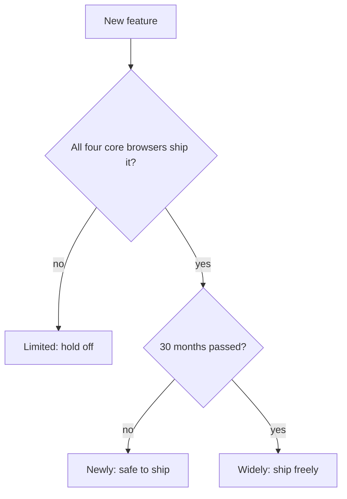

# The Baseline ship decision

**Decision tree** · teaches Browser support literacy

**Why this visual.** Decide whether a feature is safe to ship by tracing it through the Baseline labels.

## What it shows

A feature stays at Limited availability until all four core browsers, Chrome, Edge, Firefox, and Safari, ship it. Once they all do, it becomes Newly available, which means the browsers agree on how it behaves, so it is safe to ship. After 30 months it becomes Widely available and can ship freely.

Text alternative: A decision tree: a new feature is Limited and should be held off until all four core browsers ship it; then it is Newly available and safe to ship; after 30 months it becomes Widely available and can ship freely.

## Check yourself

A feature is Limited today. What must happen before you ship it?

Answer: All four core browsers must ship it, which makes it Newly available.

## Sources

- Baseline — https://web.dev/baseline (`web-dev-baseline`)

## Used in

- lesson page `/frontend-engineering/learning-system-and-workstation/how-to-learn-frontend/lesson/04-browser-support/` (file `site/src/content/lessons/frontend-engineering/learning-system-and-workstation/how-to-learn-frontend/04-browser-support.mdx`)

Back to [[visuals-how-to-learn-frontend|all visuals]].

## My insights
