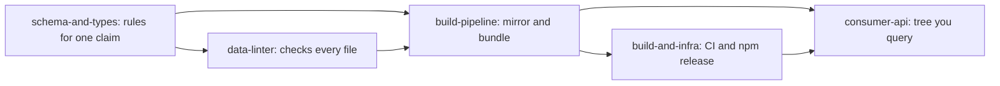

# Browser Compat Data: module map

**Architecture** · teaches Browser support literacy: Baseline and caniuse, Reading other people's code

**Why this visual.** See the five parts of the repository and how a support claim moves from its schema to an app.

## What it shows

The schema defines one support claim. The linter checks files against it. The build resolves mirror values and writes data.json. CI and release publish it, and apps then query the tree. Evidence: lint/lint.js:127-160 and scripts/build/index.js:248-257 at 8f942b4.

Text alternative: Flowchart of five modules: schema-and-types feeds data-linter and build-pipeline, the linter feeds the build, the build feeds build-and-infra for release and consumer-api for querying.

## Check yourself

Which module turns the string mirror into a real version number?

Answer: build-pipeline, in scripts/build/mirror.js, not the consumer code.

## Sources

- mdn/browser-compat-data — https://github.com/mdn/browser-compat-data (`mdn-browser-compat-data-repo`)

## Used in

- [[browser-compat-data-architecture]]

Back to [[visuals-how-to-learn-frontend|all visuals]].

## My insights
