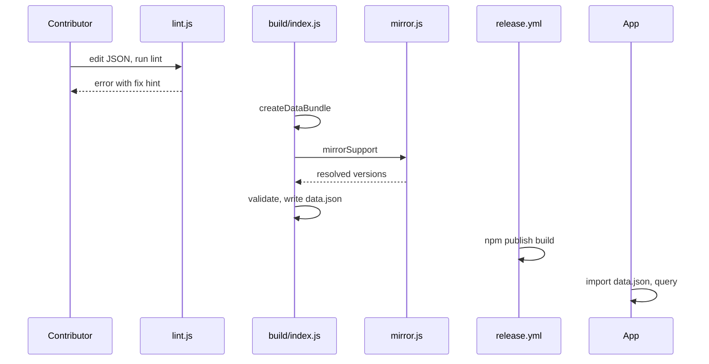

# Browser Compat Data: from edit to app

**Sequence** · teaches Browser support literacy: Baseline and caniuse, Reading other people's code

**Why this visual.** Follow one support claim from a contributor's edit through lint, build and publish to an app's query.

## What it shows

A contributor edits JSON and the linter rejects bad claims. The build resolves mirror values through mirror.js, validates the result and writes data.json. The release workflow publishes the build folder. An app imports data.json and walks it. Evidence: scripts/build/index.js:284-290 and .github/workflows/release.yml:63 at 8f942b4.

Text alternative: Sequence diagram: contributor edits and lints, build calls the mirror step and writes data.json, the release workflow publishes the build folder, and an app imports and queries the data.

## Check yourself

Where do mirror values get replaced by numbers: in the source file or in the published file?

Answer: In the published data.json; the source files keep the string mirror.

## Sources

- mdn/browser-compat-data — https://github.com/mdn/browser-compat-data (`mdn-browser-compat-data-repo`)

## Used in

- [[browser-compat-data-architecture]]

Back to [[visuals-how-to-learn-frontend|all visuals]].

## My insights
