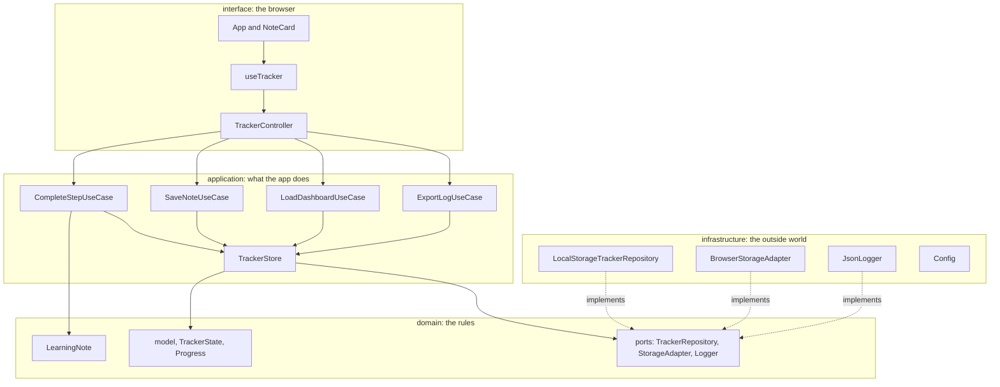

# Learning tracker: the layers and who depends on whom

**Architecture** · teaches Learning loop, Reading source code

**Why this visual.** See where the rules of the learning loop live and which layer may use which.

## What it shows

The app has four layers. The domain holds the rules of a note and the four steps of the loop. The application turns a command into a patch. The infrastructure keeps the log in the browser. The interface is the React view. Every arrow points inward, so the rules can be read and tested without a browser.

Text alternative: Four stacked groups. The browser parts at the top call the controller, which calls the four use cases, which use the store and the domain rules. The storage, the logger and the config sit at the bottom and implement the ports of the domain.

## Check yourself

Which layer may change the shape of a saved note?

Answer: Only the domain layer. The infrastructure reads and writes the saved value, but the shape is set by LearningNote and by the version number in the repository.

## Sources

- pmndrs/zustand: Bear necessities for state management in React — https://github.com/pmndrs/zustand (`pmndrs-zustand-repo`)
- Learn web development — https://developer.mozilla.org/en-US/docs/Learn_web_development (`mdn-learn-web-development`)

## Used in

- `projects/frontend-engineering/learning-system-and-workstation/how-to-learn-frontend/capstone/ARCHITECTURE.md`
- [[06-capstone-how-to-learn-frontend]]

Back to [[visuals-how-to-learn-frontend|all visuals]].

## My insights
