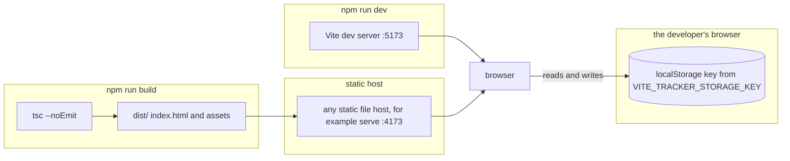

# Learning tracker: how the app is built and where the log lives

**Deployment** · teaches Learning loop

**Why this visual.** See that the app ships as static files and that the log never leaves the browser.

## What it shows

The type check runs first, then Vite writes the whole app into the dist folder. Any static host can serve that folder. The browser reads the log from its own local storage under the key that VITE_TRACKER_STORAGE_KEY names. No server and no database are involved.

Text alternative: The type check and the bundler write an index file and an assets folder. A static host serves them to the browser. The browser then reads and writes the learning log in its own local storage.

## Check yourself

Where is the learning log stored?

Answer: In the local storage of the developer's own browser, under the key that the environment variable VITE_TRACKER_STORAGE_KEY names.

## Sources

- Learn web development — https://developer.mozilla.org/en-US/docs/Learn_web_development (`mdn-learn-web-development`)
- The web standards model — https://developer.mozilla.org/en-US/docs/Learn_web_development/Getting_started/Web_standards/The_web_standards_model (`mdn-web-standards-model`)

## Used in

- `projects/frontend-engineering/learning-system-and-workstation/how-to-learn-frontend/capstone/ARCHITECTURE.md`
- [[06-capstone-how-to-learn-frontend]]

Back to [[visuals-how-to-learn-frontend|all visuals]].

## My insights
