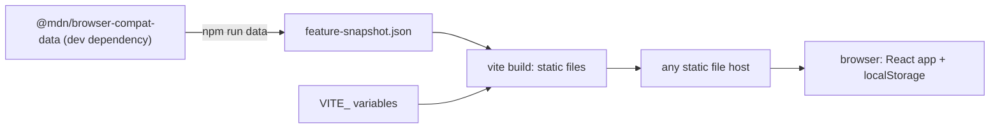

# TIL journal build and hosting

**Architecture** · teaches Browser support literacy: Baseline and caniuse, Staying current: release notes, blogs, surveys

**Why this visual.** Show how the app is built and served as static files.

## What it shows

npm run data reads the compat data package once and writes a small JSON snapshot. vite build bundles the app with the VITE_ variables into static files. Any static host serves them; the browser keeps notes in localStorage.

Text alternative: Flowchart: the compat data package feeds feature-snapshot.json, which with the VITE_ variables goes into vite build, then a static file host, then the browser with localStorage.

## Check yourself

Why is @mdn/browser-compat-data not in the production dependencies?

Answer: Only the snapshot file ships; the package is used at development time, so it stays out of the bundle and the production audit.

## Sources

- mdn/browser-compat-data — https://github.com/mdn/browser-compat-data (`mdn-browser-compat-data-repo`)
- Baseline: web platform feature availability — https://web.dev/baseline (`web-dev-baseline-docs`)

## Used in

- `projects/frontend-engineering/learning-system-and-workstation/how-to-learn-frontend/capstone/ARCHITECTURE.md`
- [[06-capstone-how-to-learn-frontend]]

Back to [[visuals-how-to-learn-frontend|all visuals]].

## My insights
