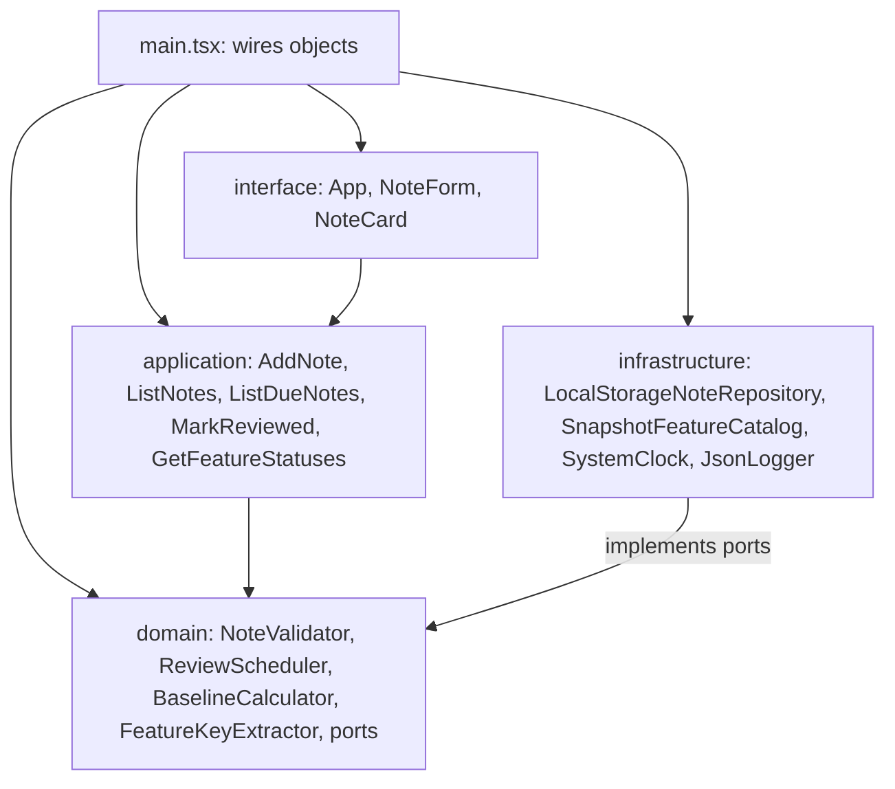

# TIL journal layers

**Architecture** · teaches Browser support literacy: Baseline and caniuse, Learning loop: read, build, measure, explain

**Why this visual.** Show the four layers of the TIL learning journal and which depends on which.

## What it shows

The interface calls the application use cases, which call domain rules and ports. Infrastructure implements the ports. main.tsx creates and wires every object. The Baseline status rule in BaselineCalculator comes from mini project 1 and the browser-compat-data takeaways.

Text alternative: Layer diagram: main.tsx wires the interface, application, domain and infrastructure objects. Interface depends on application, application on domain, and infrastructure implements the domain ports.

## Check yourself

Why does the domain layer not import LocalStorageNoteRepository?

Answer: The domain declares the NoteRepository port and infrastructure implements it, so rules stay testable without a browser.

## Sources

- mdn/browser-compat-data — https://github.com/mdn/browser-compat-data (`mdn-browser-compat-data-repo`)
- Baseline: web platform feature availability — https://web.dev/baseline (`web-dev-baseline-docs`)

## Used in

- `projects/frontend-engineering/learning-system-and-workstation/how-to-learn-frontend/capstone/ARCHITECTURE.md`
- [[06-capstone-how-to-learn-frontend]]

Back to [[visuals-how-to-learn-frontend|all visuals]].

## My insights
