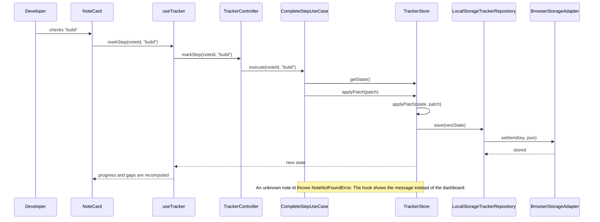

# Learning tracker: one checked step, end to end

**Request flow** · teaches Learning loop

**Why this visual.** Follow one step of the learning loop from the click to the saved log.

## What it shows

Checking the build step of one note travels from the component to the hook, the controller, and the use case. The use case returns a patch, the store merges it over the state and saves the log in the browser. The state comes back to the hook, and the dashboard shows the new progress and the new gaps.

Text alternative: The developer checks a box. The card tells the hook, the hook tells the controller, the controller calls the use case, the use case hands a patch to the store, the store saves the log in the browser storage, and the new state travels back to the dashboard.

## Check yourself

Which part of the flow decides that a step is done?

Answer: The use case. It builds the patch with the step marked as done and hands it to the store.

## Sources

- Learn web development — https://developer.mozilla.org/en-US/docs/Learn_web_development (`mdn-learn-web-development`)
- pmndrs/zustand: Bear necessities for state management in React — https://github.com/pmndrs/zustand (`pmndrs-zustand-repo`)

## Used in

- `projects/frontend-engineering/learning-system-and-workstation/how-to-learn-frontend/capstone/ARCHITECTURE.md`
- [[06-capstone-how-to-learn-frontend]]

Back to [[visuals-how-to-learn-frontend|all visuals]].

## My insights
