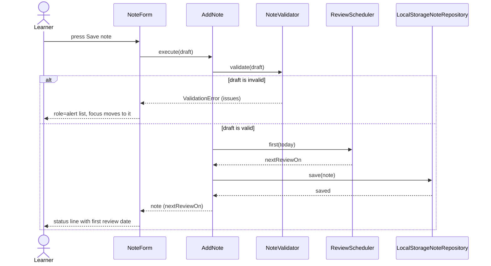

# Saving a note, with the failure path

**Workflow** · teaches Learning loop: read, build, measure, explain, Primary sources over tutorials

**Why this visual.** Show what happens when the learner saves a note, including the failure path.

## What it shows

NoteForm calls AddNote, which asks NoteValidator to check the draft. An invalid draft throws ValidationError and the form shows a focused alert list. For a valid draft, AddNote asks ReviewScheduler for the first review date, saves the note through LocalStorageNoteRepository, and returns the note to NoteForm.

Text alternative: Sequence diagram: Learner presses Save; NoteForm calls AddNote; AddNote calls NoteValidator. On invalid input the form shows an alert. Otherwise AddNote asks ReviewScheduler for the first review date, the repository saves the note, AddNote returns the note to NoteForm, and the form shows a status line.

## Check yourself

Where does the first review date come from?

Answer: AddNote asks ReviewScheduler.first(today) after validation, and the form shows it in the status line.

## Sources

- mdn/browser-compat-data — https://github.com/mdn/browser-compat-data (`mdn-browser-compat-data-repo`)
- Baseline: web platform feature availability — https://web.dev/baseline (`web-dev-baseline-docs`)

## Used in

- `projects/frontend-engineering/learning-system-and-workstation/how-to-learn-frontend/capstone/ARCHITECTURE.md`

Back to [[visuals-how-to-learn-frontend|all visuals]].

## My insights
