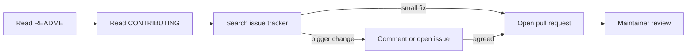

# The path to a first open source contribution

**Workflow** · teaches Build in public and teach

**Why this visual.** See the order in which a newcomer orients in a project and reaches a pull request, and when an issue comes first.

## What it shows

The GitHub Open Source Guide orders the path. The README explains the project and the CONTRIBUTING file explains how to help. The issue tracker shows current work. A small fix, such as a typo, goes straight to a pull request. A bigger change starts with a comment or an issue, and the pull request follows after discussion. Maintainers then review it.

Text alternative: Flowchart: Read README, then Read CONTRIBUTING, then Search issue tracker. A small fix goes straight to Open pull request; a bigger change goes first to Comment or open issue, then to the pull request when agreed. The pull request ends at Maintainer review.

## Check yourself

You want to add a new option to a library you use. Do you open a pull request first?

Answer: No. A bigger change starts with a comment or an issue so the maintainers can agree first; only small fixes such as a typo go straight to a pull request.

## Sources

- How to Contribute to Open Source (Open Source Guides) — https://opensource.guide/how-to-contribute/ (`github-opensource-guide-contribute`)

## Used in

- lesson page `/frontend-engineering/learning-system-and-workstation/how-to-learn-frontend/lesson/07-build-in-public-and-teach/` (file `site/src/content/lessons/frontend-engineering/learning-system-and-workstation/how-to-learn-frontend/07-build-in-public-and-teach.mdx`)

Back to [[visuals-how-to-learn-frontend|all visuals]].

## My insights
