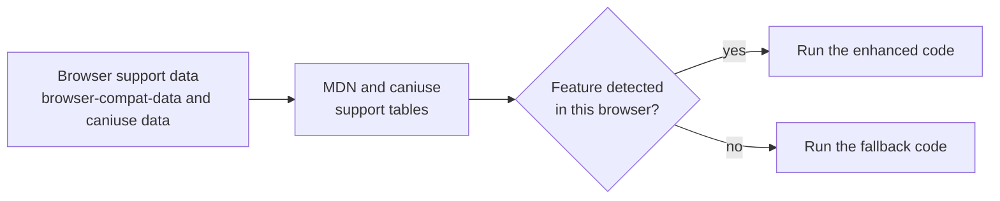

# From support data to a runtime feature check

**Workflow** · teaches Browser support literacy: Baseline and caniuse, Feature detection, polyfills and experimental features

**Why this visual.** Show how a developer decides whether a web feature can be used: shared support data, support tables, then a runtime feature check.

## What it shows

MDN browser-compat-data feeds MDN support tables; its README lists caniuse among projects using the data, and caniuse also uses its own Fyrd/caniuse data (caniuse About). You read the tables to plan. At runtime, feature detection (MDN guide, 'The concept of feature detection') runs the enhanced code when the feature exists and the fallback code when it does not.

Text alternative: Flowchart: support data from browser-compat-data and caniuse feeds MDN and caniuse support tables; then a decision Feature detected in this browser? leads to enhanced code on yes and fallback code on no.

## Check yourself

A support table says a feature works in 90% of browsers. Why does your code still need a runtime check?

Answer: Tables describe browsers in general; the user's own browser may be old or partial, so feature detection picks the enhanced or fallback path at runtime.

## Sources

- mdn/browser-compat-data — https://github.com/mdn/browser-compat-data (`mdn-browser-compat-data-repo`)
- Can I use: About and support legend — https://caniuse.com/ (`caniuse-docs`)
- Implementing feature detection (MDN) — https://developer.mozilla.org/en-US/docs/Learn_web_development/Extensions/Testing/Feature_detection (`mdn-feature-detection-guide`)

## Used in

- [[01-brief-how-to-learn-frontend]]

Back to [[visuals-how-to-learn-frontend|all visuals]].

## My insights
