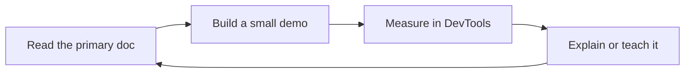

# The learning loop

**Workflow** · teaches Learning loop

**Why this visual.** See the four steps of the learning loop as one repeatable cycle.

## What it shows

Read, build, measure, and explain form one loop: each step feeds the next, and explaining leads back to reading the next topic. This is the method the whole roadmap follows.

Text alternative: Four steps in a circle: read the primary doc, build a small demo, measure in DevTools, then explain or teach it, which leads back to reading.

## Check yourself

Which step starts the next loop?

Answer: Explain, because teaching a topic shows the next gap to read about.

## Sources

- Learn web development — https://developer.mozilla.org/en-US/docs/Learn_web_development (`mdn-learn-web-development`)

## Used in

- [[01-brief-how-to-learn-frontend]]

Back to [[visuals-how-to-learn-frontend|all visuals]].

## My insights
