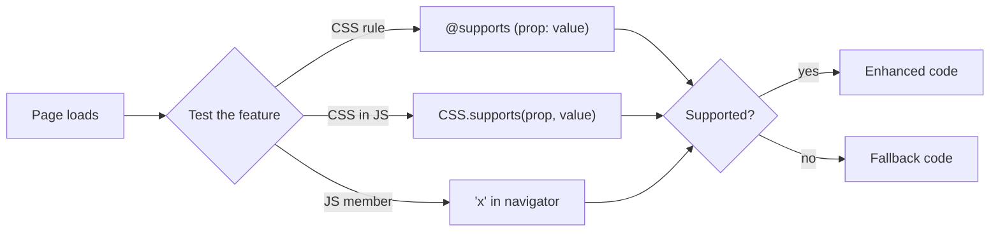

# Three ways to test a feature, one decision

**Workflow** · teaches Feature detection, polyfills and experimental features, Polyfills only when needed, and their supply-chain risk

**Why this visual.** See that different tests all end in the same choice between enhanced code and fallback code.

## What it shows

A page can test a feature with the CSS @supports rule, with CSS.supports() in JavaScript, or with the in operator on an object. Each test answers yes or no. Yes runs the enhanced code. No runs the fallback code, so the page still works.

Text alternative: Flowchart: a page loads, then one of three tests runs (@supports, CSS.supports, in operator), all joining one supported question that leads to enhanced code on yes and fallback code on no.

## Check yourself

Which test needs no JavaScript?

Answer: The @supports rule, because it is written in CSS.

## Sources

- Implementing feature detection (MDN) — https://developer.mozilla.org/en-US/docs/Learn_web_development/Extensions/Testing/Feature_detection (`mdn-feature-detection-guide`)

## Used in

- [[mdn-feature-detection-guide-how-to-learn-frontend]]

Back to [[visuals-how-to-learn-frontend|all visuals]].

## My insights
