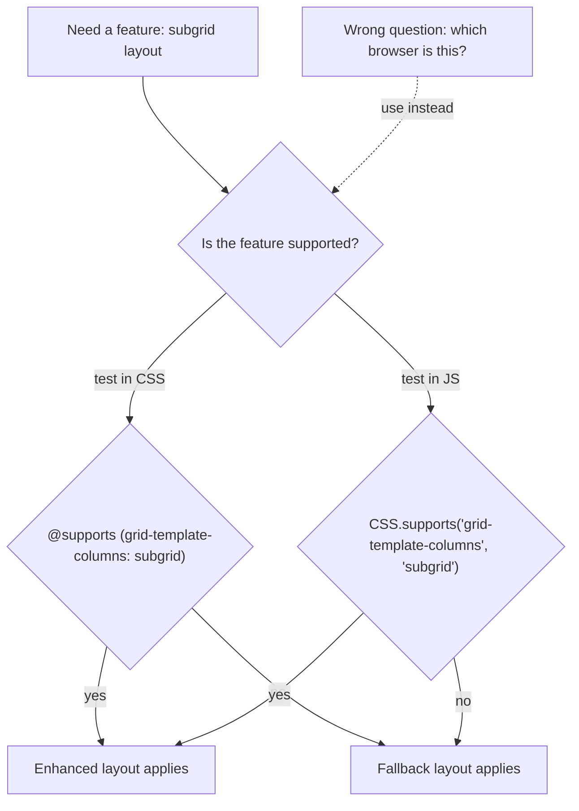

# Feature detection: one question, two test paths, two outcomes

**Workflow** · teaches Feature detection and polyfills

**Why this visual.** See that both the CSS at-rule and the JavaScript call ask the same feature question, and that both end in an enhanced path or a fallback path.

## What it shows

The page needs one feature, here a subgrid layout. MDN gives two ways to ask whether the browser has it: the @supports at-rule in CSS and the CSS.supports() call in JavaScript. Both answers go to the same place. A yes applies the enhanced layout and a no applies the fallback layout, so the page always renders. The dashed arrow marks the wrong question. Reading the user agent string to name the browser replaces the feature question with a guess, and MDN discourages it.

Text alternative: Flowchart: a need for a subgrid layout leads to the question 'is the feature supported?'. That question splits into a CSS test using @supports and a JavaScript test using CSS.supports. Both tests lead to 'enhanced layout applies' on yes and 'fallback layout applies' on no. A separate box asks the wrong question, which browser is this, and points to the feature question instead.

## Check yourself

Which of the two tests needs no JavaScript?

Answer: The @supports at-rule, because the browser runs the test itself while it parses the CSS.

## Sources

- Implementing feature detection — https://developer.mozilla.org/en-US/docs/Learn_web_development/Extensions/Testing/Feature_detection (`mdn-feature-detection`)

## Used in

- [[mdn-feature-detection-how-to-learn-frontend]]

Back to [[visuals-how-to-learn-frontend|all visuals]].

## My insights
