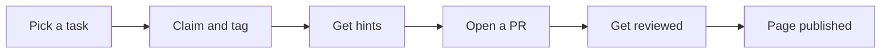

# Publishing on MDN: the review loop

**Workflow** · teaches Teaching in public

**Why this visual.** See that publishing on MDN is a review loop, not a one-shot upload.

## What it shows

A contribution to MDN starts when you pick a task from the board, claim it, and tag the MDN community team so a mentor can find it. You open a pull request, get the writing reviewed, and the page goes live. Teaching in public is this loop: write it, ship it, and let a reviewer correct what you missed.

Text alternative: Six steps in a row: pick a task, claim it and tag the MDN community team, get hints from a mentor, open a pull request, get the writing reviewed, and the page is published.

## Check yourself

Which step catches the mistakes you did not know you made?

Answer: The review, because a reviewer checks the writing and asks you to fix what you got wrong.

## Sources

- Getting started with MDN Web Docs — https://developer.mozilla.org/en-US/docs/MDN/Community/Getting_started (`mdn-getting-started-contributing`)

## Used in

- lesson page `/frontend-engineering/learning-system-and-workstation/how-to-learn-frontend/lesson/07-teach-and-stay-current/` (file `site/src/content/lessons/frontend-engineering/learning-system-and-workstation/how-to-learn-frontend/07-teach-and-stay-current.mdx`)

Back to [[visuals-how-to-learn-frontend|all visuals]].

## My insights
