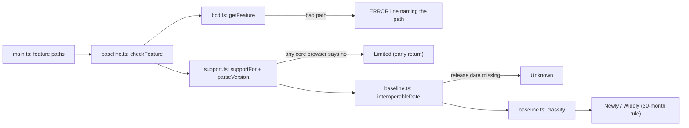

# Baseline checker execution flow

**Data flow** · teaches Browser support literacy: Baseline and caniuse, Baseline lifecycle: limited, newly, widely available, Reading caniuse support tables

**Why this visual.** Show how the checker turns a feature path into a Limited, Newly or Widely label.

## What it shows

main.ts passes each feature path to checkFeature. It reads the feature from the BCD tree and each core browser's support. One missing browser gives Limited. Otherwise the latest release date is the interoperable date, and classify applies the 30-month rule.

Text alternative: Flowchart: main.ts passes feature paths to checkFeature. getFeature reports an ERROR line for a bad path. supportFor returns Limited early when any core browser says no. interoperableDate gives Unknown when a release date is missing; otherwise classify returns Newly or Widely by the 30-month rule.

## Check yourself

One core browser has no support for a feature. What status does the checker print, and why?

Answer: Limited, because Baseline needs all core browsers to support a feature before it can be Newly or Widely.

## Sources

- Baseline: web platform feature availability — https://web.dev/baseline (`web-dev-baseline-docs`)
- mdn/browser-compat-data — https://github.com/mdn/browser-compat-data (`mdn-browser-compat-data-repo`)

## Used in

- `projects/frontend-engineering/learning-system-and-workstation/how-to-learn-frontend/mini-01-baseline-checker/README.md`

Back to [[visuals-how-to-learn-frontend|all visuals]].

## My insights
