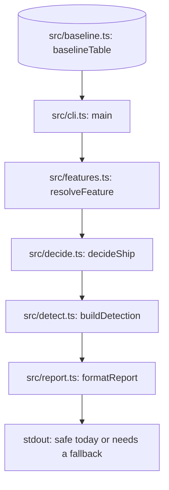

# How the ship-it checker decides

**Workflow** · teaches Browser support literacy, Feature detection and polyfills

**Why this visual.** See the order in which the checker reads the Baseline snapshot, decides the verdict, and writes the runtime check.

## What it shows

The command line picks the target and the feature ids. The lookup finds each feature in the Baseline snapshot, the decision compares the feature's status with the target, and the detection step writes the runtime check for the fallback. The report prints one block per feature.

Text alternative: Flowchart: the Baseline table and the command line feed the feature lookup, which feeds the ship decision, which feeds the runtime check, which feeds the report, which prints the verdict.

## Check yourself

Which step turns a Baseline status into a runtime check?

Answer: The decision step, because it knows the feature needs a fallback and asks the detection step for the check that goes with it.

## Sources

- Baseline — https://web.dev/baseline (`web-dev-baseline`)
- Implementing feature detection — https://developer.mozilla.org/en-US/docs/Learn_web_development/Extensions/Testing/Feature_detection (`mdn-feature-detection`)

## Used in

- `projects/frontend-engineering/learning-system-and-workstation/how-to-learn-frontend/mini-01-ship-it-checker/README.md`

Back to [[visuals-how-to-learn-frontend|all visuals]].

## My insights
