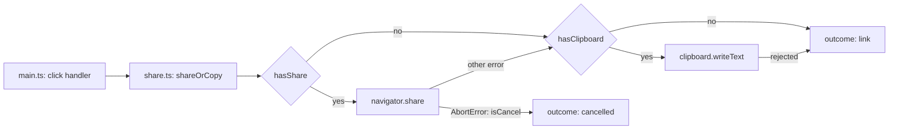

# Share button decision flow

**Data flow** · teaches Feature detection, polyfills and experimental features, Polyfills only when needed, and their supply-chain risk

**Why this visual.** Show how the Share button picks the Web Share API, the clipboard, or a visible link.

## What it shows

main.ts passes navigator to shareOrCopy. hasShare is tested first with the in operator. If sharing is missing or fails, hasClipboard is tested. If the clipboard is missing or rejected, the page shows a selectable link. A closed share sheet ends as cancelled.

Text alternative: Flowchart: the click handler calls shareOrCopy, which tests hasShare and calls navigator.share, then falls back to hasClipboard and clipboard.writeText, and last to a visible link; AbortError ends as cancelled.

## Check yourself

Why does shareOrCopy test for navigator.share instead of the browser name?

Answer: A member test stays correct as browsers change, and it picks the fallback only where the feature is missing.

## Sources

- Implementing feature detection (MDN) — https://developer.mozilla.org/en-US/docs/Learn_web_development/Extensions/Testing/Feature_detection (`mdn-feature-detection-guide`)

## Used in

- `projects/frontend-engineering/learning-system-and-workstation/how-to-learn-frontend/mini-02-share-button-fallback/README.md`

Back to [[visuals-how-to-learn-frontend|all visuals]].

## My insights
