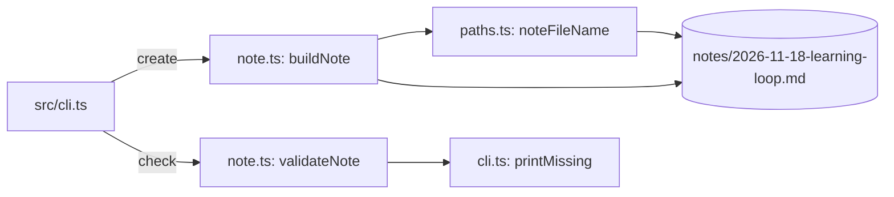

# How the learning log scaffolds and checks a note

**Workflow** · teaches Learning loop

**Why this visual.** See how one command scaffolds the four steps of the loop and how the check command finds the empty ones.

## What it shows

The create command builds a note with one empty section for each step of the learning loop, then writes it under a dated file name. The check command reads a note you filled in and names every step whose section still holds no text, so the four steps stay visible until each one has content.

Text alternative: Two commands share one note file: the create command writes a note with four empty sections and a dated name, and the check command reads a filled note and names the steps that still hold no text.

## Check yourself

Which step does the check command name when you leave the Measure section empty?

Answer: measure, because the validator reports every step whose section holds no text yet.

## Sources

- Learn web development — https://developer.mozilla.org/en-US/docs/Learn_web_development (`mdn-learn-web-development`)

## Used in

- `projects/frontend-engineering/learning-system-and-workstation/how-to-learn-frontend/mini-02-learning-log/README.md`

Back to [[visuals-how-to-learn-frontend|all visuals]].

## My insights
