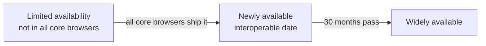

# The three Baseline statuses over time

**Workflow** · teaches Browser support literacy: Baseline and caniuse, Baseline lifecycle: limited, newly, widely available

**Why this visual.** See how a web feature moves from limited availability to newly available to widely available.

## What it shows

A feature starts as Limited availability. When every core browser supports it, it becomes Newly available on the newly interoperable date. After 30 months it becomes Widely available. The status changes only because of support and time.

Text alternative: Flowchart with three boxes in a row: Limited availability, then Newly available when all core browsers ship the feature, then Widely available after 30 months.

## Check yourself

A feature became Newly available in December 2023. In which month does it become Widely available?

Answer: June 2026, which is 30 months after December 2023.

## Sources

- Baseline: web platform feature availability — https://web.dev/baseline (`web-dev-baseline-docs`)

## Used in

- [[web-dev-baseline-docs-how-to-learn-frontend]]

Back to [[visuals-how-to-learn-frontend|all visuals]].

## My insights
