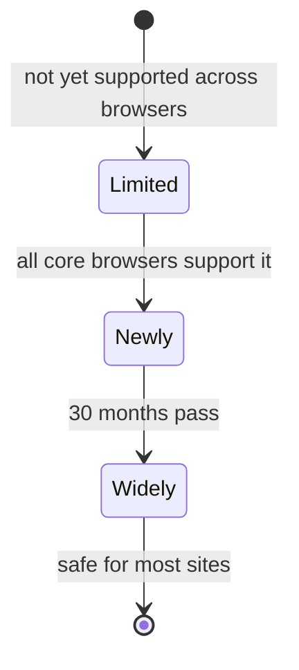

# How a feature gains a Baseline status

**Workflow** · teaches Browser support literacy

**Why this visual.** See that a Baseline status changes only because of browser support and the passage of time.

## What it shows

A feature starts at Limited availability while browsers disagree about it. When all four core browsers support it, it becomes Newly available on the newly interoperable date. Thirty months later it becomes Widely available, and most sites can then use it without worrying about support.

Text alternative: State diagram with three states in a row: Limited availability, then Newly available once every core browser supports the feature, then Widely available after 30 months pass.

## Check yourself

A feature became Newly available in December 2023. In which month does it become Widely available?

Answer: June 2026, which is 30 months after December 2023.

## Sources

- Baseline — https://web.dev/baseline (`web-dev-baseline`)

## Used in

- [[web-dev-baseline-how-to-learn-frontend]]

Back to [[visuals-how-to-learn-frontend|all visuals]].

## My insights
