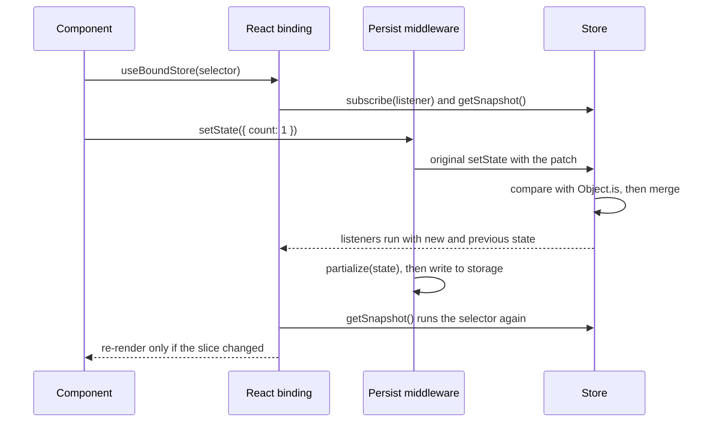

# One write through the zustand store

**Sequence** · teaches Reading source code

**Why this visual.** Follow one state change from a component, through the store and the persist middleware, back to the component.

## What it shows

A component writes a patch, the persist middleware takes it first, and the store compares the next value with the current one before it merges the patch. The listeners run with the new and the previous state, the middleware saves the part of the state it was told to keep, and the component re-renders only when its own slice changed.

Text alternative: A sequence of four participants: the component asks the React binding for a slice, the binding subscribes and reads a snapshot, the component writes a patch that the persist middleware passes on, the store compares and merges the patch and notifies its listeners, the middleware saves the state, and the binding returns the slice to the component.

## Check yourself

Why does the component not always re-render after a write?

Answer: The React binding runs the selector again and compares the slice, so only a component whose own slice changed re-renders.

## Sources

- pmndrs/zustand: Bear necessities for state management in React — https://github.com/pmndrs/zustand (`pmndrs-zustand-repo`)

## Used in

- [[zustand-architecture]]

Back to [[visuals-how-to-learn-frontend|all visuals]].

## My insights
