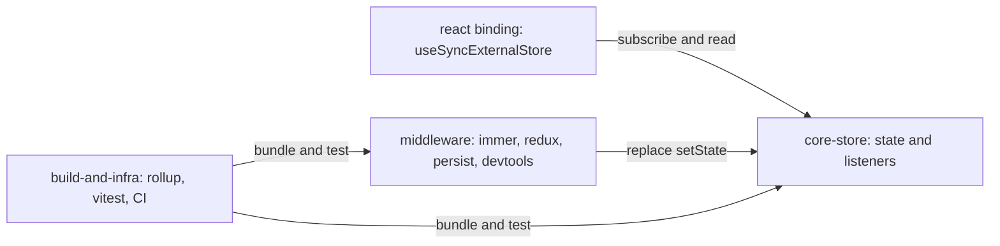

# The four modules of the zustand library

**Architecture** · teaches Reading source code

**Why this visual.** See that the React binding, the middlewares and the build machinery all depend on one small core store.

## What it shows

The core store holds the state and the listeners. The React binding subscribes to that store and reads a snapshot. Every middleware reaches the store by replacing one method on the store object, and the build machinery bundles and tests both layers.

Text alternative: A module map with four boxes: the React binding points at the core store with 'subscribe and read', the middleware points at the core store with 'replace setState', and the build machinery points at both the core store and the middleware with 'bundle and test'.

## Check yourself

Which module does the React binding write to?

Answer: None. The binding subscribes and reads a snapshot, so a write always goes through the store api, which a middleware can replace.

## Sources

- pmndrs/zustand: Bear necessities for state management in React — https://github.com/pmndrs/zustand (`pmndrs-zustand-repo`)

## Used in

- [[zustand-architecture]]

Back to [[visuals-how-to-learn-frontend|all visuals]].

## My insights
