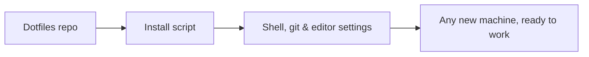

# Workstation & editor in brief

## What it is

Your workstation is the shell, git, editor, and Node setup you use every day. This topic shows you how to set it up once, keep the configuration in version control, and reproduce it on any new machine.

## The problem it solves

A messy or unreproducible setup wastes time and breaks in surprising ways. Without versioned configuration, a new laptop means hours of rebuilding, and a team ends up with slightly different tools that behave differently. A disciplined workstation makes every later frontend topic start from the same base.

## How it works in one picture

Your configuration lives in a dotfiles repository, and one install script recreates the whole setup.

You commit your configuration files to a dotfiles repository, run an install script that links them into place, and a new machine gets the same shell, git, and editor settings. [[visual-how-it-works-workstation-and-editor|explanation and sources]]

## Where it is used in the real world

- A developer keeps shell and git configuration in a versioned dotfiles repo so a new machine is ready in minutes. (mit-missing-semester)
- A team standardizes Node versions per project with a version manager so everyone runs the same runtime. (nodejs-releases-docs)
- A working developer reads the official command-line reference, not a tutorial, when a command behaves unexpectedly. (mdn-command-line)

## What you need to know first

- [[Basic programming]] — you already studied this
- [[Command line]] — you already studied this
- [[Version control]] — you already studied this

## What you will be able to do

- Explain why a disciplined, reproducible workstation pays off every day.
- Explain what PATH and environment variables do when a command runs.
- Build a dotfiles repository that reproduces your setup on a new machine.
- Decide between merge and rebase for a given branch history.
- Decide how to use an AI coding agent without trusting its output.
- Build a git bisect run that finds the commit that introduced a bug.

## My insights
