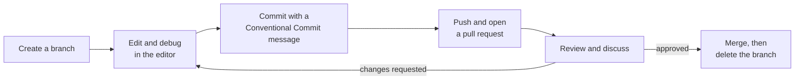

# Workstation & editor in brief

## What it is

A workstation is the set of tools you use every day: a terminal and shell, Git and GitHub, a code editor, an AI coding agent and Node.js. This topic shows how to use each tool well and how they work together.

## The problem it solves

Slow tools make every task slow. If you cannot read a pipe in the shell, you copy commands you do not understand. If you cannot recover a commit, one mistake can delete a day of work. If two projects need different Node versions, code that runs on your laptop can fail in CI. A fluent workstation removes these problems before they cost you time.

## How it works in one picture

The diagram shows one change from a new branch to a merged pull request.

Each step uses one tool from this topic. [[visual-how-it-works-workstation-and-editor|explanation and sources]]

## Where it is used in the real world

- Teams on GitHub use this branch and pull request flow, so every change gets a review before it reaches the main branch.
- Projects such as commitlint check each commit message against Conventional Commits. Release tools then write the changelog from the history.
- Node.js decides if a file is an ES module or CommonJS from its extension and from the `type` field in `package.json`. Every Node project depends on this rule.

## What you need to know first

- [[Git and GitHub]] — Git tracks code changes; GitHub hosts repositories and pull requests.
- [[Operating system process]] — a running program with its own input, output, environment variables and exit code.
- [[npm]] — npm installs the packages that `package.json` lists and runs its scripts.

## What you will be able to do

- Combine shell commands with pipes and fix a PATH problem.
- Choose merge or rebase, and find a bad commit with `git bisect`.
- Open a pull request with Conventional Commit messages.
- Debug JavaScript with breakpoints in the editor.
- Review and test the code an AI agent writes before you merge it.
- Pin a Node.js version for each project.

## My insights
