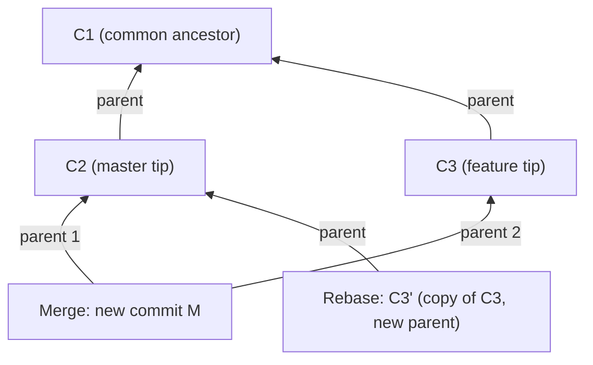

# Pro Git

Scott Chacon and Ben Straub, 2014, Apress (free online edition on git-scm.com), a book. This digest covers nine sections of the second edition, read on 2026-11-18.

## The claim in one sentence

Git is a graph of snapshots with movable labels, so branching is cheap, and once you know how merge, rebase, stash, partial staging, cherry-pick and bisect move those labels, you can shape and debug history with confidence.

## The problem before this

A beginner who knows `add`, `commit` and `push` still hits walls. Two branches change the same line and Git stops. A half-done change blocks a branch switch. One commit among a hundred broke the build. This book explains the model under the commands, so each wall has a known way out.

## Key ideas

### A branch is a tiny pointer

A branch is a file that holds the 40-character checksum of one commit, so creating one costs 41 bytes (Section 3.1). A commit stores a pointer to a snapshot, the author, a message and its parent commits: zero for the first commit, one for a normal commit, several for a merge. `HEAD` points to the branch you are on.

### Merge joins two lines of work

If the other branch is directly ahead, Git only moves your pointer: a fast-forward. If the histories diverged, Git does a three-way merge from both tips and their common ancestor, then records a merge commit (Section 3.2). When both sides edited the same part of a file, Git pauses and marks the file with `<<<<<<<`, `=======` and `>>>>>>>`. The [[Merge conflict]] ends when you edit the file, run `git add`, then `git commit`.

### Rebase replays commits

[[Rebase]] takes the changes of your branch commit by commit and applies them on top of another branch (Section 3.6). The final snapshot equals the merge result. Only the history differs: it is a straight line.

### The golden rule of rebasing

The book states: "Do not rebase commits that exist outside your repository and that people may have based work on." Rebasing creates new commits. Teammates who hold the old ones then get duplicates after a pull.

### Small tools for daily friction

`.gitignore` keeps build output out of Git (Section 2.2). `git add -p` stages one hunk at a time (Section 7.2). `git stash` shelves uncommitted work (Section 7.3). `git cherry-pick` copies one commit onto your branch (Section 5.3). [[Git bisect]] finds the first bad commit by binary search (Section 7.10).

### SSH keys replace passwords

An [[SSH key pair]] has a private file that stays on your machine and a `.pub` file you share (Section 4.3).

## How it works

In plain words: Git history is a chain of commits, and each commit knows its parent. A branch is a sticky note on one commit. Merge ties two chains together with a new commit. Rebase makes copies of your commits and places them at the end of the other chain.

**Analogy.** Merge is like stapling two notebooks together with a cover page. Rebase is like copying your pages into the other notebook, after its last page.

The diagram follows Sections 3.2 and 3.6. Arrows point from a commit to its parent. [[visual-chacon-2014-pro-git-mechanism-workstation-and-editor|Explanation and sources of this diagram]]

Rebase steps from Section 3.6:

1. Find the common ancestor of the two branches.
2. Take the diff that each commit on your branch introduced.
3. Save those diffs as temporary files.
4. Reset your branch to the same commit as the target branch.
5. Apply each saved change in turn.
6. Then fast-forward the target branch with `git merge`.

Bisect steps from Section 7.10: run `git bisect start`, `git bisect bad`, then `git bisect good v1.0`. Git checks out the middle commit. You test it and answer `good` or `bad`. The book's run shows "6 revisions left", then 3, then 1, and ends with the first bad commit. Finish with `git bisect reset`. With a script that exits 0 for good, `git bisect run <script>` does the loop for you.

**Interpretation.** Binary search halves the range each step. A range of about 100 commits needs about seven tests, not a hundred. The book's numbers (6, 3, 1) fit this halving.

## Results and evidence

- The same final snapshot comes from merge and from rebase; only the history shape differs (Section 3.6).
- `.gitignore` patterns: a trailing `/` matches directories, a leading `/` anchors to the top, `!` re-includes a file, `**` matches nested directories (Section 2.2).
- Cherry-pick gives the copied commit a new SHA-1, because its applied date differs (Section 5.3).
- `git stash apply` keeps the stash. `git stash pop` applies and drops it. `-u` includes untracked files. `git stash branch <name>` starts a branch from the stash commit (Section 7.3).

## Limitations and criticisms

- Rebasing published commits makes duplicates for teammates. The book's repair is `git pull --rebase`, which uses patch-ids and works only when the rewritten patches are nearly identical to the originals (Section 3.6).
- The book says teams disagree. One side treats history as a record to keep. The other treats it as a story to tidy. It advises rebasing local work before you push, and never rebasing what you pushed (Section 3.6).
- `git clean` deletes untracked files, usually for good. Run `git clean -n -d` first (Section 7.3).
- The SSH page shows `ssh-keygen -o` and file names such as `id_rsa`. It dates from 2014, so check your Git host's current key advice (Section 4.3).
- The pages I read do not cover `git reflog` or reverting a merge.

## What practitioners took from it

No source recorded in `sources.json` for this topic shows how teams adopted these pages, so I make no adoption claim.

## How it connects to this topic

- [[01-brief-workstation-and-editor|Workstation & editor brief]] — the brief's goal "choose merge or rebase, and find a bad commit with `git bisect`" comes from these sections.
- [[Git and GitHub]] — these chapters deepen the basic commands you already know.
- [[Merge conflict]] — the conflict markers appear in your editor; its merge tools can help.
- [[SSH key pair]] — the key lets you push to GitHub without a password.

## Test yourself

1. A branch has 41 bytes of storage. What does the file contain, and why is switching branches cheap?
2. You rebased a branch that three teammates already pulled. What goes wrong at their next pull?
3. A release has 100 commits between a good tag and a broken `HEAD`. Which commands find the culprit, and what does `git bisect reset` do?

## My insights
