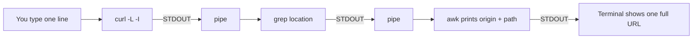

# Command line crash course (MDN Learn web development, Environment setup)

MDN contributors (Mozilla), MDN Web Docs article in the Environment setup module, last modified 2026-09-12. Type: official documentation.

## The claim in one sentence

The terminal is a set of small tools that each read and write text, and piping them together with `|` gives results that no single command gives you.

## The problem before this

A graphical file manager works well for one file. It does not work well for a thousand. One batch job would take a long time by hand: renaming files from `ch01-xxxx.png` to `ch02-xxxx.png` (section "Where did the terminal come from?"). The gap appears at the other end too: a cloud server has no windows, so the terminal is the only way in. The article names the cost too. A blank screen with a blinking cursor gives very little help, and that is the main criticism of the command line (section "Welcome to the terminal").

## Key ideas

### Three words, three layers

A terminal is a program that starts and connects to a shell. A shell is your session and its environment. It holds the prompt and the shortcuts you configure. The command line is the literal line where you type and the cursor blinks. People use the three words interchangeably, and these sentences separate them (section "Side note: what's the difference between a command line and a terminal?").

### A command is a name, then options

You type a command name, a space, and options. An option is a modifier that changes behaviour: a dash and one or more letters, as in `ls -l`. You can join several options after one dash, as in `ls -lah`. Options are not guesswork, because `man <command>` opens the manual page that lists them all (section "Introducing command options").

### Paths are relative or absolute

`cd Desktop/project/src` moves down three levels in one command. A leading slash makes the path absolute, starting at the root. No leading slash makes it relative to the current directory. The article compares this to URLs in the browser (section "Navigation on the command line"). Windows uses a backslash instead.

### Small tools that print text

Unix tools follow one design rule: a tool prints text to the terminal, which the article calls standard output or `STDOUT`. Many tools also read streamed text, called standard input or `STDIN`. Each tool does one job well. `ls` cannot count lines, and `wc` can count lines but cannot list a directory (section "Connecting commands together with pipes").

### Install tools per project, not per machine

`npm install --save-dev prettier` puts a tool in the project, and `npx prettier` then runs that local copy. A global install (`npm install -g`) is reachable anywhere and takes less disk space, but a teammate who clones the repository does not get the tool. Replication breaks (section "Where to install our CLI tools?").

## How it works

In plain words: you type a command. It prints text. The `|` symbol sends that text into the next command instead of onto the screen. The next command prints its own text, and the chain repeats until the last command writes the answer you wanted.

The diagram follows section "A slightly more complex example", which builds this exact chain. [[visual-mdn-command-line-mechanism-workstation-and-editor|explanation and sources of this diagram]]

### Step trace on the article's own example

The input is `curl https://developer.mozilla.org/en-US/docs/Web/API/WindowOrWorkerGlobalScope/fetch -L -I | grep location | awk '{ print "https://developer.mozilla.org" $2 }'`.

1. `curl` requests the URL's headers. The `-I` flag asks for headers only.
2. The server answers with a redirect, because the page has moved to `/Web/API/fetch`. The `-L` flag tells `curl` to follow it. Without `-L` the first attempt prints nothing.
3. `curl` writes the header block to `STDOUT`. The pipe hands that block to `grep` as its `STDIN`, so nothing appears on screen yet.
4. `grep location` keeps only the lines that contain the word "location". The kept line is `location: /en-US/docs/Web/API/Window/fetch`.
5. `awk` splits each kept line on whitespace. `$2` is the path, and the program prints the origin in front of it.
6. The final `STDOUT` is one complete URL: `https://developer.mozilla.org/en-US/docs/Web/API/Window/fetch`.

The article calls this example contrived, and it is. Its value is the shape: three programs that know nothing of each other produced one answer.

## Results and evidence

- `ls | wc -l` prints a count of files and directories in the current directory. `ls` prints one name per line, so `wc -l` counts those names (section "Connecting commands together with pipes").
- `ls -l` gives one entry per line with more detail, and a `d` in the leftmost column marks a directory (section "Introducing command options").
- `npx prettier --check index.js` reports `Code style issues found in the above file(s).` With `--write` it reformats the file, and the article shows the before and after code (section "Playing with Prettier").
- `rm` deletes permanently, with no recycle bin, and `rm -r` removes a whole directory (section "Creating, copying, moving, removing").
- Running `npx prettier` without a local install downloads the latest version for that one command. The formatter output can then change under you (note in section "Installing Prettier").

## Limitations and criticisms

- The article is explicitly an introduction. It points to "a number of good tutorials on the web that go much deeper" and calls itself "only a brief introduction" (section "Basic built-in terminal commands").
- It teaches no shell scripting: no variables, no loops, no exit codes, no `$PATH`. You need those to automate anything, and the article leaves them to the next chapter. `mit-missing-semester` covers them.
- The article warns that complex commands are dangerous. It gives one safety mechanism: "make a backup copy of your directory and try running the command on that first" (section "Terminal — considered harmful?").
- Coverage of Windows is shallow. `cmd` lacks `ls` (the equivalent is `dir`), and the advice is to install WSL for Unix parity rather than to teach Windows commands (section "Windows").

## What practitioners took from it

The article records no adoption data, and nothing in `sources.json` measures how developers use it. `mit-missing-semester` supports the same ground from the other side. It teaches the shell and command-line environment as a full course, the place a developer goes after this page. The brief states the same practice in one line: a working developer reads the official reference when a command behaves unexpectedly ([[01-brief-workstation-and-editor|Workstation & editor brief]]).

## How it connects to this topic

- [[01-brief-workstation-and-editor|Workstation & editor brief]] — this page is the source behind the brief's real-world line about reading a command reference.
- [[Command line]] — the concept this page defines for a beginner, and the one your workstation setup runs in.
- [[Standard streams]] — the `STDOUT` and `STDIN` rule that makes the pipe work.
- [[Local versus global install]] — the decision this page turns into a default: install into the project, so a teammate can reproduce it.

## Test yourself

1. A teammate clones your repository and runs the tool you used to format the code. Why does the tool work for you and fail for them?
2. In `ls | wc -l`, which side writes to `STDIN`, and what would you see on screen if you removed the pipe?
3. You want to delete only files named `mdn-*.bak` in a directory. What do you run, and what do you do before you run it?

## My insights
