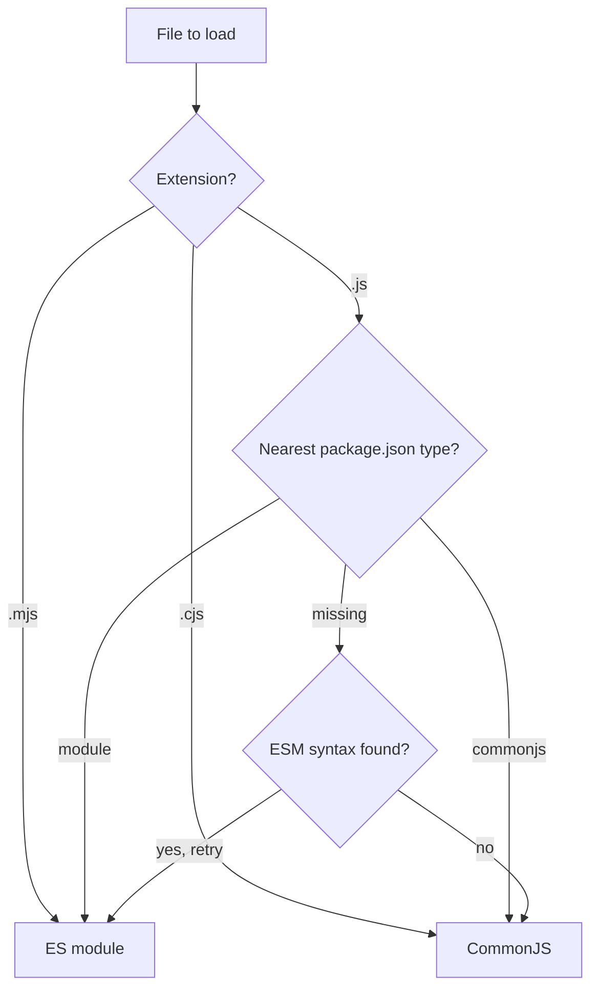

# Node.js documentation: Packages and Corepack

Node.js project, official documentation "Modules: Packages" (read as the v26.13.1 page) and the Corepack page, read on 2026-11-18.

## The claim in one sentence

Node.js decides whether a file is an ES module or CommonJS from its extension and from the `type` field of the nearest `package.json`, and the `exports` field lets a package say which files outsiders may import.

## The problem before this

JavaScript grew two module systems: CommonJS (`require`) and ES modules (`import`). A plain `.js` file does not say which one it uses, so Node.js needs a rule. Packages also had no way to hide internal files: any file inside a package could be imported by path. A third pain was that each project can need a different package manager version, and nothing in the project recorded it.

## Key ideas

### Extensions are explicit markers

A `.mjs` file is always an ES module and a `.cjs` file is always CommonJS, whatever the nearest `package.json` says (section "package.json and file extensions"). You can mix both kinds inside one package by using these two extensions.

### The `type` field decides plain `.js` files

The `type` field sets the format for every `.js` file whose nearest parent `package.json` holds it. The nearest one is the first found by searching the current folder, then its parents, up to a `node_modules` folder or the volume root (field "type"). The value `"module"` means ES module. The value `"commonjs"`, a missing field, or no `package.json` at all means CommonJS.

### Syntax detection guesses when nothing is marked

For an "ambiguous" file (`.js`, no `type` field), Node.js runs it as CommonJS first. If the parser then finds ES module syntax, such as `import`, `export`, `import.meta` or top-level `await`, it retries as an ES module (sections "Determining module system" and "Syntax detection"). Detection is on by default since v22.7.0 and v20.19.0, and its stability is marked 1.2, release candidate. The docs say it costs performance and advise authors to always set `type`, even in all-CommonJS packages.

### `exports` encapsulates a package

When `exports` exists, all subpaths not listed are blocked, and `require('pkg/subpath.js')` throws `ERR_PACKAGE_PATH_NOT_EXPORTED` (section "Main entry point export"). Subpaths appeared in v12.7.0. The docs recommend `exports` for new packages. If both `exports` and `main` exist, `exports` wins. Conditional exports map `import` and `require` to different files, which is how a package ships two formats (section "Conditional exports").

### `imports` gives private aliases

The `imports` field maps names that start with `#` to files or packages, and only code inside the same package can use them (section "Subpath imports"). Unlike `exports`, it may point to external packages.

### Corepack pins the package manager

The `packageManager` field names the tool and version, for example `yarn@3.2.3` plus an optional SHA-224 hash. The hash is optional but "strongly recommended" for security. Allowed names are `yarn`, `npm` and `pnpm`. If you run a different manager than the one pinned, Corepack asks you to rerun with the right one (Corepack page, "Usage").

## How it works

In plain words: Node.js looks at the file name first. If the name is `.mjs` or `.cjs`, the answer is fixed. If it is `.js`, Node.js reads the nearest `package.json`. If that file has no `type`, Node.js tries CommonJS and switches to ES module only when the code needs it.

The diagram follows the sections "Determining module system" and "package.json and file extensions". [[visual-nodejs-packages-docs-mechanism-workstation-and-editor|explanation and sources]]

1. Node.js gets a file from the command line, an `import` statement or `import()`.
2. It checks the extension. `.mjs` and `.cjs` end the search.
3. For `.js` it searches upward for the nearest `package.json` and reads `type`.
4. With no `type`, it runs the file as CommonJS and retries as ES module on ES module syntax.
5. For a package import, `exports` is then checked: only listed paths resolve.

Loading differs too. `require()` adds extensions and accepts folders; `import` needs full file names and, for JSON, an import attribute such as `with { type: 'json' }` (section "Module resolution and loading").

## Results and evidence

- The docs state the rule table above as the behavior; there are no benchmarks. The only cost named is a performance cost for ES syntax in ambiguous files ("Determining module system").
- Syntax detection: added in v21.1.0 and v20.10.0, default since v22.7.0 and v20.19.0 ("Syntax detection").
- `exports` encapsulation is "not a strong" guard: requiring an absolute file path still loads the file ("Main entry point export").
- Corepack: shipped with Node.js from 14.19.0 up to, not including, 25.0.0 (Corepack page, "Default Installs").

## Limitations and criticisms

- Adding `exports` to an existing package is a likely breaking change, because every path not listed stops working ("Package entry points"). The page lists every old entry point to avoid that.
- The Dual CommonJS/ES module packages section of the page I read is only a pointer to an examples repository, so I did not digest a dual-package recipe beyond conditional exports.
- Corepack is not bundled from Node.js 25.0.0, so on newer Node you install it yourself with `npm install -g corepack` (Corepack page). The `nodejs.org/api/corepack.html` address I fetched showed the Corepack repository README, not a Node.js API page.

## What practitioners took from it

Adoption by named projects could not be verified from the sources recorded for this topic, so nothing is claimed here. The brief says every Node project depends on this rule ([[01-brief-workstation-and-editor|Workstation & editor brief]]).

## How it connects to this topic

- [[01-brief-workstation-and-editor|Workstation & editor brief]] — the brief's "pin a Node.js version" goal and its module rule come from this source.
- [[ES modules and CommonJS]] — the concept behind the decision diagram.
- [[Package exports field]] — how a package hides internals.
- [[Corepack]] — the pinning tool for the package manager.
- [[Node.js]] — the runtime whose docs this is.
- [[npm]] — installs the packages that `package.json` describes.

## Test yourself

1. A folder has a `package.json` with `"type": "module"`. Which file name there loads as CommonJS, and why?
2. A `.js` file has no `type` anywhere and uses `import`. What does Node.js do, and what should the author add?
3. After a package adds `exports`, why can `require('pkg/lib/util.js')` fail, and what error appears?

## My insights
