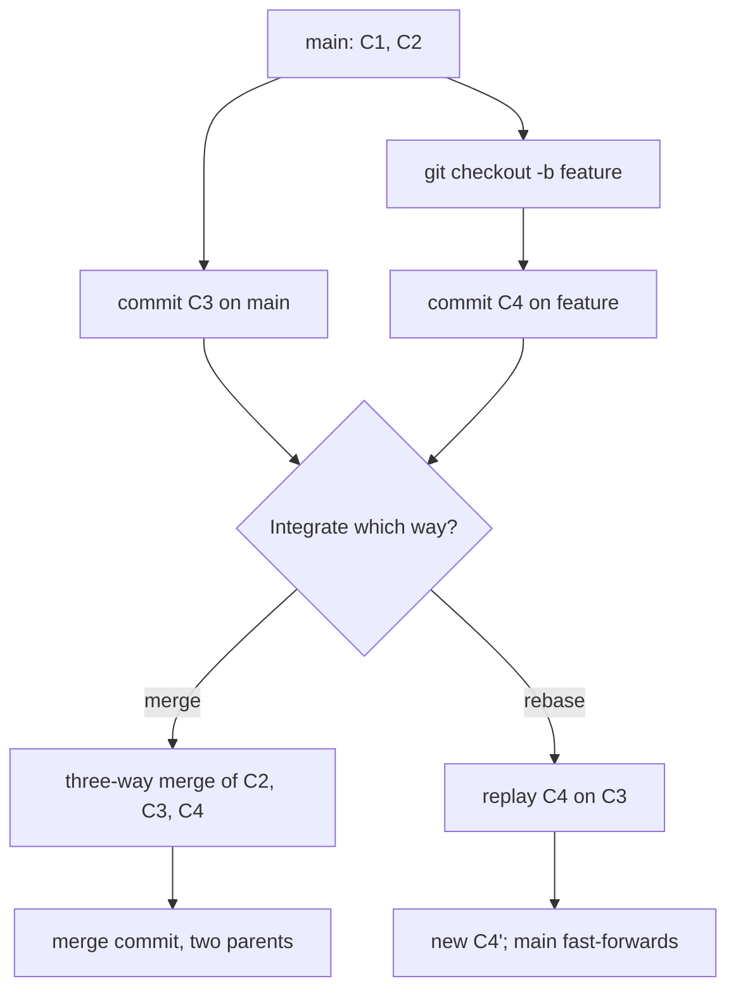

# Pro Git

Scott Chacon and Ben Straub, 2014, Apress. The official free Git book, published on the Git project's own site; read online (2nd edition, chapters 1 and 3) on 2026-11-19.

## The claim in one sentence

Git stores a project as a stream of full snapshots, and a branch is only a tiny movable pointer. Joining two lines of work is therefore a deliberate choice: merge records what happened, and rebase rewrites it into a straight line.

## The problem before this

Older version control systems stored one base copy of each file plus its changes, and branching usually meant copying the whole project directory. On a large project that copy took seconds or even minutes, so developers avoided branches. History also lived on a server, so most operations waited on the network. Git answers both problems. It keeps every snapshot on your own disk, and a branch is a pointer rather than a copy (section "Snapshots, Not Differences"; section "Branches in a Nutshell").

## Key ideas

### Every commit is a full snapshot

Git pictures all your files at each commit and stores a reference to that picture. If a file did not change, Git links to the identical copy it already has. A commit object holds the snapshot pointer, the author, the message, and its parents. There are none for the first commit, one normally, and several for a merge (sections "Snapshots, Not Differences" and "Branches in a Nutshell").

### Three states, three areas

A file is modified, staged, or committed. Those states map to the working tree, the staging area (also called the index), and the Git directory. A commit writes exactly what the staging area holds. That is why you can stage part of your work and leave the rest out (section "The Three States").

### A branch is a 41-byte pointer

A branch is a small file that holds the checksum of one commit. Creating one is "as quick and simple as writing 41 bytes to a file (40 characters and a newline)". It costs nothing to branch per task. `HEAD` points at the branch you are on, and a commit moves only that branch forward (section "Branches in a Nutshell").

### Merge keeps both lines of history

When the branch you merge in is directly ahead, Git just moves the pointer forward: a fast-forward. When the two lines have diverged, Git runs a three-way merge on the two tips and their common ancestor. It then writes a merge commit with two parents. A conflict pauses the merge, and `git add` marks each file resolved (section "Basic Branching and Merging").

### Rebase replays your commits on a new base

Rebase finds the common ancestor and saves each of your commits as a patch. It resets your branch to the other tip, then reapplies the patches in order. The result is a linear history of new commits with the same final files. The book's rule for safety is blunt: "Do not rebase commits that exist outside your repository and that people may have based work on." (section "Rebasing").

## How it works

In plain words, you save snapshots and a branch is a sticky note on one of them. To join two lines, you either tie them with a knot (a merge commit) or lift your commits onto the other tip (a rebase).

The diagram follows sections "Basic Branching and Merging" and "Rebasing", using the book's own C2, C3 and C4 labels. Walk through it once on that history:

1. `main` points at C2 and `HEAD` is on it. Nothing has diverged yet.
2. `git checkout -b feature` writes a second pointer at C2 and moves `HEAD`. No file changes.
3. A commit on `feature` adds C4 and moves that pointer. `main` stays at C2.
4. A commit on `main` adds C3. The lines now diverge, and C2 is their common ancestor.
5. Merge: `git checkout main` then `git merge feature` runs the three-way merge over C3, C4 and C2, and stores a merge commit with two parents.
6. Rebase: `git checkout feature` then `git rebase main` saves C4's patch, resets `feature` to C3, and reapplies the patch as a new commit C4'.
7. `git checkout main` then `git merge feature` now fast-forwards `main` to C4'. The files match the end of step 5; only the history differs.

[[visual-pro-git-book-mechanism-workstation-and-editor|Explanation and sources of this diagram]]

## Results and evidence

- Branch creation is constant work: about 41 bytes, regardless of project size (section "Branches in a Nutshell").
- Merge and rebase reach the same final snapshot. The book states that only the history differs (section "The Basic Rebase").
- Switching branches rewrites files in the working directory. Git refuses the switch when uncommitted changes would be overwritten (sections "Switching Branches" and "Basic Branching").
- Rebase can recover after a colleague force-pushes, because Git also keeps a patch-id; this works only when the two patches are almost identical (section "Rebase When You Rebase").
- The evidence is worked command transcripts and diagrams such as the three-snapshot merge in Figures 24–25, not measurements.

## Limitations and criticisms

- The book documents a mechanism and reports no data. It never measures defect rates or review quality for merge versus rebase; section "Rebase vs. Merge" closes by saying the choice belongs to each team.
- Rebase abandons commits and writes replacements. Anyone who based work on the old commits must merge again. The book warns that a public rebase leaves duplicate commits in a shared log (section "The Perils of Rebasing").
- The main text still teaches `master` and `git checkout` as the default vocabulary. `git switch` appears only in an added note for Git 2.23 and later (section "Branches in a Nutshell"). A learner will meet different names in current tools.
- The chapter stops at commands. Pull requests, protected branches, and squash merges are outside the pages read here. The book does not settle how a hosted review flow maps onto merge and rebase.

## What practitioners took from it

The sources recorded for this topic place these mechanics at the centre of daily work. MIT's Missing Semester teaches version control as one of its core developer-tool lectures. GitHub's setup page assumes you will push to a repository once identity and authentication are set (sources `mit-missing-semester` and `github-set-up-git-docs`). The book itself records no adoption figures or team policy, so nothing stronger is claimed here.

## How it connects to this topic

- [[01-brief-workstation-and-editor|Workstation & editor brief]] — the brief promises you can decide between merge and rebase for a given history; this source supplies the rule.
- [[Version control]] — the general idea this book turns into concrete commands and objects.
- [[Git branch]] — the pointer that makes branching cheap enough to do per task.
- [[Merge commit]] — the record of two lines joining, and the reason history grows a knot.
- [[Rebase]] — the rewrite that trades truth for a clean line, with the published-history rule attached.

## Test yourself

1. When does `git merge feature` only move a pointer, and when does it create a commit with two parents?
2. Merge and rebase end with the same files. Name two things that still differ.
3. A colleague rebased and force-pushed a branch you had built on. What does Git's patch-id let you do, and what does it require?

## My insights
