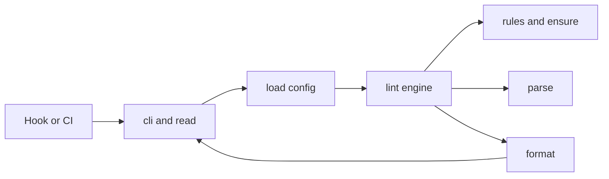
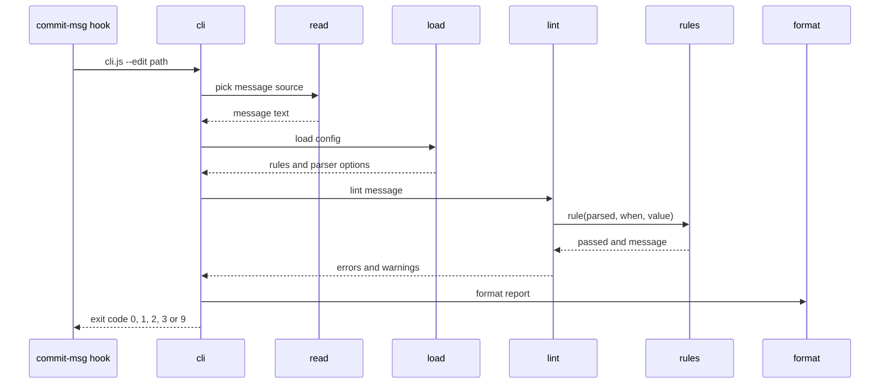

# conventional-changelog/commitlint — architecture

commitlint is a set of small npm packages. One command-line package reads a commit message, one loads the settings, one lints, many rules judge, and one formats. A Git hook or a CI job calls the command-line package and reads only its exit number.

## Module map

| Module | Responsibility | Note |
|--------|----------------|------|
| cli-and-hooks | Reads flags, picks the message source, prints the report, sets the exit code | [[commitlint-module-cli-and-hooks\|cli-and-hooks]] |
| config-loading | Finds the config file, checks it, follows `extends`, merges layers | [[commitlint-module-config-loading\|config-loading]] |
| parser-and-lint | Ignore check, parse, config shape check, run rules, split errors and warnings, format | [[commitlint-module-parser-and-lint\|parser-and-lint]] |
| rules | About 40 small functions, one check each, plus `ensure` helpers | [[commitlint-module-rules\|rules]] |
| build-and-infra | Pins Node and pnpm, builds, tests, runs CI, publishes | [[commitlint-module-build-and-infra\|build-and-infra]] |

## The picture

The CLI reads and then lints every message with `Promise.all` (`@commitlint/cli/src/cli.ts:298-325 @ d2be18a`). The lint engine parses, looks rules up by name and runs them (`@commitlint/lint/src/lint.ts:38-41 @ d2be18a`, `@commitlint/lint/src/lint.ts:143-167 @ d2be18a`). The formatter prints the report (`@commitlint/cli/src/cli.ts:381-390 @ d2be18a`). [[visual-commitlint-module-map-workstation-and-editor|explanation and sources]]

## Main flow

In plain words, in order:

1. Git runs the hook with the path of the message file, and the hook runs the built CLI with `--edit $1` (`.husky/commit-msg:1 @ d2be18a`).
2. The CLI checks the flags. `read()` takes the edit file first, then `--last`, then a range (`@commitlint/read/src/read.ts:25-38 @ d2be18a`, `@commitlint/read/src/read.ts:83-97 @ d2be18a`).
3. `load` finds the config with cosmiconfig, validates it, follows `extends` and merges the layers (`@commitlint/load/src/load.ts:52-75 @ d2be18a`, `@commitlint/resolve-extends/src/index.ts:220-240 @ d2be18a`).
4. `lint` skips ignored messages, parses the rest, checks the config shape and runs all rules in parallel (`@commitlint/lint/src/lint.ts:24-28 @ d2be18a`, `@commitlint/lint/src/lint.ts:143-167 @ d2be18a`).
5. Each rule is called as `rule(parsed, when, value)` and returns `[passed, message]` (`@commitlint/types/src/rules.ts:18-28 @ d2be18a`). Level 2 failures become errors, level 1 become warnings (`@commitlint/lint/src/lint.ts:171-178 @ d2be18a`).
6. The CLI folds results into one report and exits with 0, 1, 2, 3 or 9 (`@commitlint/cli/src/cli.ts:357-377 @ d2be18a`, `@commitlint/cli/src/cli.ts:392-405 @ d2be18a`, `@commitlint/cli/src/cli-error.ts:1-7 @ d2be18a`). [[visual-commitlint-request-flow-workstation-and-editor|explanation and sources]]

animation candidate (for a `flow` scene):

- hook → cli: `cli.js --edit $1` (`.husky/commit-msg:1 @ d2be18a`)
- cli → read: choose edit file, last commit or range (`@commitlint/read/src/read.ts:25-38 @ d2be18a`)
- cli → load: find, validate and merge config (`@commitlint/load/src/load.ts:52-75 @ d2be18a`)
- cli → lint: lint each message (`@commitlint/cli/src/cli.ts:298-325 @ d2be18a`)
- lint → rules: `rule(parsed, when, value)` (`@commitlint/lint/src/lint.ts:143-165 @ d2be18a`)
- cli → hook: exit code (`@commitlint/cli/src/cli.ts:392-405 @ d2be18a`)

## Module dependencies

The lint engine does not import the CLI or the loader. It takes `rules` and options as arguments (`@commitlint/lint/src/lint.ts:24-28 @ d2be18a`), and the CLI passes in what `load` built (`@commitlint/cli/src/cli.ts:298-325 @ d2be18a`). The `rules` package depends on the sibling helpers `message`, `to-lines` and `parse` (`@commitlint/rules/src/body-leading-blank.ts:1-2 @ d2be18a`). So the layers are: CLI on top, then load and lint side by side, then rules and helpers at the bottom. That one-way shape is why each package can be tested alone.

## Worth exploring interactively

- Message to result: ignore, parse, validate config, run rules, split by level; `FlowAnimation` (`@commitlint/lint/src/lint.ts:28-191 @ d2be18a`).
- Input source choice and exit code: `--strict` and counts decide 0, 1, 2, 3 or 9; `StateMachine` (`@commitlint/cli/src/cli.ts:392-405 @ d2be18a`).
- Config layering: seed, file, each `extends`, user config last; `FlowAnimation` (`@commitlint/resolve-extends/src/index.ts:226-239 @ d2be18a`).
- Pinning layers: `engines`, `packageManager`, mise, CI reading the pin; `SystemDiagram` (`package.json:85-89 @ d2be18a`, `.mise.toml:1-3 @ d2be18a`).

## Design decisions worth noticing

decision candidate: rules as data or as code. Option A, an `if` chain in one function: short, but not switchable. Option B, a named table with `[level, when, value]`: more files, but users can turn rules on and off and share presets. commitlint chose B ([[commitlint-pattern-rules-as-data]], [[commitlint-findings|findings 1 and 2]]).

decision candidate: pin the package manager with Corepack or by hand. Corepack is short, but the Dockerfile says it was removed from Node 25+. commitlint reads `packageManager` and checks the hash itself (`Dockerfile.ci:6-13 @ d2be18a`; [[commitlint-pattern-layered-version-pinning]], [[commitlint-findings|finding 6]]).

decision candidate: one checker for the hook and for CI. The hook lints one message, CI lints a range, and both call the same CLI (`.github/workflows/commitlint.yml:46-52 @ d2be18a`; [[commitlint-pattern-one-checker-two-gates]]).

## Not analyzed

- `cli.test.ts`, `load.test.ts`, resolve-extends tests (large; the CLI and config-loading notes say tests were not read).
- `docs/` website, `skills/`, `@alias`, `@packages`.
- `config-angular*`, `config-*-scopes`, `config-patternplate`, `cz-commitlint`, `prompt`, `prompt-cli`, `travis-cli`.
- `pnpm-lock.yaml`.
- About 25 of the 40 rule files (they were assumed to follow the same shape).

## My insights
