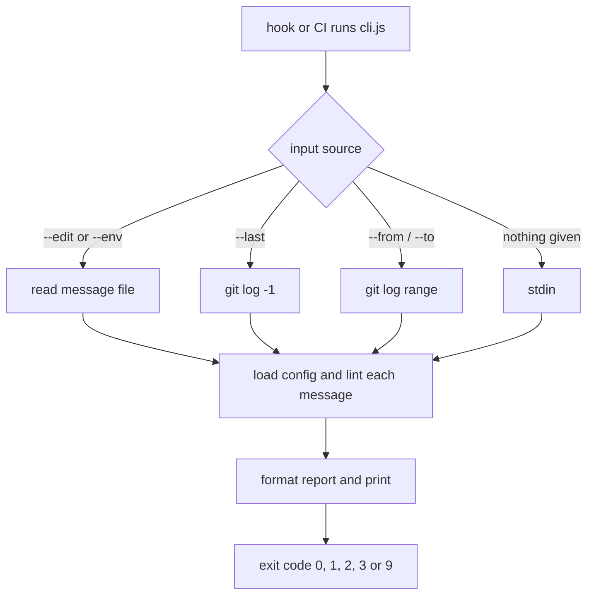

# conventional-changelog/commitlint — module: cli-and-hooks

## Responsibility

This slice is the front door of commitlint. It reads flags, decides where the commit message comes from (a file, stdin, or a range of Git history), runs the linter, prints a report, and turns the result into a process exit code. Two callers use it: a Git `commit-msg` hook on a developer machine, and a GitHub Actions job in CI.

## Key files

| File | Role |
|------|------|
| `@commitlint/cli/src/cli.ts` | Flag definitions, input choice, lint call, report, exit codes |
| `@commitlint/cli/src/cli-error.ts` | The `ExitCode` list and the `CliError` class |
| `@commitlint/cli/src/types.ts` | The `CliFlags` type that mirrors the flags |
| `@commitlint/read/src/read.ts` | Reads messages from an edit file, the last commit, or a range |
| `.husky/commit-msg` | The local hook |
| `.husky/pre-commit` | Runs staged-file lint and a build before commit |
| `.github/workflows/commitlint.yml` | The CI job |

## How it works

In plain words: the tool first works out where the message is. Then it loads the rules, checks each message, prints the problems, and exits with a number. A shell, a hook, or CI reads only that number.

1. Flags are declared with `yargs`. Each has a short alias, for example `--edit`/`-e`, `--from`/`-f`, `--to`/`-t`, `--last`/`-l` (`@commitlint/cli/src/cli.ts:41-147 @ d2be18a`). `.strict()` makes unknown flags an error (`@commitlint/cli/src/cli.ts:155 @ d2be18a`).
2. The usage text says the tool reads stdin when `--edit`, `--env`, `--from` and `--to` are all missing (`@commitlint/cli/src/cli.ts:154 @ d2be18a`).
3. `main` runs and any error goes to a catch that exits with the error's own code (`@commitlint/cli/src/cli.ts:163-170 @ d2be18a`). The exit happens inside `setTimeout(..., 0)`, which lets pending output flush first (my reading; the code gives no comment).
4. The `--cwd` path is checked to be a real directory, with separate messages for "missing" and "cannot access" (`@commitlint/cli/src/cli.ts:207-228 @ d2be18a`).
5. Stdin is the input when no positional argument is given and no Git source flag is set (`@commitlint/cli/src/cli.ts:245 @ d2be18a`, `@commitlint/cli/src/cli.ts:408-427 @ d2be18a`). The stdin reader returns an empty string on an interactive terminal, so the tool never hangs waiting for a human (`@commitlint/cli/src/cli.ts:172-186 @ d2be18a`).
6. `--last` cannot be mixed with `--from`, `--to` or `--edit` (`@commitlint/cli/src/cli.ts:247-258 @ d2be18a`). `--from` equal to `--to` is rejected with exit code 9 and a hint to use `--from X^ --to X` (`@commitlint/cli/src/cli.ts:260-269 @ d2be18a`).
7. `read()` picks the source: edit file first, then `--last` (runs `git log -1 --pretty=format:%B`), then a range (`@commitlint/read/src/read.ts:25-38 @ d2be18a`, `@commitlint/read/src/read.ts:83-97 @ d2be18a`). With `--from-last-tag` it runs `git describe` to find the tag (`@commitlint/read/src/read.ts:40-60 @ d2be18a`).
8. Empty and non-string messages are dropped (`@commitlint/cli/src/cli.ts:283-286 @ d2be18a`). If nothing is left and no Git source was asked for, the tool throws "[input] is required" (`@commitlint/cli/src/cli.ts:288-296 @ d2be18a`).
9. Config loads, then every message is linted in parallel with `Promise.all` (`@commitlint/cli/src/cli.ts:298-325 @ d2be18a`).
10. Results are folded into one report with `valid`, `errorCount` and `warningCount` (`@commitlint/cli/src/cli.ts:357-377 @ d2be18a`). A formatter turns it into text and prints it unless `--quiet` is set (`@commitlint/cli/src/cli.ts:381-390 @ d2be18a`).
11. Exit codes are chosen last (`@commitlint/cli/src/cli.ts:392-405 @ d2be18a`).

The exit codes are defined in one enum: 0 success, 1 default error, 2 warning in strict mode, 3 error in strict mode, 9 invalid argument (`@commitlint/cli/src/cli-error.ts:1-7 @ d2be18a`). A plain failing message gives 1 (`@commitlint/cli/src/cli.ts:403-405 @ d2be18a`). With `--strict`, errors give 3 and warnings give 2 (`@commitlint/cli/src/cli.ts:392-399 @ d2be18a`). Without `--strict`, warnings never fail the run.

The hook is one line: it runs the built CLI with `--edit $1` (`.husky/commit-msg:1 @ d2be18a`). Git passes the path of the message file as the first argument, so `$1` is that path. CI uses two modes. On a push it lints only the last commit (`.github/workflows/commitlint.yml:46-48 @ d2be18a`). On a pull request it lints the range from the base commit to the head commit (`.github/workflows/commitlint.yml:50-52 @ d2be18a`).

## Beyond the textbook

### Comment lines are removed the way Git removes them

- Textbook version: lint the raw text of `.git/COMMIT_EDITMSG`.
- What they do: ask Git for `core.commentChar` or `core.commentString` and give it to the parser, so lines Git would drop are not linted. If `auto` or unset, `#` is used.
- Why: the code comment says Git drops comment lines when it commits (`@commitlint/cli/src/cli.ts:320-323 @ d2be18a`).
- Evidence: `@commitlint/cli/src/cli.ts:437-460 @ d2be18a`

### Shallow clones are detected before the range walk

- Textbook version: run `git log from..to` and lint what comes back.
- What they do: run `git merge-base` first and throw if it fails (exit code 1 from git).
- Why: the code comment says a shallow clone silently returns only the commits present, which hides invalid commits.
- Evidence: `@commitlint/read/src/read.ts:62-81 @ d2be18a`. The CI job matches this with `fetch-depth: 0` (`.github/workflows/commitlint.yml:18-21 @ d2be18a`).

### Exit codes are a contract, not just 0 and 1

- Textbook version: exit 1 on any failure.
- What they do: separate codes for strict warning, strict error and bad arguments, so a script can tell "bad message" from "bad command line".
- Why: `--strict` help text names codes 2 and 3 (`@commitlint/cli/src/cli.ts:142-146 @ d2be18a`); `--config` help names code 9 (`@commitlint/cli/src/cli.ts:49-52 @ d2be18a`).
- Evidence: `@commitlint/cli/src/cli-error.ts:1-7 @ d2be18a`

### Empty rules are a failure, not a silent pass

- Textbook version: no rules means nothing to check, so pass.
- What they do: replace the results with an "empty-rules" error that tells the user how to add rules or use `--default-config`, and exit 9.
- Why: a misplaced config file would otherwise make every commit pass.
- Evidence: `@commitlint/cli/src/cli.ts:327-355 @ d2be18a`, `@commitlint/cli/src/cli.ts:400-402 @ d2be18a`

### The message file path can come from an environment variable

- Textbook version: only `--edit <path>`.
- What they do: `-E NAME` reads the path from that variable, and old `$HUSKY_GIT_PARAMS` syntax in `--edit` still works with a deprecation warning. The comment explains the old way failed on Windows.
- Evidence: `@commitlint/cli/src/cli.ts:462-503 @ d2be18a`

### A built-in fallback config that works without installs

- Textbook version: fail if no config exists.
- What they do: with `--default-config`, resolve `@commitlint/config-conventional` from the CLI package, then the project, then global, and put it first so user `--extends` wins.
- Evidence: `@commitlint/cli/src/cli.ts:511-539 @ d2be18a`

### The hook lints the source it just built

- Textbook version: hook calls an installed binary.
- What they do: this repo's own hook runs the built file `lib/cli.js`, and `pre-commit` runs `pnpm build` first, so the hook never checks with stale code.
- Evidence: `.husky/pre-commit:1-5 @ d2be18a`, `.husky/commit-msg:1 @ d2be18a`

## Tests and what they protect

Not present in this slice. The test files for the CLI were skipped in the slice plan.

## Error handling, performance, and security

- Errors carry a `type` and an `error_code`; only errors whose type is the package name become a clean exit code, others are rethrown (`@commitlint/cli/src/cli-error.ts:9-22 @ d2be18a`, `@commitlint/cli/src/cli.ts:163-170 @ d2be18a`).
- A missing environment variable named by `-E` throws a plain `Error` that names the variable (`@commitlint/cli/src/cli.ts:463-468 @ d2be18a`).
- A global `unhandledRejection` handler logs and rethrows, so async bugs do not pass silently (`@commitlint/cli/src/cli.ts:571-575 @ d2be18a`).
- Git is run through `tinyexec` with an argument list and not a shell string (`@commitlint/read/src/read.ts:30-32 @ d2be18a`). `--git-log-args` is split on spaces and parsed with `parseArgs` (`@commitlint/read/src/read.ts:84-88 @ d2be18a`).
- The CI job asks for read-only repository permission only (`.github/workflows/commitlint.yml:10-11 @ d2be18a`) and installs with `--frozen-lockfile` (`.github/workflows/commitlint.yml:32-33 @ d2be18a`).

## Technologies and services seen

- yargs — flag parsing, help, `--options` config file (`@commitlint/cli/src/cli.ts:20 @ d2be18a`, `@commitlint/cli/src/cli.ts:152 @ d2be18a`)
- tinyexec — runs `git` commands without a shell (`@commitlint/read/src/read.ts:6 @ d2be18a`)
- Node.js `util.parseArgs` — parses `--git-log-args` (`@commitlint/read/src/read.ts:1 @ d2be18a`)
- Husky — Git hooks folder `.husky` (`.husky/commit-msg:1 @ d2be18a`)
- lint-staged — pre-commit file checks (`.husky/pre-commit:1 @ d2be18a`)
- pnpm — install and build in hook and CI (`.github/workflows/commitlint.yml:23-24 @ d2be18a`)
- GitHub Actions: `actions/checkout`, `pnpm/action-setup`, `actions/setup-node` (`.github/workflows/commitlint.yml:18-30 @ d2be18a`)

## Worth exploring interactively

- Input source choice and exit code — steps: flags parsed (`@commitlint/cli/src/cli.ts:41-155 @ d2be18a`), source checks (`@commitlint/cli/src/cli.ts:245-269 @ d2be18a`), `read()` picks edit, last or range (`@commitlint/read/src/read.ts:25-97 @ d2be18a`), lint and report (`@commitlint/cli/src/cli.ts:325-390 @ d2be18a`), exit code (`@commitlint/cli/src/cli.ts:392-405 @ d2be18a`) — fits FlowAnimation because the learner sees one message travel from hook or CI to an exit number.
- Exit codes — strict flag, error and warning counts decide 0, 1, 2, 3 or 9 (`@commitlint/cli/src/cli.ts:392-405 @ d2be18a`, `@commitlint/cli/src/cli-error.ts:1-7 @ d2be18a`) — fits StateMachine because the learner toggles `--strict` and counts and sees the code change.

## Open questions

- How `getEditCommit` reads the file when `--edit` is empty or a path is not shown here; it is in `@commitlint/read`, outside this slice.
- How the `lint` function applies rules is in the parser-and-lint module.

## My insights
