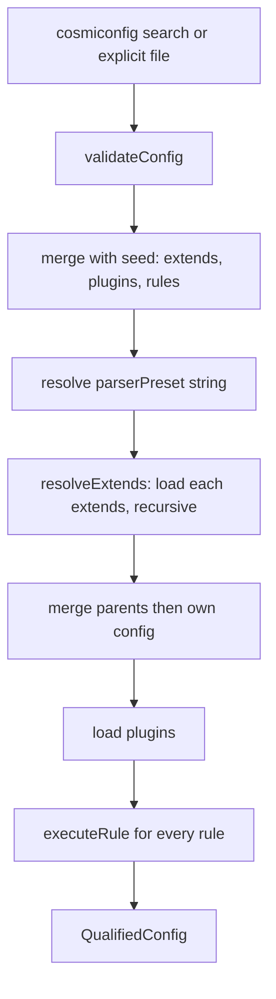

# conventional-changelog/commitlint — module: config-loading

## Responsibility

This slice finds the commitlint settings file, checks that it is valid, follows its `extends` list (shared configs, like ESLint presets), merges everything into one final config, and loads plugins and the parser preset. It also ships the shared `@commitlint/config-conventional` preset that most projects extend.

## Key files

| File | Role |
|------|------|
| `@commitlint/load/src/load.ts` | The `load` function: the whole pipeline from file to final config |
| `@commitlint/load/src/utils/load-config.ts` | Finds and reads the config file with cosmiconfig and jiti |
| `@commitlint/resolve-extends/src/index.ts` | Resolves each `extends` name to a file and merges the results |
| `@commitlint/config-validator/src/validate.ts` | Checks the config against a JSON Schema with Ajv |
| `@commitlint/config-validator/src/formatErrors.ts` | Turns Ajv errors into readable lines |
| `@commitlint/load/src/utils/load-parser-opts.ts` | Turns a parser preset into parser options |
| `@commitlint/load/src/utils/load-plugin.ts` | Loads plugins by name, with clear errors |
| `@commitlint/config-conventional/src/index.ts` | The shared preset: rules as data |

## How it works

1. `load` takes a `seed` (config passed in code) and options, and uses `process.cwd()` when no `cwd` is given (`@commitlint/load/src/load.ts:42-46 @ d2be18a`).
2. `loadConfig` asks cosmiconfig to search from `cwd`, or to load one file when `options.file` is set (`@commitlint/load/src/utils/load-config.ts:68-71 @ d2be18a`). The search strategy is `"global"`, so cosmiconfig keeps looking upward and into the home config folders (`@commitlint/load/src/utils/load-config.ts:13 @ d2be18a`).
3. If the file exports a function, `load` calls it and awaits the result. It then validates the result with `validateConfig` (`@commitlint/load/src/load.ts:52-55 @ d2be18a`).
4. The file config and the seed are merged over a base of empty `extends`, `plugins`, and `rules` (`@commitlint/load/src/load.ts:61-75 @ d2be18a`).
5. A string `parserPreset` is resolved from the config file and turned into `{ name, path, parserOpts }` (`@commitlint/load/src/load.ts:78-85 @ d2be18a`, `@commitlint/resolve-extends/src/index.ts:198-209 @ d2be18a`).
6. `resolveExtends` runs with the prefix `commitlint-config` and the config file's folder as `cwd` (`@commitlint/load/src/load.ts:88-92 @ d2be18a`).
7. Plugins are de-duplicated; strings are loaded as packages, objects become `local` plugins (`@commitlint/load/src/load.ts:99-113 @ d2be18a`).
8. Every rule goes through `executeRule`, which turns rule entries into resolved values (`@commitlint/load/src/load.ts:115-122 @ d2be18a`).
9. The result has defaults: formatter `@commitlint/format` and a fallback `helpUrl` (`@commitlint/load/src/load.ts:94-96 @ d2be18a`, `@commitlint/load/src/load.ts:124-129 @ d2be18a`).

### Which files are found

The search list has 17 places: `package.json`, `package.yaml`, `.commitlintrc` (with `.json`, `.yaml`, `.yml`, `.js`, `.cjs`, `.mjs`), `commitlint.config.js/.cjs/.mjs`, and the TypeScript forms `.commitlintrc.ts/.cts/.mts` and `commitlint.config.ts/.cts/.mts` (`@commitlint/load/src/utils/load-config.ts:35-58 @ d2be18a`). A code comment says cosmiconfig replaces its defaults when you add places, so the team copied the defaults by hand (`@commitlint/load/src/utils/load-config.ts:36-37 @ d2be18a`).

### How extends is resolved

1. A name gets a prefix: `conventional` becomes `commitlint-config-conventional`. A scoped name without a slash, like `@scope`, becomes `@scope/commitlint-config`. A relative or absolute path stays as it is (`@commitlint/resolve-extends/src/index.ts:284-295 @ d2be18a`).
2. The id is searched in the config folder first, then in global npm and yarn folders, then in the npx cache (`@commitlint/resolve-extends/src/index.ts:315-332 @ d2be18a`, `@commitlint/resolve-extends/src/index.ts:428-441 @ d2be18a`).
3. Each extended file is loaded, and its own `extends` is followed recursively; parents come before children in the list (`@commitlint/resolve-extends/src/index.ts:249-281 @ d2be18a`).
4. The list is reduced with `mergeWith`: later wins, `plugins` arrays are joined, and other arrays are replaced (`@commitlint/resolve-extends/src/index.ts:220-240 @ d2be18a`). The user config is pushed last, so it overrides every preset (`@commitlint/resolve-extends/src/index.ts:226 @ d2be18a`).

## Beyond the textbook

### One loader for ESM, CJS, and TypeScript config files

- Textbook version: read one JSON file, or `require` one `.js` file.
- What they do: JSON, YAML, `.js`, and `.cjs` use cosmiconfig's default loaders. Every TypeScript extension uses a custom loader built on jiti, created only on first use, with the default export unwrapped (`@commitlint/load/src/utils/load-config.ts:20-31 @ d2be18a`, `@commitlint/load/src/utils/load-config.ts:59-65 @ d2be18a`). A compile error is re-thrown with the prefix "TypeScriptLoader failed to compile TypeScript" (`@commitlint/load/src/utils/load-config.ts:26-28 @ d2be18a`).
- Why: users write configs in whichever module style their project uses, so one loader cannot fit all. The prefix tells the user the TypeScript step failed, not commitlint.
- Evidence: `@commitlint/load/src/utils/load-config.ts:20-31 @ d2be18a`

### Config can be a function or a promise

- Textbook version: a config is a plain object.
- What they do: `load` calls a function export and awaits a promise export before validating (`@commitlint/load/src/load.ts:52-53 @ d2be18a`). This lets a config compute rules at run time.
- Why: the code does not state a reason; the effect is dynamic configs.
- Evidence: `@commitlint/load/src/load.ts:52-55 @ d2be18a`

### Merge rules differ by layer

- Textbook version: one deep merge for everything.
- What they do: in `load`, a non-empty array in the seed replaces the file's array instead of merging by index, and the code empties the target first so the result never shares objects with its inputs (`@commitlint/load/src/load.ts:59-60 @ d2be18a`, `@commitlint/load/src/load.ts:69-74 @ d2be18a`). In `resolveExtends`, `plugins` concatenate but every other array is replaced (`@commitlint/resolve-extends/src/index.ts:229-237 @ d2be18a`).
- Why: a default deep merge joins arrays by index, which would mix `type-enum` lists from two layers. Concatenating plugins is safe because they are independent.
- Evidence: `@commitlint/resolve-extends/src/index.ts:229-237 @ d2be18a`

### Resolving pure-ESM presets with a fallback chain

- Textbook version: call `require.resolve`.
- What they do: `resolveFrom` tries five suffixes with `require.resolve`, then `resolve-from`, then walks `node_modules` by hand and reads the `exports` map, preferring the `import` condition (`@commitlint/resolve-extends/src/index.ts:166-190 @ d2be18a`, `@commitlint/resolve-extends/src/index.ts:32-62 @ d2be18a`). It also has a Yarn Plug'n'Play branch (`@commitlint/resolve-extends/src/index.ts:106-129 @ d2be18a`).
- Why: a code comment says pure-ESM presets declare only the `import` condition, so CommonJS resolution fails with `ERR_PACKAGE_PATH_NOT_EXPORTED` (`@commitlint/resolve-extends/src/index.ts:86-92 @ d2be18a`).
- Evidence: `@commitlint/resolve-extends/src/index.ts:93-146 @ d2be18a`

### Dynamic import for ESM, `require` only for JSON

- Textbook version: `require` everything.
- What they do: `.json` files use `require`; everything else uses `import()`, with absolute paths turned into `file://` URLs, and the default export is preferred (`@commitlint/resolve-extends/src/index.ts:15-22 @ d2be18a`).
- Why: `import()` works for both ESM and CJS files, and Node needs a URL for absolute paths on Windows. The Windows reason is my inference, not stated in the code.
- Evidence: `@commitlint/resolve-extends/src/index.ts:20 @ d2be18a`

### Legacy name fallback with a warning

- Textbook version: fail when the name is not found.
- What they do: if the prefixed id fails, they retry with the older prefix `conventional-changelog-lint-config` and print a warning asking the owner to rename (`@commitlint/resolve-extends/src/index.ts:301-310 @ d2be18a`).
- Why: old shared configs keep working while the ecosystem migrates.
- Evidence: `@commitlint/resolve-extends/src/index.ts:305-309 @ d2be18a`

### Schema validation with readable errors

- Textbook version: let bad keys be ignored, or crash later.
- What they do: the config is checked with Ajv against a JSON Schema. A custom `typeof` keyword checks function values, which JSON Schema cannot express (`@commitlint/config-validator/src/validate.ts:26-33 @ d2be18a`). The error names the file and lists each problem (`@commitlint/config-validator/src/validate.ts:38-41 @ d2be18a`). The formatter says things like `Unexpected top-level property` and `Property "x" has the wrong type` (`@commitlint/config-validator/src/formatErrors.ts:12-24 @ d2be18a`). Its comment says it is based on ESLint's config validator (`@commitlint/config-validator/src/formatErrors.ts:7 @ d2be18a`).
- Why: a typo in a config should fail at load time with a clear message.
- Evidence: `@commitlint/config-validator/src/validate.ts:17-43 @ d2be18a`

### Parser presets are normalised, including factory-style presets

- Textbook version: one parser option object.
- What they do: `loadParserOpts` accepts a function, a promise, an object, or a factory with a callback, and unwraps a nested `parserOpts` while keeping user-set keys (`@commitlint/load/src/utils/load-parser-opts.ts:36-65 @ d2be18a`). The callback form is used only for presets whose name starts with `conventional-changelog-`, including scoped names (`@commitlint/load/src/utils/load-parser-opts.ts:13-21 @ d2be18a`, `@commitlint/load/src/utils/load-parser-opts.ts:68-88 @ d2be18a`).
- Why: comments cite issues #2488 and #4640, which are bug reports about scoped presets and lost user overrides.
- Evidence: `@commitlint/load/src/utils/load-parser-opts.ts:51-63 @ d2be18a`

### Rules as plain data in the shared preset

- Textbook version: a lint rule is code.
- What they do: `config-conventional` is only data: a parser preset name, a rules table of `[severity, condition, value]`, and prompt text (`@commitlint/config-conventional/src/index.ts:3-5 @ d2be18a`). It allows these types: build, chore, ci, docs, feat, fix, perf, refactor, revert, style, test (`@commitlint/config-conventional/src/index.ts:25-40 @ d2be18a`). It uses `as const` and `RuleConfigSeverity` for type safety (`@commitlint/config-conventional/src/index.ts:1 @ d2be18a`, `@commitlint/config-conventional/src/index.ts:6-7 @ d2be18a`).
- Why: data can be overridden by key, merged by `extends`, and shared as an npm package.
- Evidence: `@commitlint/config-conventional/src/index.ts:5-44 @ d2be18a`

## Tests and what they protect

Not read in this slice. The slice plan skipped the large test files (`load.test.ts`, resolve-extends tests). `config-validator` has a `validate.test.ts` and a `__snapshots__` folder, which I only listed.

## Error handling, performance, and security

- Invalid config throws one `Error` that names the file and lists each problem (`@commitlint/config-validator/src/validate.ts:38-41 @ d2be18a`).
- Plugin errors are typed classes with a `messageTemplate` (`plugin-missing`, `whitespace-found`), so the caller can print a friendly message (`@commitlint/load/src/utils/plugin-errors.ts:4 @ d2be18a`, `@commitlint/load/src/utils/plugin-errors.ts:19 @ d2be18a`). A plugin name with whitespace is rejected (`@commitlint/load/src/utils/load-plugin.ts:75 @ d2be18a`).
- `searchPath` for plugins must be an absolute, existing directory (`@commitlint/load/src/utils/load-plugin.ts:61-67 @ d2be18a`).
- `resolveFromSilent` swallows errors and returns `undefined`, so local, global, and npx lookups can fall through in turn (`@commitlint/resolve-extends/src/index.ts:334-338 @ d2be18a`).
- Performance: the npx cache folder list is memoised (`@commitlint/resolve-extends/src/index.ts:366-376 @ d2be18a`), and the jiti loader is created only when a TypeScript config is read (`@commitlint/load/src/utils/load-config.ts:21 @ d2be18a`).
- Security: loading a config runs its code, and so does loading any extended preset or plugin, so a config file is trusted code. `getNpmCacheDir` runs `npm config get cache` through `execSync` when `npm_config_cache` is not set (`@commitlint/resolve-extends/src/index.ts:344-352 @ d2be18a`). Debug messages print only when `DEBUG` is `"true"` (`@commitlint/resolve-extends/src/index.ts:125 @ d2be18a`).

## Technologies and services seen

- cosmiconfig — finds and loads config files from many places and formats (`@commitlint/load/src/utils/load-config.ts:3 @ d2be18a`)
- jiti — runs TypeScript config files without a build step (`@commitlint/load/src/utils/load-config.ts:4 @ d2be18a`)
- Ajv — validates the config against a JSON Schema (`@commitlint/config-validator/src/validate.ts:4 @ d2be18a`)
- JSON Schema — the shape of a valid config, in `commitlint.schema.json` (`@commitlint/config-validator/src/validate.ts:10 @ d2be18a`)
- es-toolkit (`mergeWith`) — deep merge with a custom array rule (`@commitlint/load/src/load.ts:19 @ d2be18a`, `@commitlint/resolve-extends/src/index.ts:8 @ d2be18a`)
- resolve-from and global-directory — find packages from a folder and in global npm or yarn folders (`@commitlint/resolve-extends/src/index.ts:7 @ d2be18a`, `@commitlint/resolve-extends/src/index.ts:9 @ d2be18a`)
- is-plain-obj — checks the `prompt` value (`@commitlint/load/src/load.ts:18 @ d2be18a`)
- Yarn Plug'n'Play API — optional lookup through `pnpapi` (`@commitlint/resolve-extends/src/index.ts:106-108 @ d2be18a`)
- npm CLI — asked for its cache folder (`@commitlint/resolve-extends/src/index.ts:351 @ d2be18a`)
- conventional-changelog-conventionalcommits — the default parser preset of the shared config (`@commitlint/config-conventional/src/index.ts:4 @ d2be18a`)

## Worth exploring interactively

- Config layering: file to final config — steps: search the file (`@commitlint/load/src/utils/load-config.ts:68-71 @ d2be18a`), validate (`@commitlint/load/src/load.ts:54 @ d2be18a`), merge with seed (`@commitlint/load/src/load.ts:61-75 @ d2be18a`), load each `extends` recursively (`@commitlint/resolve-extends/src/index.ts:280 @ d2be18a`), merge parents then user config (`@commitlint/resolve-extends/src/index.ts:226-239 @ d2be18a`), execute rules (`@commitlint/load/src/load.ts:115-122 @ d2be18a`) — fits FlowAnimation because the learner would watch the config object grow and later layers overwrite earlier keys.
- Extends name resolution — steps: add prefix (`@commitlint/resolve-extends/src/index.ts:294 @ d2be18a`), try the local folder (`@commitlint/resolve-extends/src/index.ts:317 @ d2be18a`), try global folders (`@commitlint/resolve-extends/src/index.ts:324 @ d2be18a`), try the npx cache (`@commitlint/resolve-extends/src/index.ts:440 @ d2be18a`), legacy retry with a warning (`@commitlint/resolve-extends/src/index.ts:305-309 @ d2be18a`) — fits StateMachine because the lookup moves through fixed states until one succeeds or fails.

## Open questions

- Which behaviours do `load.test.ts` and the resolve-extends tests protect? They were skipped.
- Where `executeRule` turns a function-valued rule into a value is in another package.

## My insights
