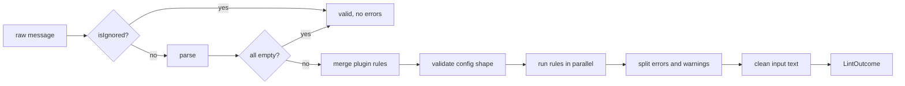

# conventional-changelog/commitlint — module: parser-and-lint

## Responsibility

This slice turns one raw commit message into a lint result. First it asks "should this message be skipped?" (merge commits, reverts, version bumps). Then it parses the text into header, body and footer. Then it runs each configured rule on the parsed commit and sorts the results into errors and warnings. A formatter prints the result. A commit message follows the Conventional Commits shape `type(scope)!: subject`, then a body, then footers such as `BREAKING CHANGE:`. The parser finds those parts. The rules judge them.

## Key files

| File | Role |
|------|------|
| `@commitlint/parse/src/index.ts` | Wraps the `conventional-commits-parser` library and merges options |
| `@commitlint/lint/src/lint.ts` | The lint engine: ignore check, parse, config validation, rule run, result |
| `@commitlint/is-ignored/src/is-ignored.ts` | Decides if a message skips linting |
| `@commitlint/is-ignored/src/defaults.ts` | The default list of ignored message patterns (read for context) |
| `@commitlint/types/src/rules.ts` | Shape of a rule, a severity, and the rule config tuple |
| `@commitlint/types/src/lint.ts` | Shape of lint options and lint outcome |
| `@commitlint/execute-rule/src/index.ts` | Resolves a rule config that may be a value, a promise or a function |
| `@commitlint/format/src/format.ts` | Turns a result into coloured text lines |
| `@commitlint/message/src/index.ts`, `@commitlint/to-lines/src/index.ts` | Tiny helpers: join non-empty parts, split on line breaks |

## How it works

1. `lint(message, rules, opts)` starts with the ignore check. It passes the message with trailing newlines removed, so patterns anchored at the start still match (`@commitlint/lint/src/lint.ts:24-28 @ d2be18a`).
2. `isIgnored` runs the default matchers plus any user matchers and returns true if any one matches. Setting `defaults: false` removes the built-in list (`@commitlint/is-ignored/src/is-ignored.ts:21-22 @ d2be18a`). The built-in list covers merges, reverts, reapply, `fixup!`/`squash!`/`amend!`, and semver-only messages (`@commitlint/is-ignored/src/defaults.ts:21-32 @ d2be18a`).
3. An empty string skips the parser. A parsed message whose header, body and footer are all null is treated as valid (`@commitlint/lint/src/lint.ts:38-51 @ d2be18a`).
4. `parse` loads the angular preset's parser options, adds `fieldPattern: null`, then spreads the user's options on top (`@commitlint/parse/src/index.ts:25-36 @ d2be18a`). The default parser builds a `CommitParser`, parses, and forces `scope`, `subject` and `type` to `null` when missing (`@commitlint/parse/src/index.ts:6-16 @ d2be18a`). The parse result keeps the original text in `raw` (`@commitlint/parse/src/index.ts:38 @ d2be18a`).
5. Rules start from the built-in map. Plugin rules are added to it by name, so a plugin can add or replace a rule (`@commitlint/lint/src/lint.ts:53-63 @ d2be18a`).
6. Every configured rule name must have a function behind it, or the call throws a `RangeError` that lists the supported rules (`@commitlint/lint/src/lint.ts:65-78 @ d2be18a`).
7. Each rule config must be an array `[level, when, value]`. Checks cover the level type, the length 2 or 3, the range 0 to 2, and `when` being `"always"` or `"never"`. All problems are joined into one error message (`@commitlint/lint/src/lint.ts:80-140 @ d2be18a`). The single-item `[0]` form is a shortcut for "off" (`@commitlint/lint/src/lint.ts:92-94 @ d2be18a`).
8. Rules with level 0 are dropped. The rest run with `Promise.all`, and each is called as `rule(parsed, when, value)` returning `[valid, message]` (`@commitlint/lint/src/lint.ts:143-165 @ d2be18a`).
9. Failed results with level 2 become `errors`; failed results with level 1 become `warnings`. `valid` is true when there are no errors, so warnings never fail a commit (`@commitlint/lint/src/lint.ts:167-178 @ d2be18a`).
10. The returned `input` is cleaned: if the parser has a `commentChar`, the text after the Git "scissors" line is cut and comment lines are removed. Then trailing whitespace is trimmed (`@commitlint/lint/src/lint.ts:180-191 @ d2be18a`).
11. `format` prints each problem as `sign message [rule-name]`, a summary line `found N problems, M warnings`, and an optional help URL. Colours use `picocolors`, and can be switched off (`@commitlint/format/src/format.ts:55-93 @ d2be18a`).

A rule is a plain function type: it gets the parsed commit, a condition and an optional value, and returns `[boolean, message?]` (`@commitlint/types/src/rules.ts:18-28 @ d2be18a`). The type `RuleOutcome` is `Readonly<[boolean, string?]>` (`@commitlint/types/src/rules.ts:10 @ d2be18a`). The rule config is data: a severity enum with 0, 1, 2 (`@commitlint/types/src/rules.ts:41-45 @ d2be18a`), then `"always"` or `"never"` (`@commitlint/types/src/rules.ts:52 @ d2be18a`).

## Beyond the textbook

### Rules as data, not code paths

- Textbook version: a linter is a list of `if` checks on the message.
- What they do: each rule is a named function. The config says only which rules are on, their severity, `always` or `never`, and an optional value. The engine looks up the function by name and calls it with the same three arguments.
- Why: the types show a single contract for all rules (`BaseRule`) and a typed map of rule names to config shapes (`RulesConfig`). Plugins can add names to it with an index signature.
- Evidence: `@commitlint/types/src/rules.ts:18-28 @ d2be18a`, `@commitlint/types/src/rules.ts:90-142 @ d2be18a`, `@commitlint/lint/src/lint.ts:53-63 @ d2be18a`.

### Default ignores for messages Git writes itself

- Textbook version: lint every message.
- What they do: skip merge commits, reverts, `fixup!` and `squash!`, tool-generated "Merged PR" text, and messages that are only a version number such as `v1.2.3` (also after a `chore:` prefix or `[skip ci]`).
- Why: tools write these messages, not people, and they would never match a type/scope format. Users can turn the list off or add their own matchers.
- Evidence: `@commitlint/is-ignored/src/defaults.ts:4-32 @ d2be18a`, `@commitlint/is-ignored/src/is-ignored.ts:21-22 @ d2be18a`.

### Fail loud on bad configuration, before any rule runs

- Textbook version: ignore unknown config keys, or crash with a vague error.
- What they do: validate rule names and the shape of every rule config up front, and report all shape problems together with the received value (`util.inspect`) in the text.
- Why: a typo in a rule name would otherwise mean "no rule runs, all commits pass".
- Evidence: `@commitlint/lint/src/lint.ts:65-78 @ d2be18a`, `@commitlint/lint/src/lint.ts:80-140 @ d2be18a`; tests `throws for invalid rule names` and `throws for rule with out of range level` (`@commitlint/lint/src/lint.test.ts:178 @ d2be18a`, `@commitlint/lint/src/lint.test.ts:223 @ d2be18a`).

### The parser can be swapped, and options merge in a defined order

- Textbook version: hard-code one regex for the header.
- What they do: the parser is a function argument. Options are layered: angular preset, then `fieldPattern: null`, then user options. Options may be passed flat or nested under a `parser` key.
- Why: the code comment says newer preset typings hide the shape, so both `.parser` and `.parserOpts` are read. Tests show that custom parsers receive the options and that array options are replaced, not merged.
- Evidence: `@commitlint/parse/src/index.ts:18-39 @ d2be18a`, `@commitlint/lint/src/lint.test.ts:496 @ d2be18a`, `@commitlint/parse/src/index.test.ts:115 @ d2be18a`.

### Handling what Git really sends: newlines, comments, scissors

- Textbook version: lint the string as given.
- What they do: trim only the end of the message for the ignore check; keep the message untouched for parsing, because some rules read blank lines from `raw`. In the returned `input`, drop comment lines and everything after the scissors line. CRLF endings stay.
- Why: the code comment explains it (leading whitespace matters to the matchers; `body-leading-blank` reads `parsed.raw`). The scissors line is what `git commit --verbose` writes before the diff.
- Evidence: `@commitlint/lint/src/lint.ts:24-28 @ d2be18a`, `@commitlint/lint/src/lint.ts:180-191 @ d2be18a`; tests `drops the scissors line and everything after it` and `keeps CRLF line endings with and without a commentChar` (`@commitlint/lint/src/lint.test.ts:389 @ d2be18a`, `@commitlint/lint/src/lint.test.ts:404 @ d2be18a`).

### Warnings versus errors, and an async-ready rule contract

- Textbook version: a check passes or fails.
- What they do: three severities. Level 1 reports but does not fail. Rules may be sync or async; the engine awaits all of them in parallel.
- Why: teams can introduce a rule as a warning first. The `RuleType` union allows `"async"`, `"sync"` or `"either"`.
- Evidence: `@commitlint/lint/src/lint.ts:143-178 @ d2be18a`, `@commitlint/types/src/rules.ts:16 @ d2be18a`, test `passes for async rule` (`@commitlint/lint/src/lint.test.ts:428 @ d2be18a`).

## Tests and what they protect

- The parser tests check: error on missing input, the output keys, the angular grammar, custom options, scopes with `/`, comment filtering, inline references, custom references, a permissive default header regex and Chinese scope names (`@commitlint/parse/src/index.test.ts:14 @ d2be18a`, `@commitlint/parse/src/index.test.ts:138 @ d2be18a`, `@commitlint/parse/src/index.test.ts:154 @ d2be18a`, `@commitlint/parse/src/index.test.ts:290 @ d2be18a`).
- One test checks that `noteKeywords` with regex symbols such as `[1]` are matched as plain text (`@commitlint/parse/src/index.test.ts:308-317 @ d2be18a`). Footers like `BREAKING CHANGE:` are "notes" in this parser, so this protects the footer path.
- The lint tests check: empty message is valid, an ignored message is valid even with a broken rule, and a semver message after a leading blank line is not ignored (`@commitlint/lint/src/lint.test.ts:12 @ d2be18a`, `@commitlint/lint/src/lint.test.ts:39 @ d2be18a`, `@commitlint/lint/src/lint.test.ts:105-110 @ d2be18a`).
- They also check config errors, issue-prefix rules, plugin rules, async rules and custom parsers (`@commitlint/lint/src/lint.test.ts:178-253 @ d2be18a`, `@commitlint/lint/src/lint.test.ts:301-340 @ d2be18a`, `@commitlint/lint/src/lint.test.ts:448-496 @ d2be18a`).
- Tests use Vitest's `vi.fn` to check that matchers get the trimmed message (`@commitlint/lint/src/lint.test.ts:112-124 @ d2be18a`).

## Error handling, performance, and security

- Bad input to `parse` throws `TypeError("Expected a raw commit")` for null or undefined (`@commitlint/parse/src/index.ts:7-9 @ d2be18a`).
- Bad `ignores` option throws: it must be an array of functions (`@commitlint/is-ignored/src/is-ignored.ts:7-19 @ d2be18a`).
- Unknown rule names throw `RangeError`; bad rule configs throw `Error` with all messages joined (`@commitlint/lint/src/lint.ts:70-78 @ d2be18a`, `@commitlint/lint/src/lint.ts:138-140 @ d2be18a`).
- A rule that returns invalid does not throw. It is only a result. Only a broken configuration throws.
- Performance: rules run concurrently with `Promise.all` (`@commitlint/lint/src/lint.ts:167 @ d2be18a`).
- Security: `ignores` and rule configs can be functions, so the config file is trusted code. `execute-rule` calls the config if it is a function (`@commitlint/execute-rule/src/index.ts:16-18 @ d2be18a`). Not otherwise present in this slice.

## Technologies and services seen

- conventional-commits-parser — the parser that splits header, body, footer, notes (`@commitlint/parse/src/index.ts:3 @ d2be18a`)
- conventional-changelog-angular — supplies the default parser options (`@commitlint/parse/src/index.ts:4 @ d2be18a`)
- semver — detects version-only commit messages (`@commitlint/is-ignored/src/defaults.ts:1 @ d2be18a`)
- picocolors — terminal colours in the formatter (`@commitlint/format/src/format.ts:1 @ d2be18a`)
- Vitest — test runner (`@commitlint/lint/src/lint.test.ts:112 @ d2be18a`, uses `vi.fn`)
- TypeScript — typed rule and options contracts (`@commitlint/types/src/rules.ts:1-144 @ d2be18a`)

## Worth exploring interactively

- Message to result — steps: ignore check (`@commitlint/lint/src/lint.ts:28 @ d2be18a`); parse (`@commitlint/lint/src/lint.ts:38-41 @ d2be18a`); config validation (`@commitlint/lint/src/lint.ts:65-140 @ d2be18a`); rules run in parallel (`@commitlint/lint/src/lint.ts:143-167 @ d2be18a`); split by level (`@commitlint/lint/src/lint.ts:171-178 @ d2be18a`); clean input (`@commitlint/lint/src/lint.ts:180-191 @ d2be18a`) — fits FlowAnimation because the learner types a message in and watches it travel through each stage, ending as errors or warnings.
- Rule config tuple — `[2, "always", value]` checked step by step (`@commitlint/lint/src/lint.ts:90-132 @ d2be18a`) — fits AlgorithmStepper because each check passes or fails in order.

## Open questions

- Which rule reads `notes` for `BREAKING CHANGE:` is in the rules slice, not this one.
- How the CLI chooses `format` options and the exit code is in the CLI slice.

## My insights
