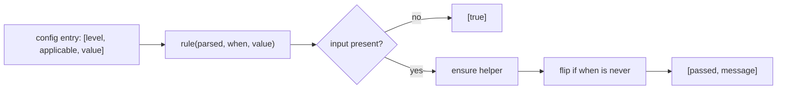

# conventional-changelog/commitlint — module: rules

## Responsibility

This slice holds the individual checks that decide if a commit message is good. Each check is one small function in its own file, such as `type-enum` or `header-max-length`. A second package, `ensure`, holds the tiny shared tests (is this value in a list, is this text too long, is this text lower case) that the rules reuse. I read all rule signatures through samples: `header-max-length`, `type-enum`, `subject-case`, `header-case`, `scope-enum`, `body-leading-blank`, `body-max-line-length`, `references-empty`, `header-trim`, `signed-off-by`, `trailer-exists`, plus all four `ensure` files and the `index.ts` registry. I did not read the other ~25 rule files; they follow the same shape.

## Key files

| File | Role |
|------|------|
| `@commitlint/rules/src/index.ts` | Registry: a plain object from rule name to function |
| `@commitlint/rules/src/type-enum.ts` | Typical "enum" rule: is the type in an allowed list |
| `@commitlint/rules/src/header-max-length.ts` | Typical "length" rule |
| `@commitlint/rules/src/subject-case.ts` | Most complex case rule (Unicode, several cases) |
| `@commitlint/rules/src/scope-enum.ts` | Enum rule with per-type scopes and delimiters |
| `@commitlint/rules/src/signed-off-by.ts` | Footer rule with git edge cases |
| `@commitlint/ensure/src/*.ts` | Pure helpers shared by rules |
| `@commitlint/rules/src/*.test.ts` | Five sample tests, written with vitest |

## How it works

A rule is a function that takes the parsed commit, a word `when` (`"always"` or `"never"`), and a `value`. It returns a pair: `[passed, message]`. The config entry `[level, applicable, value]` maps onto this: `applicable` becomes `when`, `value` becomes `value`. The `level` (off, warning, error) is not used by any rule file in this slice; it is applied by the lint engine, which is another slice.

1. The registry is one object. It maps names like `"type-enum"` to functions (`@commitlint/rules/src/index.ts:41-42 @ d2be18a`, `@commitlint/rules/src/index.ts:78 @ d2be18a`). All 40 rules are listed by hand, so adding a rule means adding an import and a line.
2. The simplest rule has three parameters and returns a pair. `headerMaxLength` ignores `when` (`_when`), defaults `value` to 0, and returns `[maxLength(parsed.header, value), "header must not be longer than ..."]` (`@commitlint/rules/src/header-max-length.ts:4-8 @ d2be18a`).
3. A rule with `always`/`never` flips the result. `typeEnum` defaults `when` to `"always"`, sets `negated = when === "never"`, and returns `negated ? !result : result` (`@commitlint/rules/src/type-enum.ts:5-18 @ d2be18a`).
4. Missing input counts as a pass. If there is no type, `typeEnum` returns `[true]` (`@commitlint/rules/src/type-enum.ts:8-10 @ d2be18a`); `headerTrim` and `bodyLeadingBlank` do the same (`@commitlint/rules/src/header-trim.ts:7 @ d2be18a`, `@commitlint/rules/src/body-leading-blank.ts:7-9 @ d2be18a`). Emptiness is the job of separate `*-empty` rules, so each rule checks one thing.
5. The message is built by `message([...])`, a helper that joins parts and ignores `null`; that is why rules write `negated ? "not" : null` (`@commitlint/rules/src/type-enum.ts:17 @ d2be18a`). Simple length rules build the string by hand (`@commitlint/rules/src/body-max-line-length.ts:11 @ d2be18a`).
6. Low-level checks live in `ensure`. `maxLength` is one line: a string whose length is at most `max` (`@commitlint/ensure/src/max-length.ts:1-2 @ d2be18a`). `ensure.enum` returns false for `undefined` or a non-array list, then uses `indexOf` (`@commitlint/ensure/src/enum.ts:1-8 @ d2be18a`). `ensure/src/index.ts` re-exports them, renaming the default exports `case` and `enum` (`@commitlint/ensure/src/index.ts:9-11 @ d2be18a`).

## Beyond the textbook

### Rules are data-driven functions with a uniform contract

- Textbook version: one big `if` chain that checks a commit message and throws on the first problem.
- What they do: about 40 separate functions share one signature and one return shape, collected in an object. A user turns each on or off by name in config, with a value.
- Why: every rule can be tested alone, and users choose which to run. The same function serves both `always` and `never` through a negation flag.
- Evidence: `@commitlint/rules/src/index.ts:41-81 @ d2be18a`, `@commitlint/rules/src/type-enum.ts:5-18 @ d2be18a`

### Quoted text is ignored when checking case

- Textbook version: compare the whole string with its lower-case form.
- What they do: `ensureCase` first deletes anything inside backticks, double quotes or single quotes, because the code comment says it can contain proper names such as `Eslint`. Text that becomes empty or starts with a digit always passes.
- Why: a rule "subject must be lower case" should not reject `fix: update Eslint config` when the name is quoted.
- Evidence: `@commitlint/ensure/src/case.ts:8-18 @ d2be18a`

### Case rules accept non-Latin alphabets and mixed checks

- Textbook version: test `/^[a-z]/`.
- What they do: `subjectCase` uses the Unicode cased-letter classes so that other alphabets are checked, and skips subjects that do not start with a cased letter. Its comment explains why `Other_Letter` and `Modifier_Letter` are left out (they have no case). `value` can be one case or a list, and each list entry can carry its own `when`. `headerCase` is the simpler version that only matches `a-z`.
- Why: a case rule must not fail on text where case has no meaning.
- Evidence: `@commitlint/rules/src/subject-case.ts:5-21 @ d2be18a`, `@commitlint/rules/src/subject-case.ts:32-44 @ d2be18a`, `@commitlint/rules/src/header-case.ts:14 @ d2be18a`

### Error messages are chosen to help

- Textbook version: print "subject case is wrong".
- What they do: for a `never` rule that failed, the message lists only the cases that matched; for `always` it lists every allowed case.
- Why: from the comment, a `never` rule fails because a case matched, so naming the matches tells the user what to change.
- Evidence: `@commitlint/rules/src/subject-case.ts:53-57 @ d2be18a`

### Line-length rules let URLs through

- Textbook version: every line must be at most N characters.
- What they do: `maxLineLength` skips any line that contains an http(s) URL. A comment calls the regex "overly lenient" on purpose, to avoid costly patterns.
- Why: a long link in a commit body cannot be wrapped.
- Evidence: `@commitlint/ensure/src/max-line-length.ts:3-11 @ d2be18a`

### Footer rules copy git's own behaviour

- Textbook version: search the message for the text `Signed-off-by`.
- What they do: `signedOffBy` skips comment lines and cherry-pick lines, treats whitespace-only lines as blank (as git does), drops trailing blank lines, then looks only at the last paragraph, so other trailers may follow. `trailerExists` runs `git interpret-trailers --parse` itself.
- Why: the comments in the code say these match git's counting rules.
- Evidence: `@commitlint/rules/src/signed-off-by.ts:5-28 @ d2be18a`, `@commitlint/rules/src/trailer-exists.ts:7-9 @ d2be18a`

### Config can narrow scopes per commit type

- Textbook version: one list of allowed scopes.
- What they do: `scope-enum` accepts a list, or an object with `scopes`, `delimiters` and `scopesByType`. A list given for the commit type replaces the general list. Multiple scopes in one header (such as `a/b` or `a, b`) are split by delimiters and each must be allowed.
- Why: code comment: "A list given for the commit type replaces the general one for that type."
- Evidence: `@commitlint/rules/src/scope-enum.ts:5-33 @ d2be18a`, `@commitlint/rules/src/scope-enum.ts:42-47 @ d2be18a`

## Tests and what they protect

Tests sit next to the rules and use vitest. Each test parses a short message with `@commitlint/parse`, calls the rule directly with `(parsed, when, value)`, and compares the first item of the result with `true` or `false` (`@commitlint/rules/src/header-max-length.test.ts:1-30 @ d2be18a`). The team did not test through the CLI here; the contract `[passed, message]` is enough.

- `header-max-length` tests the boundary: a header of exactly the limit passes, one character more fails (`@commitlint/rules/src/header-max-length.test.ts:5-8 @ d2be18a`).
- `type-enum` tests every combination of empty or present type with default, `always` and `never` (`@commitlint/rules/src/type-enum.test.ts:17-60 @ d2be18a`). The empty-type tests protect the "no input passes" rule.
- `subject-case` has dozens of named tests: empty, lower, upper, mixed, camel, kebab, pascal, caseless and Unicode subjects, each with `always` and `never` (`@commitlint/rules/src/subject-case.test.ts:55-217 @ d2be18a`).
- `body-leading-blank` tests messages with and without a blank line, for the default, `never` and `always` (`@commitlint/rules/src/body-leading-blank.test.ts:5-30 @ d2be18a`).

These five files hold about 517 `test(` lines (my count with `grep -c`-style search; I did not run them). I did not read `references-empty.test.ts`.

## Error handling, performance, and security

- Bad or missing values are handled by defaults and early returns: `value = []`, `value = 0`, `when = "always"` (`@commitlint/rules/src/type-enum.ts:5 @ d2be18a`); `ensure.enum` returns false when the list is not an array (`@commitlint/ensure/src/enum.ts:5-7 @ d2be18a`).
- `references-empty` is the one rule whose default `when` is `"never"` (`@commitlint/rules/src/references-empty.ts:4 @ d2be18a`).
- Security note: `trailerExists` starts a `git` child process with the commit text as input on stdin, not as arguments (`@commitlint/rules/src/trailer-exists.ts:7-9 @ d2be18a`). This keeps the message out of the command line. It also means this rule needs git installed.
- Performance: the rules are plain string and array work; the URL regex is kept simple on purpose (`@commitlint/ensure/src/max-line-length.ts:3-7 @ d2be18a`).

## Technologies and services seen

- vitest — test runner and `test`/`expect` (`@commitlint/rules/src/header-max-length.test.ts:1 @ d2be18a`)
- TypeScript — rule types such as `SyncRule<number>` from `@commitlint/types` (`@commitlint/rules/src/header-max-length.ts:2,4 @ d2be18a`)
- git (`interpret-trailers`) — parses trailers through a child process (`@commitlint/rules/src/trailer-exists.ts:1-9 @ d2be18a`)
- Node.js `node:child_process` — runs git (`@commitlint/rules/src/trailer-exists.ts:1 @ d2be18a`)
- Sibling packages `@commitlint/message`, `@commitlint/to-lines`, `@commitlint/parse` — message builder, line splitter, parser for tests (`@commitlint/rules/src/body-leading-blank.ts:1-2 @ d2be18a`, `@commitlint/rules/src/header-max-length.test.ts:2 @ d2be18a`)

## Worth exploring interactively

- One rule call, end to end — steps: parsed message goes in (`@commitlint/rules/src/type-enum.ts:5-6 @ d2be18a`); empty type returns pass (`@commitlint/rules/src/type-enum.ts:8-10 @ d2be18a`); `ensure.enum` checks the list (`@commitlint/rules/src/type-enum.ts:13 @ d2be18a`); `never` flips the result (`@commitlint/rules/src/type-enum.ts:12,16 @ d2be18a`); message is built (`@commitlint/rules/src/type-enum.ts:17 @ d2be18a`) — fits FlowAnimation because the learner types a commit and a `when` value and sees the pair `[passed, message]` change.
- Subject case decision — steps: skip if not a cased letter (`@commitlint/rules/src/subject-case.ts:32 @ d2be18a`); normalise value to a list (`@commitlint/rules/src/subject-case.ts:36-44 @ d2be18a`); strip quotes and compare (`@commitlint/ensure/src/case.ts:10-20 @ d2be18a`); count matches (`@commitlint/rules/src/subject-case.ts:46-51 @ d2be18a`); choose message and flip for `never` (`@commitlint/rules/src/subject-case.ts:56-62 @ d2be18a`) — fits AlgorithmStepper because the learner steps through which cases match.

## Open questions

- Where the `level` (0, 1, 2) is applied, and how a rule's `[passed, message]` becomes an error or warning, is in the lint engine slice, not here.
- Whether `message` (the helper) trims or joins with spaces: I saw only its calls, not its source.
- The unread rule files (body-case, scope-delimiter-style, footer rules and others) may add variations I did not see.

## My insights
