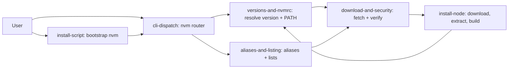
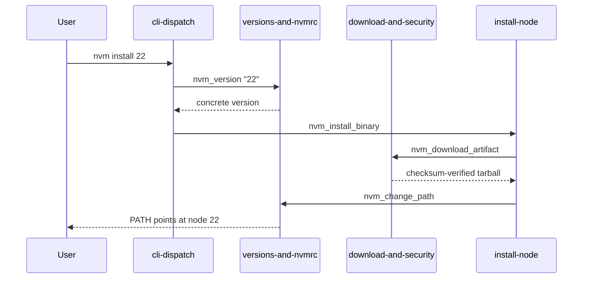

# nvm-sh/nvm — architecture

nvm is one ~7,000-line POSIX shell script plus a small installer and a wrapper. The deep
dive reads it as eight modules, each a slice of the file with one job.

## Module map

| Module | Responsibility | Note |
|--------|----------------|------|
| install-script | Bootstraps nvm onto the machine: downloads it, edits the shell profile | [[nvm-module-install-script|install-script]] |
| cli-dispatch | The front door: every command enters the `nvm()` router | [[nvm-module-cli-dispatch|cli-dispatch]] |
| versions-and-nvmrc | Turns a loose request into a concrete version and a rewritten PATH | [[nvm-module-versions-and-nvmrc|versions-and-nvmrc]] |
| aliases-and-listing | Alias files, alias resolution, `nvm ls` and `nvm ls-remote` | [[nvm-module-aliases-and-listing|aliases-and-listing]] |
| download-and-security | The download and trust boundary: fetch, redirects, checksums, locks | [[nvm-module-download-and-security|download-and-security]] |
| install-node | The install path: detect OS, download or build, extract atomically | [[nvm-module-install-node|install-node]] |
| tests-resolution-and-download | Tests that attack resolution and download security | [[nvm-module-tests-resolution-and-download|tests]] |
| build-and-infra | CI matrix, release machinery, dev container, threat model | [[nvm-module-build-and-infra|build-and-infra]] |

## The picture

The picture shows the two entry points. A new machine runs `install-script`, which after
downloading nvm sources `nvm.sh` and hands off (`install.sh:558-572 @ ad42d90`). From then on
every command enters the `nvm()` router, which dispatches on the command name
(`nvm.sh:5128-5143 @ ad42d90`). Version resolution and alias listing both need the remote
index, which they fetch through `download-and-security` (`nvm.sh:2947 @ ad42d90`,
`nvm.sh:1499-1502 @ ad42d90`). The install path reuses that downloader and checksum gate, then
writes the result back through the PATH rewrite in `versions-and-nvmrc`
(`nvm.sh:6216-6228 @ ad42d90`). [[visual-nvm-module-map-workstation-and-editor|explanation and sources]]

## Main flow

The main flow, `nvm install 22`, moves through five modules.

1. The `nvm()` router captures the command and dispatches on the first argument
   (`nvm.sh:5128-5143 @ ad42d90`).
2. `nvm_version` turns the shorthand `22` into the best matching installed or remote version
   (`nvm.sh:1379-1490 @ ad42d90`).
3. `nvm_install_binary` takes the concrete version and asks `nvm_download_artifact` for a
   tarball (`nvm.sh:3870-3924 @ ad42d90`).
4. The artifact is downloaded to a private `.unverified` directory and checksum-verified
   before it is moved into the cache (`nvm.sh:4060-4160 @ ad42d90`, `nvm.sh:3110-3141 @ ad42d90`).
5. The verified tarball is extracted and atomically renamed into the version directory
   (`nvm.sh:3847-3864 @ ad42d90`).
6. `nvm use` then rewrites PATH and MANPATH so the new node wins
   (`nvm.sh:6216-6228 @ ad42d90`).

[[visual-nvm-request-flow-workstation-and-editor|explanation and sources]]

## Worth exploring interactively

- **Version resolution** — a `.nvmrc` value or `22` from `nvm_find_up`
  (`nvm.sh:990-1001 @ ad42d90`) through parsing, validation, and `nvm_version` to the PATH
  rewrite (`nvm.sh:1767-1798 @ ad42d90`). Fits `FlowAnimation`: watch a version string turn
  into a directory path.
- **The download → verify → publish gate** — step through `nvm_download_artifact`
  (`nvm.sh:4126-4132 @ ad42d90`, `nvm.sh:4148-4157 @ ad42d90`). Fits `StateMachine`: an
  artifact is either unverified, verified, or deleted, never half-trusted.
- **`nvm_auto` shell-startup lifecycle** — the `none`/`use`/`install` decision tree with its
  no-fetch LTS guard (`nvm.sh:7216-7228 @ ad42d90`). Fits `StateMachine`: the startup mode is
  a small state machine.

## Design decisions worth noticing

- **One script, many responsibilities.** Instead of many files, nvm keeps everything in
  `nvm.sh` and slices it only by line range. The trade-off is a giant file that is easy to
  install but hard to navigate; see [[nvm-findings|findings]]. `decision candidate`.
- **Portable shell over a real language.** nvm chooses POSIX shell so it runs with zero
  install step on any Unix box, at the cost of hand-rolling version comparison and a
  hard-coded teardown list; see [[nvm-pattern-shell-portability|portable shell]].
- **Trust boundary at the downloader.** All untrusted strings stop at `nvm_download` and the
  checksum gate, so the rest of the code can assume clean inputs; see
  [[nvm-pattern-untrusted-input|untrusted input]] and [[nvm-pattern-atomic-publish|atomic publish]].

## For the lesson stage

`animation candidate`: the `nvm install 22` flow as hops
`cli-dispatch → versions-and-nvmrc` (resolve, `nvm.sh:1379-1490 @ ad42d90`) →
`install-node` (`nvm.sh:3870-3924 @ ad42d90`) → `download-and-security`
(`nvm.sh:4060-4160 @ ad42d90`) → back to `versions-and-nvmrc` (PATH rewrite,
`nvm.sh:6216-6228 @ ad42d90`).

`decision candidate`: binary install vs source build — `nvm_install_binary` falls back to
`nvm_install_source` only when the binary fails and `--no-source` is absent
(`nvm.sh:3934-3944 @ ad42d90`); curl vs wget — `nvm_download` picks whichever real binary
exists and translates flags per downloader (`nvm.sh:187-222 @ ad42d90`).

## Not analyzed

- `README.md` (~1,400 lines) and the governance/docs files — read only for the overview.
- `test/fast/Unit tests/mocks/*.tab` and the large recorded fixtures — data, not behaviour.
- `test/slow/*`, `test/installation_node/*`, `test/installation_iojs/*`, `test/xenial/*` —
  network- and machine-heavy integration suites.
- `.github/workflows/windows-nvm.yml` — the separate Windows port, not the POSIX code.

## My insights
