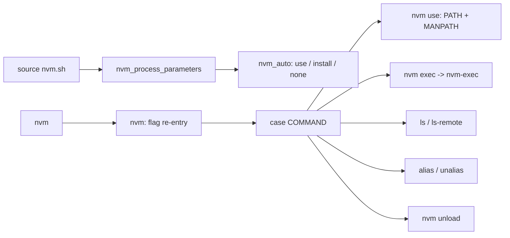

# nvm-sh/nvm — module: cli-dispatch

## Responsibility

This slice is the front door of nvm: every user command (`nvm install`, `nvm use`,
`nvm ls`, `nvm alias`, …) enters through the single `nvm()` function, which parses the
command and its flags and delegates to the internal `nvm_*` helpers. It also holds the
`nvm_auto`/`nvm_process_parameters` hook that runs the moment `nvm.sh` is sourced, and the
tiny `nvm-exec` wrapper that runs one command under a specific Node version. All of this
lives in `nvm.sh:4944-7317 @ ad42d90` plus the 24-line `nvm-exec`.

## Key files

| File | Role |
|------|------|
| `nvm.sh:4944-7118` | The `nvm()` command router: flag parsing and dispatch for every command |
| `nvm.sh:7120-7156` | `nvm_get_default_packages` / `nvm_install_default_packages` |
| `nvm.sh:7158-7210` | `nvm_supports_xz` — which platforms/versions can extract xz tarballs |
| `nvm.sh:7212-7300` | `nvm_auto` — the auto-use / auto-install behaviour on shell startup |
| `nvm.sh:7302-7317` | `nvm_process_parameters` and the script's final self-invocation |
| `nvm-exec` | Runs a command after selecting the `NODE_VERSION` (or `.nvmrc`) version |

## How it works

The main path, from a typed command to a result:

1. `nvm()` runs with no arguments → print help (`nvm.sh:4945-4948 @ ad42d90`).
2. If the caller's shell has `set -e`, `set -a`, `set -E`, or a non-default `IFS` active,
   nvm temporarily clears the flag and re-invokes itself (`nvm.sh:4953-4987 @ ad42d90`).
3. `-h`/`help`/`--help` are handled by a dedicated loop before dispatch (`nvm.sh:4994-5124 @ ad42d90`).
4. The first positional argument becomes `COMMAND` and is shifted off, then a giant
   `case $COMMAND in` dispatches (`nvm.sh:5128-5143 @ ad42d90`).
5. Each command's branch runs its own `while` loop to consume flags (`--lts`, `--only`,
   `--min`, `--silent`), then calls the matching `nvm_*` helper. `use` rewrites `PATH` and
   `MANPATH` (`nvm.sh:6216-6228 @ ad42d90`); `exec` delegates to `nvm-exec`
   (`nvm.sh:6480 @ ad42d90`); an unknown command prints help to stderr and returns 127
   (`nvm.sh:7113-7116 @ ad42d90`).
6. When the file is sourced, the last line `nvm_process_parameters "$@"` runs the auto hook
   (`nvm.sh:7315 @ ad42d90`), which selects or installs the default version.



The dispatch is one function with many case arms, not a command table: each arm duplicates
a small `while` loop that strips its own flags, so every command has a slightly different
option surface (`nvm.sh:6095-6130 @ ad42d90` for `use`, `nvm.sh:6391-6415 @ ad42d90` for
`exec`).

## Beyond the textbook

### Re-running itself with the caller's shell options neutralized

- Textbook version: a shell function just assumes the caller left default options (`set -e`
  off, default `IFS`, no `set -a`).
- What they do: the first thing `nvm()` does is test for `set -e`, `set -a`, `set -E`, and
  a non-default `IFS`, and for each one it clears the flag, re-invokes `nvm "$@"`, then
  restores it and returns the captured exit code.
- Why: nvm's own error handling relies on `set -e` being off and on word splitting, so it
  must behave identically no matter how the user configured their `.bashrc`.
- Evidence: `nvm.sh:4953-4987 @ ad42d90`

```bash
if [ "${-#*e}" != "$-" ]; then
  set +e
  local EXIT_CODE
  local IFS
  IFS="${DEFAULT_IFS}"
  nvm "$@"
  EXIT_CODE="$?"
  set -e
  return "$EXIT_CODE"
```

### The whole script is wrapped in a block so a truncated download never runs

- Textbook version: a shell script is a flat list of commands; `curl … | bash` runs each
  line as it arrives.
- What they do: `nvm.sh` opens a `{` on line 11 and closes it on line 7317, with the comment
  "this ensures the entire script is downloaded" on both lines.
- Why: if a pipe download is cut off mid-stream, the shell has a block with no closing `}`,
  so it fails to parse instead of executing half of nvm.
- Evidence: `nvm.sh:11 @ ad42d90`, `nvm.sh:7317 @ ad42d90`

### Aliases store their own selection flags inline

- Textbook version: an alias is a name that maps to a single version string.
- What they do: an alias file can hold `--lts=<name> <version>`. `nvm alias` writes the
  resolved flags in front of the target, and `nvm_auto`'s `install` mode splits those flags
  back out into positional arguments before calling `nvm install`.
- Why: a default alias like `default --lts=fermium 14` re-applies the LTS filter every time
  it is used, instead of freezing a single resolved version.
- Evidence: `nvm.sh:6787-6789 @ ad42d90` (write), `nvm.sh:7277-7288 @ ad42d90` (split back)

### Auto-use refuses to hit the network during shell startup

- Textbook version: to honour a `default` alias, resolve it — fetching remote version data
  if needed.
- What they do: `nvm_auto`'s `use` mode sets `NVM_INDEX_NO_FETCH=1` ("don't download anything
  while a shell starts up"), and if the recorded LTS status is missing it errors out and
  tells the user to run `nvm ls-remote` themselves.
- Why: a slow or failing network call at shell startup makes every new terminal hang or
  spam errors.
- Evidence: `nvm.sh:7219-7228 @ ad42d90`, `nvm.sh:7259-7263 @ ad42d90`

```bash
# don't download anything while a shell starts up
local NVM_INDEX_NO_FETCH
NVM_INDEX_NO_FETCH=1
```

### A distinct exit-code contract per failure class

- Textbook version: any error exits with a generic `1`.
- What they do: each failure class has a fixed code — 127 for "no version / unknown
  command", 55 for a bad or unsupported option, 6 for contradictory flags, 8 for an
  infinite alias loop, 3 for "not installed / N/A", 11 for a misconfigured npm prefix.
- Why: `nvm-exec` and the shell-startup hook need to tell "wrong usage" apart from "version
  not installed" so they can react differently.
- Evidence: `nvm.sh:7113-7116 @ ad42d90` (127), `nvm.sh:6403-6406 @ ad42d90` (55),
  `nvm.sh:5313-5316 @ ad42d90` (6), `nvm.sh:6197-6202 @ ad42d90` (8), `nvm.sh:6203-6207 @ ad42d90` (3)

### A complete, hand-enumerated teardown

- Textbook version: a shell library has no concept of unloading itself.
- What they do: `nvm unload` runs `unset -f` against an explicit list of ~150 `nvm_*`
  function names, then `unset`s the environment variables nvm sets.
- Why: portable shell has no way to enumerate function definitions, so the list is
  hard-coded to guarantee nothing leaks into the user's shell.
- Evidence: `nvm.sh:7044-7101 @ ad42d90`

## Tests and what they protect

Not present in this slice: the file list is only `nvm.sh` (its command-dispatch range) and
`nvm-exec`. The behaviours these commands protect — `.nvmrc` parsing, alias resolution,
download security, the `nvm use`/`nvm install` contract — are exercised by the unit and
command tests under `test/fast/`, which are covered by the `tests-resolution-and-download`
module.

## Error handling, performance, and security

- **Error handling.** `nvm use` detects an infinite alias loop via the `∞` sentinel and
  aborts with exit 8 (`nvm.sh:6197-6202 @ ad42d90`). It also refuses to switch versions when
  npm's global prefix points inside `NVM_DIR` (which `npm install -g` would clobber), and
  offers `--delete-prefix` to fix it (`nvm.sh:6244-6256 @ ad42d90`). Contradictory flags are
  rejected early: `-s`/`-b` together (`nvm.sh:5310-5325 @ ad42d90`), duplicate `--save`/`-w`
  (`nvm.sh:6115-6121 @ ad42d90`), and the `---` typo guard (`nvm.sh:5306-5309 @ ad42d90`).
- **Correctness over PATH alone.** `nvm use` also rewrites `MANPATH` so `man node` finds the
  active version's man pages, and appends a trailing colon so `man` still searches its
  default path (`nvm.sh:6216-6227 @ ad42d90`).
- **Security.** Alias names are validated: no `#` comment delimiter, no subdirectory names,
  LTS names must be lowercase, and built-in aliases (`stable`, `unstable`, `node`, `iojs`,
  `system`) cannot be deleted (`nvm.sh:6777-6785 @ ad42d90`, `nvm.sh:6740-6745 @ ad42d90`,
  `nvm.sh:6831-6837 @ ad42d90`).
- **Performance.** `nvm ls-remote --min` reports how many versions it hid on stderr, so the
  version list on stdout stays machine-parseable (`nvm.sh:6608-6618 @ ad42d90`).

## Technologies and services seen

- **POSIX shell (bash/dash/ksh/zsh)** — the entire router is portable shell; the header
  states the target shells (`nvm.sh:2-3 @ ad42d90`).
- **awk** — parses the `default-packages` file, stripping CRLF, comments and blank lines and
  rejecting multi-package lines (`nvm.sh:7124-7138 @ ad42d90`); counts hidden versions
  (`nvm.sh:6605 @ ad42d90`).
- **xargs** — feeds the package list into `npm install -g` (`nvm.sh:7152 @ ad42d90`).
- **npm** — invoked for default packages and `reinstall-packages`, including `npm link` for
  linked global packages (`nvm.sh:6923 @ ad42d90`, `nvm.sh:6937-6938 @ ad42d90`).
- **sw_vers** — detects the macOS version to decide xz support (`nvm.sh:7167 @ ad42d90`).
- **xz** — checked on the PATH to decide whether xz tarballs can be extracted
  (`nvm.sh:7178-7182 @ ad42d90`).
- **node / io.js** — probed directly for the `system` version message (`nvm.sh:6185 @ ad42d90`,
  `nvm.sh:6190 @ ad42d90`).

No external network services appear in this slice; the download machinery (curl/wget, the
nodejs.org index, mirrors, checksums) lives in the `download-and-security` and `install-node`
modules.

## Worth exploring interactively

- **`nvm use 18` from keystroke to a rewritten PATH** — fits `FlowAnimation` because the
  learner watches one command move through re-entry, dispatch, flag parsing, version
  resolution and the final `PATH`/`MANPATH` mutation. Ordered steps: flag re-entry
  (`nvm.sh:4944-4987 @ ad42d90`) → `COMMAND="${1-}"` + `case` dispatch
  (`nvm.sh:5128-5143 @ ad42d90`) → the `use` flag loop (`nvm.sh:6095-6130 @ ad42d90`) →
  `.nvmrc`/version resolution (`nvm.sh:6142-6160 @ ad42d90`) → `nvm_change_path` and export
  (`nvm.sh:6217-6228 @ ad42d90`).
- **The shell-startup lifecycle in `nvm_auto`** — fits `StateMachine` because the function is
  a small state machine over `none`/`use`/`install` modes, and the `use` branch walks a
  decision tree (default alias → `.nvmrc` → current version). Steps: mode dispatch
  (`nvm.sh:7216-7217 @ ad42d90`) → the no-fetch LTS guard (`nvm.sh:7225-7228 @ ad42d90`) →
  default-alias resolution with inline flags (`nvm.sh:7232-7265 @ ad42d90`) → fallback to
  `.nvmrc` (`nvm.sh:7266-7268 @ ad42d90`).

## Open questions

- How a loose request like `18` becomes a concrete installed version (`nvm_version`,
  `nvm_match_version`, `nvm_resolve_alias`) lives in the `versions-and-nvmrc` and
  `aliases-and-listing` modules, not here.
- The body of `nvm_die_on_prefix` (how it detects the bad npm prefix) is at
  `nvm.sh:4504 @ ad42d90`, outside this slice's range.

## My insights
