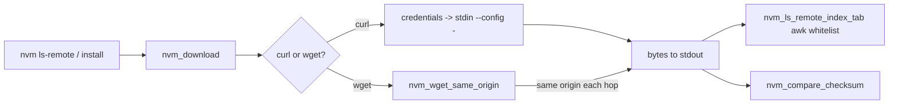

# nvm-sh/nvm — module: download-and-security

## Responsibility

This slice is the download and trust boundary of nvm. It owns every fetch the tool makes
(version indexes, tarballs, checksum files) and every place where untrusted input — a mirror
URL, a version string, a `.nvmrc` path — is turned into a shell action. Its two jobs are to
download correctly with whatever of `curl` or `wget` is present, and to stop credentials and
mirror-supplied strings from becoming an attack (command injection, credential leakage across
redirects, or a symlink-following file write). It also holds the per-version install lock and
the checksum gate that a downloaded artifact must pass before it is trusted.

## Key files

| File | Role |
|------|------|
| `nvm.sh:1-460` | Portable output helpers (`nvm_echo`, `nvm_err`) and the entire download/auth layer (`nvm_download`, `nvm_wget_same_origin`, `nvm_sanitize_auth_header`) |
| `nvm.sh:2882-3210` | Remote index parsing and sanitising (`nvm_ls_remote_index_tab`), checksum selection and comparison |
| `nvm.sh:4689-4944` | Sanitising for display, `.nvmrc` atomic write, file-permission checks, cache listing, and the install lock |

## How it works

1. A command that needs remote data (an index or a tarball) calls `nvm_download` with a URL.
   It never builds a shell string from the URL; every argument is forwarded as a literal
   `argv` element (`nvm.sh:158-160 @ ad42d90`).
2. `nvm_download` picks a downloader with `nvm_has_executable`, which un-aliases and un-functions
   the name first so only a real binary on `PATH` counts (`nvm.sh:77-85 @ ad42d90`,
   `nvm.sh:187 @ ad42d90`, `nvm.sh:195 @ ad42d90`). For curl it adds `--fail`, optional
   `--compressed`, and `-q` as the *first* argument so a user's `.curlrc` is skipped
   (`nvm.sh:189-194 @ ad42d90`).
3. If `NVM_AUTH_HEADER` is set, each URL is checked against `nvm_auth_header_applies_to` so the
   credential is only attached to a mirror's own URLs, never to a third-party host
   (`nvm.sh:171 @ ad42d90`, `nvm.sh:425-448 @ ad42d90`), and the header is reduced to a safe
   character set by `nvm_sanitize_auth_header` (`nvm.sh:181 @ ad42d90`, `nvm.sh:450-460 @ ad42d90`).
4. Credentials and credential-bearing URLs are moved off the command line: curl reads them from a
   config piped on stdin (`--config -`), wget from a private temporary `wgetrc`
   (`nvm.sh:228-254 @ ad42d90`, `nvm.sh:336-358 @ ad42d90`).
5. Because GNU wget (unlike curl ≥ 7.58) forwards a custom `Authorization` header to every
   redirect target, `nvm_wget_same_origin` follows redirects one hop at a time with
   `--max-redirect=0` and refuses to continue to a different origin
   (`nvm.sh:361-365 @ ad42d90`, `nvm.sh:398-401 @ ad42d90`).

The remote index path shows the same distrust applied to data: `nvm_ls_remote_index_tab`
downloads `index.tab` with `nvm_download -L -s … -o -` (`nvm.sh:2947 @ ad42d90`), then filters
every row through an `awk` whitelist that drops malformed version numbers and LTS codenames
before they are printed, stored as aliases, or matched against a pattern
(`nvm.sh:2952-2956 @ ad42d90`). A downloaded artifact is then only accepted after
`nvm_compare_checksum` computes a local digest and compares it to the mirror's expected value
(`nvm.sh:3110-3141 @ ad42d90`).

## Beyond the textbook

### Pass untrusted URLs as literal argv, not shell text

- Textbook version: build the request with string interpolation — `curl "$MIRROR/$version.tar"` —
  or worse, `eval`; a mirror-supplied `version` containing `;` or `` ` `` is re-parsed by the shell.
- What they do: `nvm_download` documents and enforces that "every argument is passed through as a
  literal argv element so that untrusted, mirror-supplied version strings in the URLs are never
  re-parsed by the shell" (`nvm.sh:158-160 @ ad42d90`). The URL is a positional argument handed
  straight to `command curl` / `command wget`, never interpolated into a command string
  (`nvm.sh:252 @ ad42d90`, `nvm.sh:277 @ ad42d90`).
- Why: a version manager's whole job is to fetch URLs it did not write, from mirrors it does not
  control; the comment names the exact attack this prevents — "command substitution / OS command
  injection".
- Evidence: `nvm.sh:158-160 @ ad42d90`

### Secrets go to the downloader on stdin, never in argv

- Textbook version: put the token in the URL or a `-H "Authorization: …"` argument; fine until you
  realise every local user can read a process's command line.
- What they do: for curl, credentials and credential-bearing URLs are collected into a config
  string piped to `command curl "$@" --config -` (`nvm.sh:234 @ ad42d90`, `nvm.sh:248-250 @ ad42d90`).
  For GNU wget, the header is written to a `mktemp`-created private `wgetrc` that is removed by a
  `trap` on exit (`nvm.sh:338-342 @ ad42d90`, `nvm.sh:351-355 @ ad42d90`).
- Why: the comment states it directly — "every local user can read a process's arguments (`ps`,
  `/proc/<pid>/cmdline`)" (`nvm.sh:228-229 @ ad42d90`).
- Evidence: `nvm.sh:228-254 @ ad42d90`

### Stop cross-origin redirects from leaking the auth header (wget)

- Textbook version: `wget -L "$url"`; wget happily re-sends the `Authorization` header to any host
  a redirect points at.
- What they do: `nvm_wget_same_origin` runs wget with `--max-redirect=0`, reads the `Location:`
  header, normalises it against the current origin, and returns an error rather than follow a
  hop that changes scheme, host, or port (`nvm.sh:382-401 @ ad42d90`). It also caps the chain at
  20 redirects (`nvm.sh:403-406 @ ad42d90`).
- Why: the header comment explains that curl ≥ 7.58 already refuses to forward a custom header to
  another host, but "wget sends its headers along to every one", so the same guarantee has to be
  built by hand for wget (`nvm.sh:361-365 @ ad42d90`).
- Evidence: `nvm.sh:361-365 @ ad42d90`, `nvm.sh:398-401 @ ad42d90`

### Treat the mirror's version index as hostile input

- Textbook version: `curl index.tab` and print it; a crafted line with a weird codename or version
  flows straight into alias files and grep patterns.
- What they do: the downloaded `index.tab` is piped through `awk` that keeps only rows whose
  version matches `^v[0-9]+\.[0-9]+\.[0-9]+…` and whose LTS codename is empty or a safe token,
  *before* any row is printed, stored as an LTS alias, or matched against a pattern
  (`nvm.sh:2952-2956 @ ad42d90`). The LTS-alias writer re-validates the codename with its own
  allowlist (`nvm.sh:2960-2964 @ ad42d90`).
- Why: the comment says the mirror's index "is untrusted", so it is constrained to the exact shape
  the rest of the code can safely consume.
- Evidence: `nvm.sh:2952-2956 @ ad42d90`

### Checksum verification is a hard gate, and its error output is sanitised

- Textbook version: download and unpack, optionally print the hash; a corrupted or missing checksum
  still proceeds.
- What they do: `nvm_compare_checksum` returns an error and prints "Refusing to continue *without
  checksum verification*" when the computed sum is empty (`nvm.sh:3131-3134 @ ad42d90`), and on a
  mismatch it shows the *expected* value only after reducing it to printable ASCII, because that
  value "comes from the mirror" and could contain terminal-control bytes
  (`nvm.sh:3135-3138 @ ad42d90`).
- Why: the expected checksum is attacker-influenced data, so it is both enforced and made safe to
  display; the "missing in raspberry pi binary" note shows a real platform where the sum is absent.
- Evidence: `nvm.sh:3131-3138 @ ad42d90`

### Atomic, symlink-safe writes and an advisory install lock

- Textbook version: `echo "$v" > .nvmrc` and unpack into the version dir; a symlink swapped in
  between check and write follows to an arbitrary file, and two concurrent installs of the same
  version race on the directory.
- What they do: `nvm_write_nvmrc` refuses a symlinked `.nvmrc`, writes the version to a temp file,
  then `mv -f`s it into place so a symlink is *replaced*, not followed (`nvm.sh:4740-4754 @ ad42d90`).
  `nvm_acquire_install_lock` takes a per-version lock by atomically `mkdir`-ing a directory,
  waiting in a loop with a 600s timeout, and optionally stealing a lock older than a threshold
  (`nvm.sh:4801-4859 @ ad42d90`).
- Why: the `.nvmrc` comment names the race ("a symlink can be swapped in after that check"), and the
  lock comment names the race it prevents ("one removing/replacing it while the other reads or
  writes it") (`nvm.sh:4747-4748 @ ad42d90`, `nvm.sh:4801-4804 @ ad42d90`).
- Evidence: `nvm.sh:4740-4754 @ ad42d90`, `nvm.sh:4837-4855 @ ad42d90`

## Tests and what they protect

Not present in this slice: the test files for these functions live in the separate
`tests-resolution-and-download` slice (unit tests for download security, `.nvmrc` parsing, and
version math, plus `test/mocks`). This slice is the implementation only.

## Error handling, performance, and security

- **Bad input.** The mirror index is rejected row-by-row by an `awk` allowlist (`nvm.sh:2954-2956 @
  ad42d90`); a malformed URL with whitespace or control characters is refused as a credential
  candidate (`nvm.sh:284-288 @ ad42d90`); version strings are reduced to a filesystem-safe lock
  name with `tr -c '0-9A-Za-z._+-' '_'` (`nvm.sh:4797-4799 @ ad42d90`).
- **Missing downloader.** `nvm_download` returns 0 when neither curl nor wget exists, and callers
  like `nvm_get_latest` report the missing tool with `nvm_err` (`nvm.sh:147-150 @ ad42d90`,
  `nvm.sh:224-226 @ ad42d90`).
- **Failure of a dependency.** A failed `index.tab` download is reported and the version list falls
  back to `N/A` with a non-zero exit (`nvm.sh:2947-2951 @ ad42d90`).
- **Redirection and abuse caps.** The wget redirect loop is capped at 20 hops (`nvm.sh:403-406 @
  ad42d90`); a held install lock times out after 600s rather than blocking forever
  (`nvm.sh:4829 @ ad42d90`, `nvm.sh:4844-4847 @ ad42d90`).
- **Portability as a performance concern.** `nvm_echo` avoids spawning `/usr/bin/printf` in zsh and
  the ksh variants (`nvm.sh:21-35 @ ad42d90`); curl's `--compressed` is only used when libz and a
  new-enough curl are present, so the flag is never passed to a curl that would reject it
  (`nvm.sh:129-135 @ ad42d90`).
- **Secrets and display.** Credentials are kept out of `ps` output (`nvm.sh:228-229 @ ad42d90`);
  `nvm_sanitize_url` blanks `user:password@` as `***@` and `nvm_sanitize_path` folds `NVM_DIR`/`HOME`
  into literal `${…}` placeholders before anything is printed to a log or an error
  (`nvm.sh:4714-4718 @ ad42d90`, `nvm.sh:4702-4712 @ ad42d90`).

## Technologies and services seen

- **curl** — primary downloader; `-q` first to skip `.curlrc`, `--compressed` when libz support
  exists (`nvm.sh:187-194 @ ad42d90`)
- **wget (GNU and BusyBox variants)** — fallback downloader; GNU detection by `^GNU Wget ` version
  banner, with a curl-to-wget argument translation table (`nvm.sh:195-222 @ ad42d90`,
  `nvm.sh:321-324 @ ad42d90`)
- **awk** — whitelist-filtering the untrusted `index.tab` and extracting checksum lines
  (`nvm.sh:2954-2956 @ ad42d90`, `nvm.sh:3167 @ ad42d90`)
- **sed** — URL/credential scrubbing and escaping version patterns (`nvm.sh:4717 @ ad42d90`,
  `nvm.sh:4892 @ ad42d90`)
- **tr** — character allowlists for the auth header and the lock name (`nvm.sh:460 @ ad42d90`,
  `nvm.sh:4798 @ ad42d90`)
- **sha256sum / shasum / sha256 / gsha256sum / openssl / bssl / sha1sum / sha1** — the fallback
  ladder nvm uses to compute a download digest, preferring SHA-256 (`nvm.sh:3031-3053 @ ad42d90`)
- **mktemp** — private temp `wgetrc` and `.nvmrc` staging directory (`nvm.sh:338 @ ad42d90`,
  `nvm.sh:4752 @ ad42d90`)
- **tput / terminfo** — colour and italics capability detection before emitting escapes
  (`nvm.sh:118-127 @ ad42d90`)
- **nodejs.org release index (`index.tab`) and `SHASUMS256.txt`** — the untrusted remote data this
  slice sanitises and verifies (`nvm.sh:2947 @ ad42d90`, `nvm.sh:3162 @ ad42d90`)
- **optional mirrors** (`NVM_NODEJS_ORG_MIRROR`, `NVM_IOJS_ORG_MIRROR`) — alternate download hosts,
  the only hosts an auth header is allowed to reach (`nvm.sh:425-448 @ ad42d90`)
- **latest.nvm.sh** — redirect service that reports the newest nvm release (`nvm.sh:144 @ ad42d90`)

## Worth exploring interactively

- **`nvm_download` credential and redirect path** — step through a single download with
  `NVM_AUTH_HEADER` set: (1) `nvm_auth_header_applies_to` decides whether the URL is a mirror
  (`nvm.sh:425-448 @ ad42d90`), (2) `nvm_sanitize_auth_header` reduces the header to a safe set
  (`nvm.sh:450-460 @ ad42d90`), (3) curl takes the credential on stdin via `--config -`
  (`nvm.sh:248-250 @ ad42d90`) or GNU wget enters the one-hop redirect loop (`nvm.sh:382-401 @
  ad42d90`). Fits **FlowAnimation** because the learner watches one URL branch through the
  credential-splitting and redirect-following logic and sees exactly where the secret stops being
  an argument.
- **`nvm_acquire_install_lock` lifecycle** — two installs of the same version contend for a lock:
  (1) the first `mkdir`s the lock dir (`nvm.sh:4837 @ ad42d90`), (2) the second loops, sleeps 1s,
  and announces it is waiting (`nvm.sh:4849-4854 @ ad42d90`), (3) it either times out after 600s
  (`nvm.sh:4844-4847 @ ad42d90`) or steals a stale lock when `NVM_INSTALL_LOCK_STALE` is set
  (`nvm.sh:4839-4843 @ ad42d90`). Fits **StateMachine** because the lock moves between *waiting*,
  *acquired*, *stale-stolen*, and *released* states.

## Open questions

- How the auth header and mirror variables are actually *populated* (from the environment or a
  config file) lives outside this slice's line ranges; the synthesis can confirm from the
  cli-dispatch and install-node modules.
- The test slice is where the injection and symlink-attack cases are proven; this slice only shows
  the defensive code, not the assertions that pin it down.

## My insights
