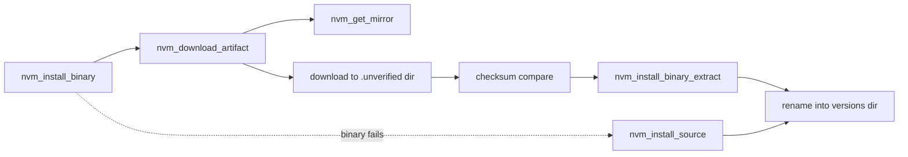

# nvm-sh/nvm — module: install-node

## Responsibility

This slice is the install path a user actually runs when they type `nvm install <version>`.
It turns a resolved version string into a working Node.js on disk: it detects the operating
system and CPU architecture, picks a mirror, downloads a prebuilt binary (or falls back to
compiling from source), extracts the archive into nvm's versions directory, and reconciles
npm's `prefix` / `globalconfig` settings that would otherwise fight nvm's per-version layout.
Every function lives inside `nvm.sh`; the slice is the line range 3560–4689.

## Key files

| File | Role |
|------|------|
| `nvm.sh:3585` (`nvm_get_os`), `nvm.sh:3657` (`nvm_get_arch`) | Detect OS and CPU architecture, incl. musl and 32-bit container special cases |
| `nvm.sh:3768` (`nvm_get_mirror`) | Pick the download mirror and validate that its value is a safe URL |
| `nvm.sh:3870` (`nvm_install_binary`) and `nvm.sh:3804` (`nvm_install_binary_extract`) | Download the prebuilt binary and install it into the versions directory |
| `nvm.sh:3948`–`4013` (`nvm_get_download_slug`, `nvm_get_artifact_compression`, `nvm_download_artifact`) | Build the tarball URL, choose compression, cache and checksum-verify the download |
| `nvm.sh:4172` (`nvm_extract_tarball`) | Hardened extraction of the downloaded archive |
| `nvm.sh:4250` (`nvm_get_make_jobs`), `nvm.sh:4304` (`nvm_install_source`) | Count CPU cores and compile Node.js from source as the fallback |
| `nvm.sh:4476` (`nvm_npmrc_bad_news_bears`), `nvm.sh:4504` (`nvm_die_on_prefix`) | Detect and fix npm `prefix` / `globalconfig` settings that conflict with nvm |

## How it works

The main path, from a resolved version to an installed binary:



1. `nvm_install_binary` validates its flavor (`node`/`iojs`) and version, then asks
   `nvm_download_artifact` for a tarball (`nvm.sh:3870-3924 @ ad42d90`).
2. `nvm_download_artifact` gets the mirror and rejects any version containing characters
   outside `[0-9A-Za-z._+-]` (`nvm.sh:4035-4053 @ ad42d90`).
3. It builds a slug like `node-v22.0.0-linux-x64` from OS and arch, then a cache path, and
   downloads into a fresh `.unverified` directory, checksums it, and only then moves it into
   the cache (`nvm.sh:4060-4160 @ ad42d90`).
4. `nvm_install_binary_extract` extracts to a staging directory and atomically renames it
   into the version directory (`nvm.sh:3844-3866 @ ad42d90`).
5. If the binary path fails and `--no-source` was not set, `nvm_install_source` compiles from
   a source tarball instead (`nvm.sh:3934-3944 @ ad42d90`).
6. After install, `nvm_die_on_prefix` checks that no npm `prefix` or `globalconfig` setting
   would redirect global installs away from the per-version directory (`nvm.sh:4504-4633 @ ad42d90`).

## Beyond the textbook

### Install atomically with a single rename

- Textbook version: extract the archive straight into the target directory, overwriting files
  in place as they stream out.
- What they do: extract into a temporary staging directory, delete the old version directory,
  then move the whole tree into place with one `mv`; if that rename crosses a filesystem, fall
  back to a per-entry move.
- Why: the comment explains that a half-written tree must never be observed as installed — a
  leftover directory without a working `bin/node` wedges the install, and a per-entry `mv`
  refuses to overwrite non-empty `bin/`, `lib/` subdirectories and leaves a half-updated tree.
- Evidence: `nvm.sh:3847-3864 @ ad42d90`

```sh
  # Install atomically: replace any pre-existing version directory with a
  # single rename, so a partial or broken tree is never observed as installed.
  # A leftover directory without a working bin/node otherwise wedges the
  # install - the per-entry `mv` refuses to overwrite the non-empty bin/, lib/,
  # ... subdirectories and leaves a half-updated tree behind. Removing it first
  # is safe: the tarball has already downloaded and extracted into TMPDIR.
  command rm -rf "${VERSION_PATH}" || return 1
  command mkdir -p "$(dirname "${VERSION_PATH}")" || return 1
  if command mv "${TMPDIR}" "${VERSION_PATH}" 2>/dev/null; then
    return 0
  fi
```
`nvm.sh:3847-3857 @ ad42d90`

### Download to a private path, verify, then publish

- Textbook version: `curl -o $TARBALL $URL` writes directly to the final cache filename.
- What they do: create a `mktemp -d "${TARBALL}.unverified.XXXXXX"` directory, download into
  it, compare the checksum, and only `mv -f` the file into the real cache path afterwards.
- Why: the comment states a downloader left running by another install can open its output
  late (curl does on the first body byte) and rewrite the already-verified file; a path no
  other process knows prevents that. The whole download is also refused up front if no
  checksum tool is installed.
- Evidence: `nvm.sh:4087-4158 @ ad42d90`

### Extract defensively against tar path traversal and hard links

- Textbook version: `tar --strip-components=1 -xzf archive -C target` and trust the archive.
- What they do: refuse `--strip-components` (some tars check for absolute paths before
  rewriting, so `top//abs/path` would be written to `/abs/path`), extract as-is and rename the
  top-level directory; reject any archive containing hard links; require exactly one
  top-level directory.
- Why: an archive is untrusted input from a mirror, and a hard link could share the inode of a
  file outside the extraction tree, letting the install write through it.
- Evidence: `nvm.sh:4202-4241 @ ad42d90`

### OS detection that reads, never sources, a config file

- Textbook version: shell out to `uname -a` and case-match the string.
- What they do: prefer the `ID=` line of `/etc/os-release`, read line by line (the comment
  stresses "read, not sourced, so nothing in it runs"), stripping quotes, a trailing CR, and
  comments, then map distribution IDs to nvm's OS names; only fall back to `uname` when the
  file is absent or unhelpful. The same function maps Alpine to `-musl` and macOS-on-ARM for
  Node < 16 to x64.
- Why: avoids spawning a subprocess on every OS probe, and avoids a file in a config path being
  executed as shell code.
- Evidence: `nvm.sh:3598-3639 @ ad42d90`; musl mapping `nvm.sh:3706-3713 @ ad42d90`; M1 fallback
  `nvm.sh:3981-3985 @ ad42d90`

### npm prefix reconciliation before it breaks the install

- Textbook version: install Node and assume global npm packages land in the right place.
- What they do: `nvm_die_on_prefix` scans four npmrc locations (builtin, global, user, project)
  plus the `PREFIX` and `NPM_CONFIG_PREFIX` env vars, and errors — or with `--delete-prefix`,
  removes — any `prefix`/`globalconfig` that would redirect global installs outside nvm's
  per-version directory.
- Why: a stray `prefix` makes npm install global packages somewhere else and silently breaks
  nvm's isolation, so nvm fails loudly instead. The helper `nvm_npmrc_bad_news_bears` is
  written fork-free on purpose because it runs up to four times per `nvm use`/`install`.
- Evidence: `nvm.sh:4504-4632 @ ad42d90`; fork-free comment `nvm.sh:4482-4483 @ ad42d90`

### Leave one core free for source builds

- Textbook version: `make -j$(nproc)` uses every core.
- What they do: detect the core count per OS with a long fallback chain
  (`getconf _NPROCESSORS_ONLN || NPROCESSORS_ONLN || nproc || NUMBER_OF_PROCESSORS`), then run
  `make -j $(cores - 1)`, and fall back to single-threaded with a "please report an issue"
  message if the count cannot be determined.
- Why: keep the machine responsive while compiling Node, and degrade gracefully on systems
  without any of the CPU-counting tools.
- Evidence: `nvm.sh:4281-4299 @ ad42d90`

## Tests and what they protect

This slice contains no test files; the unit tests for these functions live in a sibling slice
(`tests-resolution-and-download`, under `test/fast/Unit tests/`) and were not read here. What
the surrounding code tells us the team cares about protecting is encoded in the defensive
checks themselves: version-string character whitelisting, mirror-URL validation, archive
structure validation, and the npm prefix scan all exist because a malformed input must not
become a shell action or a broken install. No test lines are cited because none are in this
slice.

## Error handling, performance, and security

- Invalid input is rejected with a specific error and exit code rather than proceeding: an
  unsupported mirror returns "unknown type of node.js or io.js release"
  (`nvm.sh:3774-3778 @ ad42d90`); a mirror with shell metacharacters is refused
  (`nvm.sh:3780-3798 @ ad42d90`); a version with disallowed characters returns "Invalid
  version" (`nvm.sh:4049-4052 @ ad42d90`); `nvm_install_binary_extract` and `nvm_extract_tarball`
  enforce their exact argument counts (`nvm.sh:3805-3808 @ ad42d90`,
  `nvm.sh:4173-4176 @ ad42d90`).
- On dependency failure the code cleans up its temporary state and reports: a failed download
  removes the unverified directory and cache dir (`nvm.sh:4136-4140 @ ad42d90`); an HTTP 404
  is detected by grepping the downloaded body (`nvm.sh:4142-4146 @ ad42d90`); a failed
  checksum removes the directory (`nvm.sh:4148-4151 @ ad42d90`); a failed source build removes
  the source temp dir (`nvm.sh:4409-4413 @ ad42d90`).
- A binary failure falls back to a source build, but only when `--no-source` was not passed
  (`nvm.sh:3934-3944 @ ad42d90`).
- Performance: `nvm_npmrc_bad_news_bears` avoids `grep` and sub-shells because it runs up to
  four times per `nvm use`/`install` (`nvm.sh:4482-4483 @ ad42d90`); `nvm_get_os` avoids
  forking `uname` when `/etc/os-release` is readable (`nvm.sh:3598-3602 @ ad42d90`); offline
  mode skips the download and checksum entirely (`nvm.sh:4076-4085 @ ad42d90`).
- Security: the whole trust chain lives here — downloads are checksum-verified before being
  published into the cache, archives are structurally validated against path traversal and
  hard links, and every echoed path goes through `nvm_sanitize_path` so a hostile path cannot
  inject terminal escape sequences into the log (`nvm.sh:4109-4113 @ ad42d90`).

## Technologies and services seen

- `curl` / `wget` — the downloader, selected and invoked through `nvm_download`
  (`nvm.sh:4136 @ ad42d90`), also used to fetch a legacy npm installer
  (`nvm.sh:4434 @ ad42d90`).
- `tar` (with `gtar` on AIX and `xzcat` piped on OpenBSD) — archive extraction
  (`nvm.sh:4196-4216 @ ad42d90`).
- `unzip` — Windows (Git Bash/Cygwin) archive extraction (`nvm.sh:3830 @ ad42d90`).
- `nodejs.org/dist` and `iojs.org/dist` — the official download mirrors, configurable via
  `NVM_NODEJS_ORG_MIRROR` / `NVM_IOJS_ORG_MIRROR` (`nvm.sh:3772-3773 @ ad42d90`).
- `unofficial-builds.nodejs.org` — musl (Alpine) binaries (`nvm.sh:3706-3713 @ ad42d90`).
- `npm` — `npm config delete prefix`/`globalconfig` during prefix reconciliation
  (`nvm.sh:4581-4582 @ ad42d90`), and a legacy `npmjs.org/install.sh` bootstrap for very old
  Node (`nvm.sh:4434 @ ad42d90`).
- `clang` / `clang++` — compiler detection for source builds (`nvm.sh:4371-4376 @ ad42d90`).
- `./configure`, `make` / `gmake` — the Node source build itself (`nvm.sh:4404-4408 @ ad42d90`).
- `getconf`, `sysctl`, `nproc`, `psrinfo`, `pmcycles` — CPU-core counting per OS
  (`nvm.sh:4263-4284 @ ad42d90`).

## Worth exploring interactively

- The download → verify → publish path (`nvm_download_artifact`) — step through (1) build the
  mirror and slug (`nvm.sh:4035-4061 @ ad42d90`), (2) refuse when no checksum tool exists
  (`nvm.sh:4087-4091 @ ad42d90`), (3) create the `.unverified.XXXXXX` directory
  (`nvm.sh:4126-4132 @ ad42d90`), (4) checksum-compare and `mv -f` into the cache only on
  success (`nvm.sh:4148-4157 @ ad42d90`). Fits `FlowAnimation` because the learner watches an
  artifact move through private temp space into trusted cache only after verification.
- The atomic binary install (`nvm_install_binary_extract`) — step through (1) extract into a
  staging dir (`nvm.sh:3845 @ ad42d90`), (2) remove the old version dir and rename the stage
  into place (`nvm.sh:3853-3857 @ ad42d90`), (3) fall back to a per-entry move on
  cross-filesystem rename failure (`nvm.sh:3859-3864 @ ad42d90`). Fits `StateMachine` because
  the version directory is in one of three states — absent, partial, or complete — and the
  code makes partial states unobservable.

## Open questions

- `nvm_get_checksum_binary`, `nvm_binary_available`, and the checksum retrieval live in the
  download-and-security slice, so the exact checksum algorithm and the mirror origin checks
  are not visible here; the synthesis note can join the two.
- The `.tab`-based remote index used for listing is not part of this slice, so "how a version
  string like `22` becomes `v22.x.y`" is answered in the versions-and-nvmrc and
  aliases-and-listing slices rather than here.

## My insights
