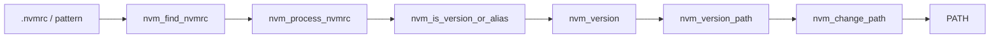

# nvm-sh/nvm — module: versions-and-nvmrc

## Responsibility

This slice is the heart of version management: it turns a loose request — a bare
`22`, a `.nvmrc` file, `lts/*`, or `current` — into one concrete, installed
version and a rewritten `$PATH`. It covers `.nvmrc` discovery and parsing, the
shell-level version comparison, the mapping from a version string to a directory on
disk, and the PATH rewriting that makes the chosen Node the one that runs.

## Key files

| File | Role |
|------|------|
| `nvm.sh:461-1200` | installed-version checks, npm upgrade ladder, `.nvmrc` discovery and parsing |
| `nvm.sh:1207-1800` | version comparison, version directories, `nvm_version`, PATH rewriting |

## How it works

The main path: a `.nvmrc` value (or a partial version like `22`) becomes a real
`node` on the `$PATH`.

1. Discovery. `nvm_find_nvmrc` calls `nvm_find_up`, which climbs from `$PWD` up
   through parent directories until it finds a file named `.nvmrc`, stopping only
   at the filesystem root (`nvm.sh:990-1001 @ ad42d90`).
2. Parsing. `nvm_process_nvmrc` reads the file through a single open descriptor and
   hands it to `nvm_process_nvmrc_content`, which strips `#` comments, trims
   whitespace, drops blank lines, and splits the rest into key/value pairs plus one
   bare "version-ish" line (`nvm.sh:1035-1111 @ ad42d90`).
3. Validation. The bare line must pass `nvm_is_version_or_alias` — a valid version
   string or an existing alias name — before it is accepted (`nvm.sh:1113-1130 @ ad42d90`).
4. Expansion. `nvm_version` turns the pattern into the best installed version: an
   exact installed version short-circuits immediately, otherwise the pattern goes
   through `nvm_ls` and the last matching line is kept (`nvm.sh:1379-1490 @ ad42d90`).
5. Directory mapping. `nvm_version_path` routes the version through `nvm_version_dir`
   into one of three layouts: `versions/node/<v>` (modern), `versions/io.js/<v>`
   (io.js), or the bare `$NVM_DIR` (pre-0.12) (`nvm.sh:1301-1320 @ ad42d90`).
6. PATH rewrite. `nvm_strip_path` removes the old nvm entry and `nvm_change_path`
   prepends the new one so its `bin` wins (`nvm.sh:1747-1800 @ ad42d90`).



## Beyond the textbook

### `.nvmrc` is treated as untrusted input

- Textbook version: read the file with `cat .nvmrc` and use whatever string comes out.
- What they do: `nvm_process_nvmrc` reads through one open file descriptor, and if
  the content is not a plain version/alias it verifies the file is not a symlink and
  has exactly one link, using `ls -dLi /dev/stdin` for the inode and
  `find -links 1 -inum` to re-check the path (`nvm.sh:1141-1166 @ ad42d90`).
- Why: a `.nvmrc` symlink can point at any file on the machine, and a local user can
  read another process's arguments, so only a version or an alias is ever accepted
  from a symlinked file, and its content is never shown (`nvm.sh:1141-1142 @ ad42d90`).
- Evidence: `nvm.sh:1156-1166 @ ad42d90`

```sh
NVMRC_INODE="${NVMRC_INODE#"${NVMRC_INODE%%[! ]*}"}"
NVMRC_INODE="${NVMRC_INODE%%[!0123456789]*}"
if [ -L "${NVMRC_PATH}" ]; then
  nvm_err "invalid .nvmrc! '${NVMRC_PATH}' is a symbolic link, so it must contain a version or an alias name; its content is not shown."
  return 1
fi
if [ -z "${NVMRC_INODE}" ] \
  || [ -z "$(command find "${NVMRC_FIND_PATH}" -prune -type f -links 1 -inum "${NVMRC_INODE}")" ]; then
  nvm_err "invalid .nvmrc! '${NVMRC_PATH}' has another link, or was replaced while being read, so it must contain a version or an alias name; its content is not shown."
  return 1
fi
```

### `.nvmrc` has a real grammar, not just a version string

- Textbook version: `.nvmrc` holds a single version string, full stop.
- What they do: the parser accepts either one bare version-ish line, or several
  `key=value` pairs alongside one bare version, rejects duplicate keys and the
  reserved `node` key, and refuses control characters (other than tabs)
  (`nvm.sh:1040-1100 @ ad42d90`).
- Why: key/value pairs let tooling attach metadata (for example an LTS filter)
  without a second file, while the bare line remains the single source of the
  version — and duplicate keys are rejected in the shell because a symlinked
  `.nvmrc` can hold any file's content (`nvm.sh:1084-1086 @ ad42d90`).
- Evidence: `nvm.sh:1061-1110 @ ad42d90`

### Version comparison avoids forking `awk` when it can

- Textbook version: call a subprocess (e.g. `awk` or `semver`) for every comparison.
- What they do: `nvm_version_greater` compares plain `x.y.z` operands in pure shell
  arithmetic — three groups, each compared with `-lt`/`-gt` — and only falls back to
  `awk` when an operand is a prerelease, partial, or long enough to overflow shell
  arithmetic (19+ characters) (`nvm.sh:1219-1256 @ ad42d90`).
- Why: this function runs on every shell startup, so each avoided `awk` fork is one
  fewer subprocess; the comment states the arithmetic "avoids a fork" and the
  `[ "${#NVM_LEFT}" -lt 19 ]` guard keeps the numbers inside shell arithmetic range
  (`nvm.sh:1219-1234 @ ad42d90`).
- Evidence: `nvm.sh:1234-1256 @ ad42d90`

```sh
while [ "${NVM_GROUP}" -le 3 ]; do
  NVM_LEFT_GROUP="${NVM_LEFT%%.*}"
  NVM_LEFT="${NVM_LEFT#*.}"
  NVM_RIGHT_GROUP="${NVM_RIGHT%%.*}"
  NVM_RIGHT="${NVM_RIGHT#*.}"
  if [ "${NVM_LEFT_GROUP}" -lt "${NVM_RIGHT_GROUP}" ]; then
    return 1
  elif [ "${NVM_LEFT_GROUP}" -gt "${NVM_RIGHT_GROUP}" ]; then
    return 0
  fi
  NVM_GROUP=$((NVM_GROUP + 1))
done
```

### Installed-version checks take a fast path first

- Textbook version: resolve the version string through the full comparison pipeline,
  then test the directory.
- What they do: `nvm_is_version_installed` checks the modern-layout path
  `$NVM_DIR/versions/node/<v>/bin/node` directly with `[ -x ]`, and only falls back
  to `nvm_version_path` (and its `awk` compare) for old versions, io.js, Windows
  binaries, or `..` traversal (`nvm.sh:509-528 @ ad42d90`).
- Why: the comment says the direct path "avoids forking `nvm_version_path` ... on
  shell startup", and `nvm_version` has a matching exact-version short-circuit that
  skips the whole `nvm_ls` pipeline (`nvm.sh:1466-1473 @ ad42d90`).
- Evidence: `nvm.sh:503-516 @ ad42d90`

### Install validation catches partial installs without running `node`

- Textbook version: a version is "installed" if its `bin/node` exists.
- What they do: `nvm_validate_install` requires a *non-empty and executable*
  `bin/node` (a zero-byte file still passes `[ -x ]`), and rejects a dangling `npm`
  symlink, but deliberately does not execute `node` (`nvm.sh:560-572 @ ad42d90`).
- Why: a correctly installed binary can still fail to run on an incompatible host
  (newer node on an older glibc), which is not a broken install, and a corrupt
  download is already rejected earlier by the checksum check, so running the binary
  here would only add false negatives (`nvm.sh:531-538 @ ad42d90`).
- Evidence: `nvm.sh:558-574 @ ad42d90`

### PATH rewriting preserves order and escapes regex metacharacters

- Textbook version: build the new PATH by string replacement.
- What they do: `nvm_change_path` escapes `$NVM_DIR`'s regex-special characters
  before matching, prepends instead of replacing when a system binary path precedes
  the nvm path (a known shadowing bug), and otherwise substitutes in place with
  `sed` to keep entry order (`nvm.sh:1773-1798 @ ad42d90`).
- Why: the comment links to nvm issue #1652 — only what precedes the *first* nvm
  path counts, so a shadowed nvm path further on must not cause endless prepending
  (`nvm.sh:1781-1788 @ ad42d90`).
- Evidence: `nvm.sh:1767-1798 @ ad42d90`

## Tests and what they protect

This slice holds no tests of its own; the tests live in the `tests-resolution-and-download`
and `cli-dispatch` slices. What this slice's code is written to protect is readable
from its own checks: the `.nvmrc` symlink/inode defense (`nvm.sh:1158-1166 @ ad42d90`),
the control-character rejection in parsing (`nvm.sh:1047-1051 @ ad42d90`), and the
`..` traversal rejection in `nvm_version_path` (`nvm.sh:1304-1308 @ ad42d90`).

## Error handling, performance, and security

- **Error handling.** `nvm_rc_version` distinguishes "no `.nvmrc`" (exit 1) from
  "empty `.nvmrc`" (exit 2), each with its own message, and honours a `NVM_SILENT`
  flag to suppress them (`nvm.sh:1170-1194 @ ad42d90`). `nvm_version` returns the
  literal `N/A` and exit 3 when no installed version matches (`nvm.sh:1485-1489 @ ad42d90`).
- **Performance.** The three fast paths — direct installed-path check
  (`nvm.sh:509-516 @ ad42d90`), exact-version short-circuit (`nvm.sh:1470-1473 @ ad42d90`),
  and shell-arithmetic comparison (`nvm.sh:1234-1255 @ ad42d90`) — all exist to cut
  subprocess forks on shell startup.
- **Security.** The `.nvmrc` symlink and multi-link defense (`nvm.sh:1158-1166 @ ad42d90`),
  control-character stripping before echoing a parsed value (`nvm.sh:1024-1028 @ ad42d90`),
  and `nvm_cd_root` running npm from `/` so an untrusted project `.npmrc` cannot steer
  npm's log path (`nvm.sh:577-591 @ ad42d90`).

## Technologies and services seen

- **POSIX shell (sh/dash/bash/zsh/ksh)** — the whole file is portable shell; zsh gets a
  special `NVM_CD_FLAGS="-q"` to skip `chpwd` hooks (`nvm.sh:876-881 @ ad42d90`).
- **awk** — fallback version comparison and version normalisation
  (`nvm.sh:1256-1272 @ ad42d90`, `nvm.sh:1658-1664 @ ad42d90`), PATH stripping
  (`nvm.sh:1753-1758 @ ad42d90`).
- **sed** — `.nvmrc` trimming (`nvm.sh:1040 @ ad42d90`), version prefixing
  (`nvm.sh:1711 @ ad42d90`), in-place PATH replacement (`nvm.sh:1796-1798 @ ad42d90`).
- **npm** — upgraded per-node-version by `nvm_install_latest_npm` via `nvm_npm`
  (`nvm.sh:589-590 @ ad42d90`, `nvm.sh:603 @ ad42d90`).
- **node.js / io.js** — the runtimes being managed, laid out under
  `versions/node`, `versions/io.js`, and the legacy root (`nvm.sh:1282-1294 @ ad42d90`).
- **clang** — version probed for source builds (`nvm.sh:1197-1199 @ ad42d90`).
- **nodejs.org / iojs.org release index** — reached indirectly through `nvm_ls_remote`
  and `nvm_ls_remote_iojs` from `nvm_remote_version` (`nvm.sh:1499-1502 @ ad42d90`);
  the download itself is in another slice.

## Worth exploring interactively

- **Version resolution** — follow a `.nvmrc` value from `nvm_find_up` discovery
  (`nvm.sh:990-1001 @ ad42d90`) → `nvm_process_nvmrc_content` parsing
  (`nvm.sh:1040-1100 @ ad42d90`) → `nvm_is_version_or_alias` validation
  (`nvm.sh:1113-1129 @ ad42d90`) → `nvm_version` expansion (`nvm.sh:1470-1478 @ ad42d90`)
  → `nvm_version_path` directory mapping (`nvm.sh:1301-1318 @ ad42d90`) → PATH rewrite
  (`nvm.sh:1767-1798 @ ad42d90`). Fits **FlowAnimation**: a version string moving
  through functions until it becomes a directory path.

- **`.nvmrc` symlink defense** — step through `nvm_process_nvmrc`'s decision: read one
  open descriptor (`nvm.sh:1147 @ ad42d90`), accept if it is a plain version/alias
  (`nvm.sh:1148-1151 @ ad42d90`), else read the inode (`nvm.sh:1153 @ ad42d90`), reject a
  symlink (`nvm.sh:1158-1160 @ ad42d90`), and reject a multi-link or swapped file
  (`nvm.sh:1162-1165 @ ad42d90`). Fits **StateMachine**: the file is either a trusted
  version or a rejected alias, with no state in between.

## Open questions

- Whether the `nvm_change_path` regex-replacement branch (the final `sed`) has any
  remaining edge case that the two earlier `grep` guards do not cover is not proven
  here; the issue #1652 comment explains the second guard but not the third.
- The `nvm_install_latest_npm` ladder (`nvm.sh:603-872 @ ad42d90`) is hand-maintained;
  how the maintainers keep it current (release automation, manual review) is not
  visible in this slice.

## My insights
