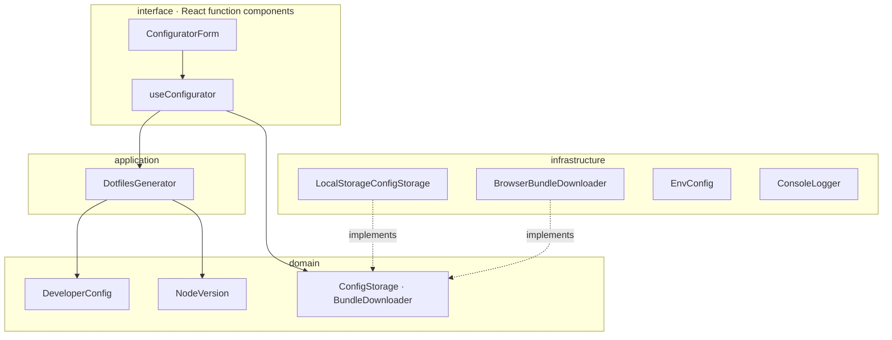

# Workstation & editor — capstone

## What it is

Dev environment configurator is a single-page React app. A developer picks
their shell, git identity, editor, and Node version in a form, and the app
generates a ready dotfiles repository — shell config, `.gitconfig`, `.nvmrc`,
`.editorconfig`, editor settings, a `README.md`, and a `CHECKLIST.md` — then
downloads one idempotent `install.sh` that recreates the setup on a new
machine. It solves the "new machine, same setup" problem the whole topic is
about. The project is in
`projects/frontend-engineering/learning-system-and-workstation/workstation-and-editor/capstone/`.

## Architecture at a glance



Every dependency points inward, toward the domain. Diagrams with their
explanations and sources: [[visual-capstone-layers-workstation-and-editor]],
[[visual-capstone-request-flow-workstation-and-editor]],
[[visual-capstone-deployment-workstation-and-editor]].

## Layers and key classes

| Layer | Key classes | What the layer is for |
|-------|-------------|-----------------------|
| domain | `DeveloperConfig`, `NodeVersion`, the ports `ConfigStorage` and `BundleDownloader` | The rules, with no dependency on React or the browser |
| application | `DotfilesGenerator` | One class for the one thing the app does: generate the dotfiles |
| infrastructure | `LocalStorageConfigStorage`, `BrowserBundleDownloader`, `EnvConfig`, `ConsoleLogger` | The adapters to the browser |
| interface | `ConfiguratorForm`, `useConfigurator`, `ErrorBoundary` | The view; function components plus one required class |

## Ideas applied

- [[Untrusted input]]: `DeveloperConfig.create` validates every field against an
  allow-list before it reaches the generated script.
- [[Atomic write]]: the installer writes each file to a temp file and renames it
  once, so a half-written file never looks installed.
- [[Error classification]]: each failure has a fixed code, and "missing" is
  split from "misconfigured".
- [[Dependency inversion]]: the hook depends on ports, so it is tested without
  the browser.

## Borrowed from production

- Validate every input as untrusted, from [[nvm-findings|nvm findings]]
  (finding 1) and [[nvm-takeaways|nvm takeaways]].
- Verify before you publish, then rename once, from
  [[nvm-pattern-atomic-publish|nvm: atomic publish]].
- A fixed error code per failure class, from
  [[nvm-pattern-error-classification|nvm: error classification]].
- Idempotent re-runs that converge, from [[nvm-findings|nvm findings]] (finding 7).

## How to run it

```bash
cd projects/frontend-engineering/learning-system-and-workstation/workstation-and-editor/capstone
npm install
npm test          # 24 unit + integration tests
npm run build     # typecheck, then bundle
npm run preview   # serve the production bundle
```

Read `ARCHITECTURE.md` in that folder for every class and the decision records
in `docs/adr/0001-single-installer.md` and `docs/adr/0002-validate-at-boundary.md`.

## How to extend it

- Add a shell or an editor by extending the allow-lists and teaching
  `DotfilesGenerator` where to write each one.
- Add a storage backend as a new class implementing `ConfigStorage`.
- Add linting as a `lint` script that runs alongside `npm test`.

## My insights
