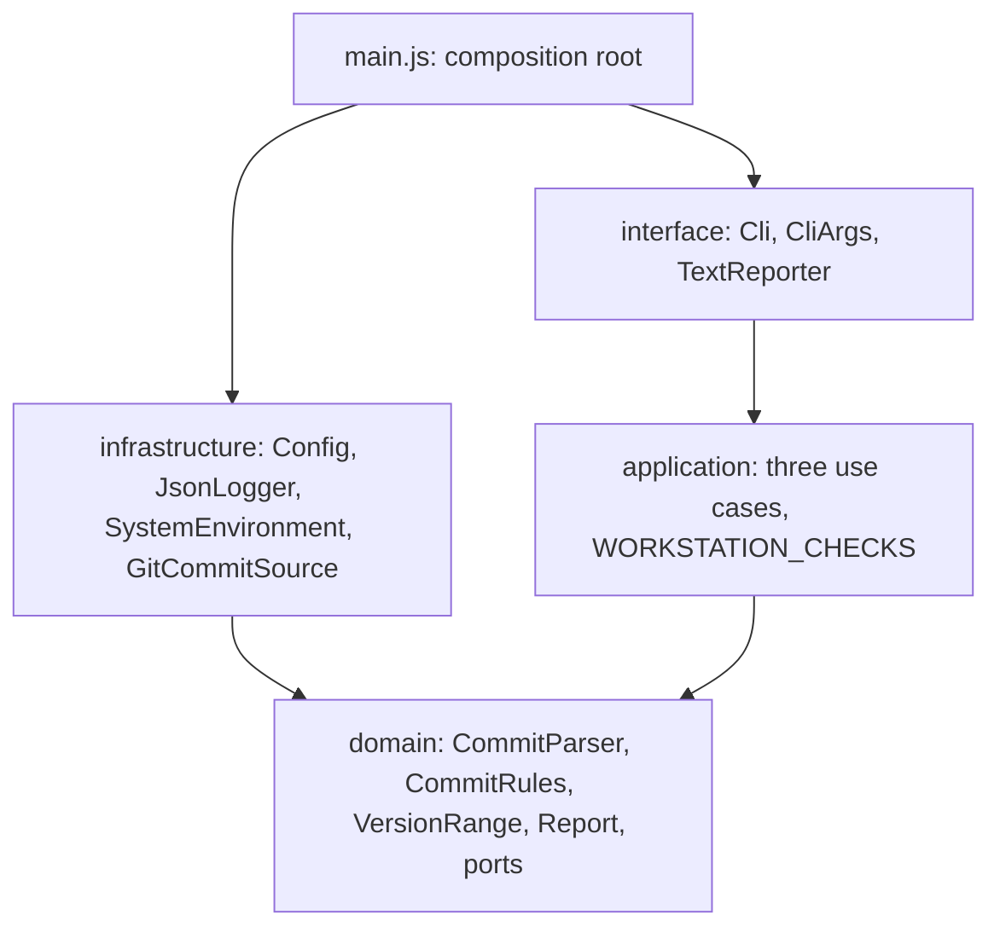

# Workstation & editor — capstone

## What it is

The devkit workstation CLI is a dependency-free Node.js tool for a frontend team that onboards new developers. `doctor` checks the Node version against `.nvmrc` and `engines`, the Git identity, and the tools on `PATH`. `lint` checks commit messages against [[Conventional Commits]], and `notes` writes release notes from the same commits. It uses [[Node.js]], [[Git]] and the [[Node.js test runner]]. The project is in `projects/frontend-engineering/learning-system-and-workstation/workstation-and-editor/capstone/`.

It builds on mini project 02, the commit message linter, and adds the workstation checks, three commit sources and the release-notes writer.

## Architecture at a glance



Visual notes: [[visual-capstone-layers-workstation-and-editor]], [[visual-capstone-request-flow-workstation-and-editor]], [[visual-capstone-deployment-workstation-and-editor]].

## Layers and key classes

| Layer | Key classes | Job |
|---|---|---|
| domain | `CommitParser`, `CommitRules`, `VersionRange`, `Report`, `CheckResult` | Pure rules for commits, versions and results. |
| application | `CheckWorkstationUseCase`, `LintCommitsUseCase`, `WriteReleaseNotesUseCase` | One class per command. |
| infrastructure | `SystemEnvironment`, `GitCommitSource`, `Config`, `JsonLogger` | The real machine, real Git, settings, logs. |
| interface | `Cli`, `CliArgs`, `TextReporter` | Arguments in, text and exit code out. |

`src/main.js` is the composition root. Read `projects/frontend-engineering/learning-system-and-workstation/workstation-and-editor/capstone/ARCHITECTURE.md` for the full class table.

## Ideas applied

- Per-project Node versions: `WorkstationChecks.js` compares `node --version` with `engines.node` and `.nvmrc`. See [[Tool version pinning]] and [[ES modules and CommonJS]] (the tool is ESM only; see ADR 0002).
- PATH lookup: `SystemEnvironment.findOnPath` walks `PATH` left to right like a shell. See [[Operating system process]].
- Exit codes: `ExitCode.js` is the one list: 0, 1, 9. See [[Exit codes]].
- Git hooks: `examples/commit-msg` runs the linter before each commit. See [[Git hooks]].
- Conventional Commits and changelog: `CommitParser` and `WriteReleaseNotesUseCase` turn history into release notes.
- Rules as data: [[Rules as data]] explains the table in `CommitRules.js`.

## Borrowed from production

| Practice | Source | Applied in |
|---|---|---|
| Small functions with one shape, listed in one table | [[commitlint-takeaways]] (takeaway 1) | `src/domain/CommitRules.js` |
| Levels: warnings pass, errors fail | [[commitlint-takeaways]] (takeaway 2) | `src/domain/Report.js` |
| Exit codes as one contract | [[commitlint-findings]] (finding 3) | `src/domain/ExitCode.js` |
| Read a message like Git does | [[commitlint-findings]] (finding 5) | `src/domain/CommitParser.js` |
| Three sources and a shallow-clone stop | [[commitlint-takeaways]] (takeaway 6) | `src/infrastructure/GitCommitSource.js` |

## How to run it

```bash
cd projects/frontend-engineering/learning-system-and-workstation/workstation-and-editor/capstone
node src/main.js doctor
node src/main.js lint --from HEAD~5 --to HEAD
npm test
```

The result of the last run: 45 tests, 45 passed (36 unit, 9 integration). Node.js 22 or newer and Git are needed. Nothing to install.

## How to extend it

- Add a commit rule: one function in `RULES`, one tuple in `conventionalPreset`, one test.
- Add a workstation check: one function in `WORKSTATION_CHECKS`.
- Add a command: a use case, a name in `CliArgs.js`, a method in `Cli`, one line in `main.js`.

## My insights
