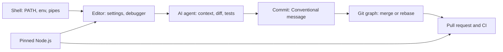

# Workstation & editor — final notes

## In one sentence

A fluent workstation (shell, Git, editor, AI agent and pinned Node.js) lets you change code, find and undo mistakes, and get the change reviewed without losing work or time.

## The mental model



Read it left to right: one change moves from the shell to a merged pull request. Pinned Node.js keeps your laptop and CI on the same runtime.

## Visual refresher

- [[visual-git-graph-lab-workstation-and-editor|Merge or rebase lab]] (interactive): watch which pointer moves on commit, merge and rebase. Redo the rebase checkpoint.
- [[visual-bisect-lab-workstation-and-editor|Bisect lab]] (interactive): count how each answer halves the suspect commits.
- [[visual-shell-pipeline-lab-workstation-and-editor|Shell pipeline lab]] (interactive): follow the text through each stage of a pipe.

All visuals: [[visuals-workstation-and-editor|all visuals]].

## Key ideas

- A pipe sends one command's standard output to the next command's standard input, so small tools combine into one job.
- The shell finds a program by searching the `PATH` directories left to right, so the first match wins.
- A branch is a movable pointer to a commit, and `HEAD` names the branch you are on; a commit moves only that pointer.
- Merge keeps history as it happened; rebase copies your commits onto a new base, so never rebase commits that others already pulled.
- On shared history, undo with `git revert` (a new commit); `git reset` moves the branch pointer and suits only local commits.
- `git bisect` halves the suspect commits with each test, so about 30 commits need about 5 tests; reflog finds commits that no branch points to.
- A Conventional Commit type (`feat`, `fix`, `feat!`) lets tools choose the version bump and write the changelog.
- Workspace settings override user settings, so a project's `.vscode/settings.json` gives every developer the same setup.
- AI output is untrusted input: give the agent context, read the diff, and run the tests before you merge.
- Node.js chooses ESM or CommonJS per file from the extension and the nearest `type` field; `.nvmrc` and `engines` pin the runtime.

## When to use it / when not to

Use it when:
- A bug appeared between two known commits: script `git bisect run` with a test instead of reading every diff.
- A team needs readable history and changelogs: lint commit messages in a hook and again in CI.

Do not use it when:
- The branch is shared: merge instead of rebase.
- The project is a quick experiment: skip release-note tooling and keep plain commit messages.

## Trade-offs and failure modes

- Rebase gives a straight history but rewrites commit ids. Symptom: a teammate's push is rejected and duplicate commits appear.
- `export PATH=...` typed in a shell lasts only for that shell. Symptom: the tool is "not found" again tomorrow; put it in a startup file such as `~/.bashrc`.
- Hooks are fast feedback but `--no-verify` skips them. Symptom: bad messages reach main, so CI must lint too.
- A shallow CI clone hides commits. Symptom: a range lint checks fewer commits than the pull request has.
- A `.js` file with no `type` field makes Node.js guess the module format. Symptom: slower start or `require is not defined`.
- Passing tests do not prove AI code is safe. Symptom: string-built SQL from model output passes review.

## Commands or code worth remembering

```bash
grep 404 access.log | sort | uniq -c | sort -rn   # pipe stages
git rebase main            # replay my branch on main (private branches only)
git bisect start HEAD v1.2.0 && git bisect run npm test
git reflog                 # find the "lost" commit, then: git branch rescue <sha>
git commit -m "feat(cart)!: drop legacy coupon API"
nvm use                    # reads .nvmrc
npx --yes @commitlint/cli --edit .git/COMMIT_EDITMSG
```

## What production systems do differently

- commitlint uses exit codes as a contract: 1 for a bad message, 9 for bad arguments. See [[commitlint-findings|findings]] §3.
- The same checker runs in the commit-msg hook and in CI, and CI fetches full history before a range lint. See [[commitlint-findings|findings]] §4.
- Versions are pinned in layers: `engines` for users, `packageManager` with a hash for contributors and CI. See [[commitlint-takeaways|takeaways]].

## Go deeper

[[00-start-here-workstation-and-editor|Start here]] · [[01-brief-workstation-and-editor|Brief]] · [[02-lesson-workstation-and-editor|Lesson]] · [[03-mini-projects-workstation-and-editor|Mini projects]] · [[00-digests-workstation-and-editor|Digests]] · [[00-repo-intel-workstation-and-editor|Repository deep dive]] · [[06-capstone-workstation-and-editor|Capstone]] · [[08-recall-workstation-and-editor|Recall cards]]

## My insights
