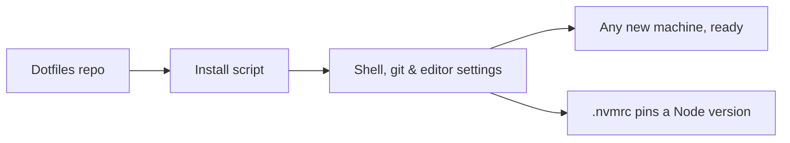

## In one sentence

A disciplined workstation — shell, git, editor, and Node versions kept in version control — turns a new machine from an hours-long rebuild into one command, so every project starts from the same base.

## The mental model



The repo is the source of truth. The install script links its files into a new home directory, and the version manager pins the Node version so the machine behaves like every other.

## Visual refresher

- [[visual-how-it-works-workstation-and-editor|The reproducible workstation]]: follow the dotfiles-to-machine flow.
- [[visual-team-setup-workflow-workstation-and-editor|A team's setup]]: see the LTS policy feed the pinned version.
- [[visual-ai-review-loop-workstation-and-editor|The AI review loop]]: watch a proposed edit pass review, tests, and approval.

All visuals: [[visuals-workstation-and-editor|all visuals]].

## Key ideas

- A pipe feeds one command's STDOUT into the next command's STDIN, because small tools combine into one result.
- PATH is an ordered list of directories, and the shell runs the first match, so a version manager rewrites PATH to switch Node versions.
- Git stores snapshots and a branch is a movable pointer; merge records what happened, rebase replays your changes onto a new base.
- Workspace settings in `.vscode/settings.json` are committed, so a team shares one editor configuration.
- Nothing an AI agent proposes reaches the repo until you review, test, and approve it; treat every generated string as untrusted input.
- `git bisect` turns a manual bug hunt into a binary search over commits.

## When to use it / when not to

Use it when you want a reproducible setup, need to share configuration with a team, or must switch Node versions per project.

Do not use rebase on a branch others have pulled; use merge to keep the shared history honest. Rebase only your own unpushed branches.

## Trade-offs and failure modes

- A version manager rewrites PATH per shell; if its hook is not sourced, `node` runs the wrong version (symptom: version mismatch).
- Rebasing a pushed branch rewrites shared history and confuses collaborators (symptom: duplicate or conflicting commits).
- A sandboxed agent can still propose insecure code; the symptom is a diff that passes tests but leaks a secret or runs an unsafe command.

## Commands or code worth remembering

```bash
curl -s https://api.example.com/items | grep -o '"id":[0-9]*' | sort | uniq -c
nvm install 22 && nvm use 22
git bisect start && git bisect bad && git bisect good <first-commit>
git merge --no-ff feature/branch
```

## What production systems do differently

- nvm validates every downloaded string as untrusted input before it reaches a shell, see [[nvm-findings]].
- nvm writes downloads to a private temp dir, checksums them, then renames once into place, see [[nvm-takeaways]].
- nvm maps each failure class to a fixed exit code, so scripts can act on the kind of error, see [[nvm-findings]].

## Go deeper

- [[00-start-here-workstation-and-editor|Start here: the topic map]]
- [[01-brief-workstation-and-editor|Brief]]
- [[02-lesson-workstation-and-editor|Interactive lesson]]
- [[03-mini-projects-workstation-and-editor|Mini projects]]
- [[00-digests-workstation-and-editor|Digests]]
- [[00-repo-intel-workstation-and-editor|Repository deep dive]]
- [[06-capstone-workstation-and-editor|Capstone]]
- [[08-recall-workstation-and-editor|Recall cards]]

## My insights
