# Concept map of Workstation & editor

Generated from the research curriculum. A solid arrow points from a concept to the concept that refines it; a dotted arrow shows a prerequisite.

```mermaid
flowchart TD
  terminal_shell_basics["Terminal and shell basics"]
  pipes_and_redirection["Pipes and redirection"]
  path_and_env_vars["PATH and environment variables"]
  ssh_keys_for_git["SSH keys for Git hosting"]
  git_github_fluency["Git and GitHub fluency"]
  commit_graph_and_branches["Commit graph and branches"]
  merge_vs_rebase["Merge versus rebase"]
  merge_conflicts["Resolving merge conflicts"]
  git_bisect["Finding a bad commit with git bisect"]
  reflog_recovery["Recovering work with the reflog"]
  stash_and_cherry_pick["Stash and cherry-pick"]
  interactive_staging_and_gitignore["Interactive staging and .gitignore"]
  pr_workflow["Pull request workflow (GitHub flow)"]
  conventional_commits["Conventional Commits"]
  vs_code_or_jetbrains_zed_setup["Editor setup: VS Code, JetBrains or Zed"]
  workspace_settings["Settings layers and workspace settings"]
  editor_debugging["Debugging JavaScript in the editor"]
  ai_assisted_development["AI-assisted development"]
  reviewing_ai_diffs["Reviewing AI-generated diffs"]
  tests_before_generation["Tests before generation"]
  untrusted_generated_code["Treating generated code as untrusted"]
  node_js_runtime_version_management["Node.js runtime and version management"]
  esm_vs_cjs["ESM versus CommonJS loading"]
  node_lts_and_release_lines["Node.js LTS and release lines"]
  per_project_node_versions["Per-project Node.js versions and engines"]
  corepack_package_manager_pinning["Pinning the package manager with Corepack"]
  shell_startup_files_and_aliases["Shell startup files and aliases"]
  safe_undo_and_git_config["Safe undo (reset, revert) and git config"]
  rewrite_local_history["Rewriting local history: amend, interactive rebase, squash"]
  secrets_out_of_git["Keeping secrets out of Git"]
  revision_selection["Revision selection: HEAD~n and A..B ranges"]
  signed_commits["Signed commits"]
  terminal_shell_basics --> pipes_and_redirection
  terminal_shell_basics -. needed for .-> pipes_and_redirection
  terminal_shell_basics --> path_and_env_vars
  terminal_shell_basics -. needed for .-> path_and_env_vars
  terminal_shell_basics --> ssh_keys_for_git
  path_and_env_vars -. needed for .-> ssh_keys_for_git
  git_github_fluency --> commit_graph_and_branches
  git_github_fluency -. needed for .-> commit_graph_and_branches
  git_github_fluency --> merge_vs_rebase
  commit_graph_and_branches -. needed for .-> merge_vs_rebase
  git_github_fluency --> merge_conflicts
  merge_vs_rebase -. needed for .-> merge_conflicts
  git_github_fluency --> git_bisect
  commit_graph_and_branches -. needed for .-> git_bisect
  git_github_fluency --> reflog_recovery
  commit_graph_and_branches -. needed for .-> reflog_recovery
  git_github_fluency --> stash_and_cherry_pick
  commit_graph_and_branches -. needed for .-> stash_and_cherry_pick
  git_github_fluency --> interactive_staging_and_gitignore
  git_github_fluency -. needed for .-> interactive_staging_and_gitignore
  git_github_fluency --> pr_workflow
  merge_vs_rebase -. needed for .-> pr_workflow
  git_github_fluency --> conventional_commits
  pr_workflow -. needed for .-> conventional_commits
  vs_code_or_jetbrains_zed_setup --> workspace_settings
  vs_code_or_jetbrains_zed_setup -. needed for .-> workspace_settings
  vs_code_or_jetbrains_zed_setup --> editor_debugging
  workspace_settings -. needed for .-> editor_debugging
  ai_assisted_development --> reviewing_ai_diffs
  ai_assisted_development -. needed for .-> reviewing_ai_diffs
  ai_assisted_development --> tests_before_generation
  reviewing_ai_diffs -. needed for .-> tests_before_generation
  ai_assisted_development --> untrusted_generated_code
  reviewing_ai_diffs -. needed for .-> untrusted_generated_code
  node_js_runtime_version_management --> esm_vs_cjs
  node_js_runtime_version_management -. needed for .-> esm_vs_cjs
  node_js_runtime_version_management --> node_lts_and_release_lines
  node_js_runtime_version_management -. needed for .-> node_lts_and_release_lines
  node_js_runtime_version_management --> per_project_node_versions
  node_lts_and_release_lines -. needed for .-> per_project_node_versions
  path_and_env_vars -. needed for .-> per_project_node_versions
  node_js_runtime_version_management --> corepack_package_manager_pinning
  per_project_node_versions -. needed for .-> corepack_package_manager_pinning
  terminal_shell_basics --> shell_startup_files_and_aliases
  path_and_env_vars -. needed for .-> shell_startup_files_and_aliases
  git_github_fluency --> safe_undo_and_git_config
  git_github_fluency --> rewrite_local_history
  git_github_fluency --> secrets_out_of_git
  git_github_fluency --> revision_selection
  git_github_fluency --> signed_commits
  safe_undo_and_git_config -. needed for .-> signed_commits
```

Back to [[visuals-workstation-and-editor|all visuals]].

## My insights
