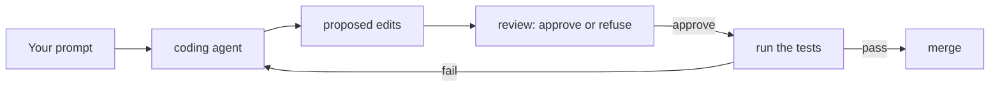

# The AI review gate

**Workflow** · teaches AI-assisted development

**Why this visual.** See that every change an agent proposes passes a review gate before it reaches the repository.

## What it shows

The agent proposes edits, but nothing is merged until you approve it and the tests pass. A failing test sends the change back to the agent instead of forward to merge.

Text alternative: A flow from your prompt to the coding agent to proposed edits, through a review gate to running the tests; a passing test goes to merge, a failing test loops back to the agent.

## Check yourself

Which test result sends a change back to the agent?

Answer: A failing test, so an unverified change never reaches merge.

## Sources

- openai/codex — https://github.com/openai/codex (`openai-codex-repo`)

## Used in

- lesson page `/frontend-engineering/learning-system-and-workstation/workstation-and-editor/lesson/05-ai-assisted-development/` (file `site/src/content/lessons/frontend-engineering/learning-system-and-workstation/workstation-and-editor/05-ai-assisted-development.mdx`)

Back to [[visuals-workstation-and-editor|all visuals]].

## My insights
