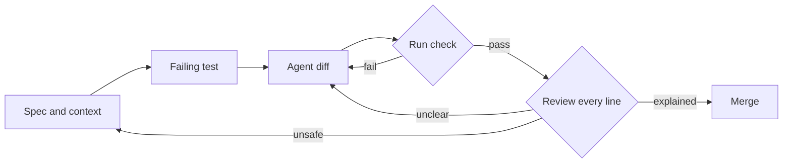

# The safe loop for AI-written code

**Workflow** · teaches AI-assisted development, Reviewing AI-generated diffs, Tests before generation, Treating generated code as untrusted

**Why this visual.** Show the gates that AI-written code passes before it is merged: a spec, a failing test, a check that runs, and a human review of every line.

## What it shows

Claude Code best practices advise a specific prompt, a failing test first, and a pass-or-fail check the agent runs until it passes. A failed check sends the work back to the agent. Then you review the diff against your spec. OWASP LLM05 says to treat model output as untrusted and to review code and suggested packages. Only a diff you can explain line by line goes to merge.

Text alternative: Flowchart from left to right: spec and context, then a failing test, then the agent diff, then run the check. A failed check loops back to the agent diff. A passed check goes to review of every line. An unclear line goes back to the agent, an unsafe one goes back to the spec, and an explained diff goes to merge.

## Check yourself

All tests pass, but one line builds an SQL query by joining strings with user input. Where does the diff go?

Answer: Back, not to merge. A passing check does not prove safety. OWASP LLM05 says to parameterize queries from model output, so you reject the line or fix the spec and ask again.

## Sources

- Best practices for Claude Code — https://code.claude.com/docs/en/best-practices (`claude-code-best-practices`)
- LLM05:2025 Improper Output Handling — https://genai.owasp.org/llmrisk/llm052025-improper-output-handling/ (`owasp-llm05-improper-output-handling`)

## Used in

- lesson page `/frontend-engineering/learning-system-and-workstation/workstation-and-editor/lesson/06-ai-assisted-development/` (file `site/src/content/lessons/frontend-engineering/learning-system-and-workstation/workstation-and-editor/06-ai-assisted-development.mdx`)

Back to [[visuals-workstation-and-editor|all visuals]].

## My insights
