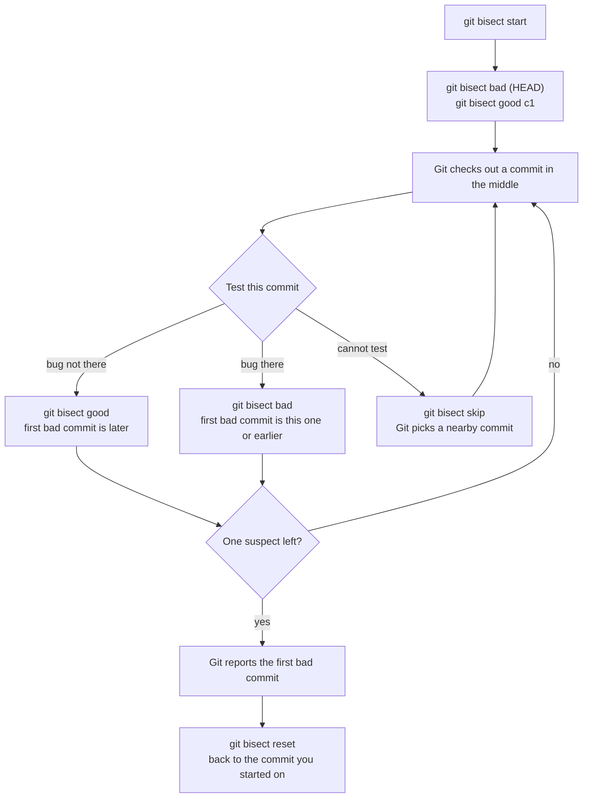

# The git bisect loop

**Workflow** · teaches Finding a bad commit with git bisect

**Why this visual.** Show the git bisect loop as one static diagram for readers without JavaScript.

## What it shows

You mark one bad commit (often HEAD) and one good older commit. Git checks out a commit in the middle; you test it and mark it good, bad or skip. Each good or bad answer removes about half of the suspect commits, so the loop ends after about log2(n) tests and Git reports the first bad commit (Pro Git, Section 7.10). git bisect reset returns to the commit checked out before git bisect start (git-bisect manual).

Text alternative: Flowchart: git bisect start, mark HEAD bad and c1 good, Git checks out a middle commit, you test it; good or bad leads to a check for one suspect left, which loops back to the middle commit or ends with Git reporting the first bad commit and git bisect reset; skip makes Git pick a nearby commit.

## Check yourself

You mark the middle commit bad. Where can the first bad commit be now?

Answer: In the tested commit or in an earlier commit after the last good one.

## Sources

- Git reference manual: git-bisect and git-reflog — https://git-scm.com/docs/git-bisect (`git-scm-docs`)
- Pro Git — https://git-scm.com/book/en/v2 (`chacon-2014-pro-git`)

## Used in

- `projects/frontend-engineering/learning-system-and-workstation/workstation-and-editor/experiences/bisect-lab/experience.json`
- lesson page `/frontend-engineering/learning-system-and-workstation/workstation-and-editor/lesson/03-bisect-reflog-and-recovery/` (file `site/src/content/lessons/frontend-engineering/learning-system-and-workstation/workstation-and-editor/03-bisect-reflog-and-recovery.mdx`)

Back to [[visuals-workstation-and-editor|all visuals]].

## My insights
