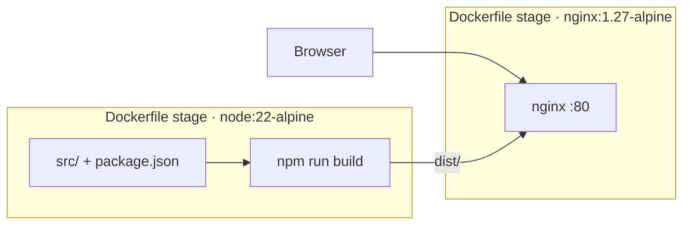

# Deployment of the static build

**Deployment** · teaches Workstation setup

**Why this visual.** See the two Dockerfile stages: build the static bundle with Node, serve it with nginx.

## What it shows

The Dockerfile builds the app in a node stage with Vite, then copies the dist folder into an nginx stage that serves it on port 80. Configuration is baked in at build time.

Text alternative: Two Dockerfile stages: a node:22-alpine stage runs npm run build to produce dist, and an nginx:1.27-alpine stage serves that dist folder to the browser on port 80.

## Check yourself

Which Dockerfile stage runs npm run build?

Answer: The node:22-alpine build stage; the nginx stage only serves the result.

## Sources

- Node.js Releases (release statuses, LTS schedule and installation methods) — https://nodejs.org/en/about/previous-releases (`nodejs-releases-docs`)
- nvm-sh/nvm — https://github.com/nvm-sh/nvm (`nvm-sh-nvm-repo`)

## Used in

- `projects/frontend-engineering/learning-system-and-workstation/workstation-and-editor/capstone/ARCHITECTURE.md`

Back to [[visuals-workstation-and-editor|all visuals]].

## My insights
