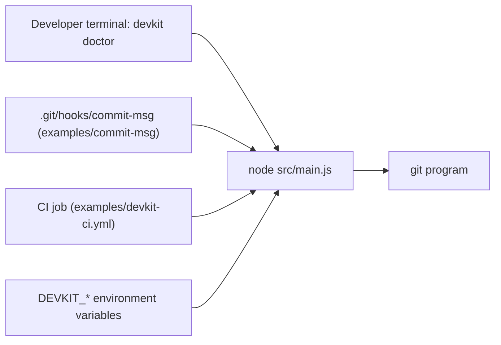

# Where devkit runs

**Deployment** · teaches [[Conventional Commits]], PATH and environment variables

**Why this visual.** Show the three places that run the same devkit process and what it reads.

## What it shows

devkit is one short Node.js process. A developer starts it in a terminal, a commit-msg hook starts it before each commit, and a CI job starts it on a pull request range. It calls the git program and reads DEVKIT_ environment variables as its only configuration.

Text alternative: Flowchart: a developer terminal, the commit-msg hook and a CI job all start node src/main.js, which calls the git program and reads DEVKIT environment variables.

## Check yourself

Why does the CI job use fetch-depth 0?

Answer: A shallow clone hides commits, so GitCommitSource.range stops with an error. Full history lets CI lint every commit of the pull request.

## Sources

- Conventional Commits 1.0.0 — https://www.conventionalcommits.org/en/v1.0.0/ (`conventionalcommits-spec-1-0-0`)
- conventional-changelog/commitlint — https://github.com/conventional-changelog/commitlint (`conventional-changelog-commitlint-repo`)

## Used in

- `projects/frontend-engineering/learning-system-and-workstation/workstation-and-editor/capstone/ARCHITECTURE.md`
- [[06-capstone-workstation-and-editor]]

Back to [[visuals-workstation-and-editor|all visuals]].

## My insights
