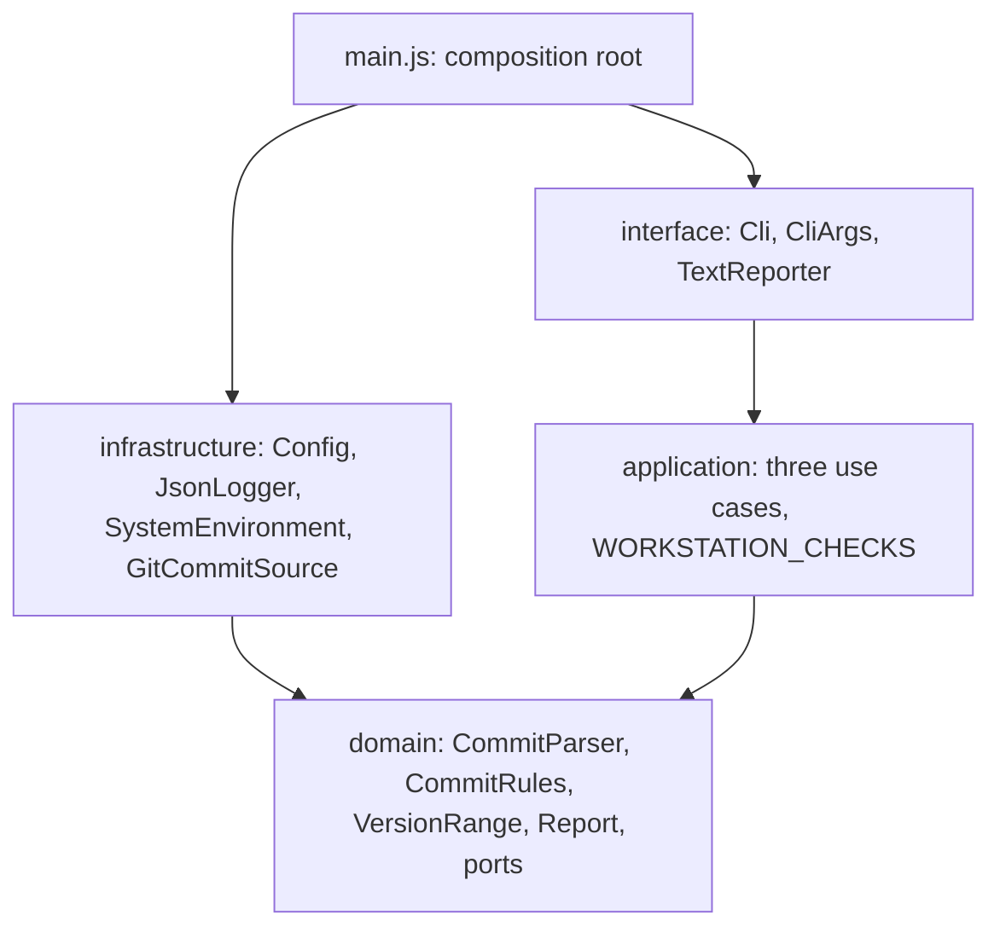

# Layers of the devkit CLI

**Architecture** · teaches [[Conventional Commits]], Per-project Node.js versions and engines

**Why this visual.** Show the four layers of devkit and which layer depends on which.

## What it shows

The devkit code has a domain core, an application layer with three use cases, an infrastructure layer for the real machine and Git, and an interface layer for the CLI. main.js wires them. Dependencies point inward, so the commit and version logic never imports Git or the file system.

Text alternative: Flowchart: main.js wires the interface and infrastructure layers; interface depends on application; infrastructure and application both depend on the domain core, so the domain imports nothing.

## Check yourself

Which layer may import node:child_process, and why not the domain?

Answer: Only infrastructure (SystemEnvironment, GitCommitSource) may. The domain stays pure, so tests run with fakes and without Git.

## Sources

- Conventional Commits 1.0.0 — https://www.conventionalcommits.org/en/v1.0.0/ (`conventionalcommits-spec-1-0-0`)
- conventional-changelog/commitlint — https://github.com/conventional-changelog/commitlint (`conventional-changelog-commitlint-repo`)

## Used in

- `projects/frontend-engineering/learning-system-and-workstation/workstation-and-editor/capstone/ARCHITECTURE.md`
- [[06-capstone-workstation-and-editor]]

Back to [[visuals-workstation-and-editor|all visuals]].

## My insights
